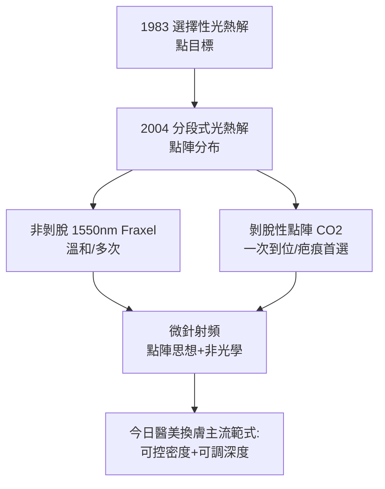

## 2004 - 飛梭雷射（把大傷口切成一千個小傷口：換膚的幾何學革命）

## 案件摘要

**本案的謎題：為什麼把同樣的總熱量打進皮膚，「連成一片」會留疤，「切成點陣」卻能無痕？**

2004 年，麻省總醫院 Wellman 中心的 **Dieter Manstein 與 R. Rox Anderson**（選擇性光熱解的作者本人，見 `1983-選擇性光熱解理論.md`）發表**分段式光熱解（Fractional Photothermolysis）**理論與首台機器 Fraxel：以 1550 nm 鉺玻璃雷射在皮膚上打出陣列狀的**微熱治療區（MTZ, Microscopic Treatment Zone）**——每個直徑約 100–150 μm 的微小柱狀傷口，周圍環繞未受傷的正常組織。這是換膚技術從「面」到「點陣」的幾何學革命，一舉破解了 CO2 雷射換膚「效果越好、停機期與風險越大」的死結。

## 前因 -- 為什麼會有這個案子

- **CO2 雷射換膚的黃金年代與困境**：1995 年起，CO2 雷射（10600 nm，水為靶）全面換膚效果卓越，但需要**全層表皮＋真皮淺層的連續剝脫**，紅腫期數月、反黑率高、偶見永久色脫與疤痕——效果好但太痛太慢。
- **痊癒引擎的再發現**：皮膚表皮再生依靠毛囊與汗腺的**上皮幹細胞儲備**（此洞見來自克羅邁爾時代，`1905-克羅邁爾磨皮術.md`）。連續大面積剝脫耗盡局部的修復來源；點陣傷口則讓每個 MTZ 被四周健康的表皮「**從邊緣爬入修復**」。
- **Anderson 的理論推理路線**：與其增加能量深度，不如改變傷口的**空間分布**——把治療面積占比（treatment density）變成新的獨立參數。

## 線索與推理 -- 數學式、程式、理論

**線索一：MTZ 的數學。** 分段式光熱解把換膚分解成三個獨立變數：

$$ E_{total} = \underbrace{F_{MTZ}}_{\text{單點能量(深度)}} \times \underbrace{N}_{\text{點數}} \times \underbrace{A_{MTZ}}_{\text{單點面積}} $$

$$ \text{密度} = \frac{N \times A_{MTZ}}{A_{treated}} \quad (\text{典型 } 5{-}40\%) $$

修復時間由**未受傷面積的比例**決定，而非總能量：

```python
# 為什麼點陣傷口無痕: 修復幾何模型
def healing(density, epidermal_cell_migration_mm_per_day=0.1):
    # MTZ 直徑 ~0.13mm → 表皮從邊緣爬完一個 MTZ 約需 1 天
    mtz_d = 0.13
    close_days = mtz_d / 2 / epidermal_cell_migration_mm_per_day
    remaining_skin = 100 - density
    return f"密度{density}%: 每個傷口約{close_days:.1f}天再上皮化, {remaining_skin}%皮膚是種子庫"

for d in [20, 40, 100]:
    print(healing(d))
# 100%(連續剝脫=CO2換膚): 種子庫歸零, 全靠附屬器深處 → 慢且有疤風險
# 20%: 隔天上班沒人看得出來
```

**線索二：為什麼選 1550 nm。** 1550 nm 以**水**為吸收靶，形成非剝脫性的熱凝固柱（不開放傷口、表皮保留）；凝固柱深約 0.3–1.4 mm——剛好在真皮重塑的目標層、附屬器存活層之上。此後家族擴展：剝脫性點陣 CO2（10,600 nm，開放性微傷口，效果更強）、點陣鉺（2,940 nm）。



**線索三：與磨皮、果酸的連續譜。** 分段式光熱解其實是把整個換膚歷史統一成一個參數空間：果酸（`1974-果酸換膚革命.md`）是「傷口小到分子級、密度 100%」；磨皮（`1905-克羅邁爾磨皮術.md`）是「連續機械剝脫、密度 100%」；CO2 是「熱學連續剝脫」；飛梭是「熱學點陣、密度可調」。**醫師第一次可以用一組數字（深度 × 密度 × 剝脫與否）為每個病人客製風險—效果曲線**。

關鍵推論：飛梭雷射的革命不是新波長、不是新能量，而是**幾何**——把「傷口的形狀」變成治療變數。這證明了組織修復的關鍵資源是空間上的幹細胞儲備密度：傷口的鄰居決定傷口的命運。

## 結案 -- 後果與影響

- **換膚的普及化**：非剝脫點陣以「紅一天、隔天化妝」的體驗打開了上班族市場；「down time」成為醫美行銷的核心詞彙。
- **疤痕治療的突破**：剝脫性點陣 CO2 成為痤瘡疤痕的首選——連續式技術做不到的「疤痕內重塑」被點陣實現。
- **微針射頻的誕生**：把點陣思想移植到射頻能量（絕緣微針把熱送到真皮指定深度），解決雷射被表皮色素干擾的問題——亞洲膚質（PIH 風險高）因此獲得更安全的選項。
- **理論的反哺**：Anderson 團隊的傷口癒合研究推動了「組織再生醫學」對微環境的重視。
- **一句話結案**：治療的最高境界不是消滅傷口，而是設計傷口——飛梭證明了「傷得聰明」比「傷得少」更重要。

## 關鍵人物與文獻

- **Dieter Manstein**——德國裔生物醫學工程師，分段式光熱解理論第一作者，後續冷凍溶脂（CoolSculpting）的共同發明人。
- **R. Rox Anderson**——Wellman 中心主任，1983 與 2004 兩大理論的作者，皮膚光醫學的總設計師。
- **Manstein, D. et al.**, "Fractional photothermolysis: a new concept for cutaneous remodeling using microscopic patterns of thermal injury", *Lasers in Surgery and Medicine* 34:426–438 (2004)。
- **Hantash, B.M. et al.**——點陣傷口癒合組織學的闡明者。
- 延伸閱讀：`1983-選擇性光熱解理論.md`、`1905-克羅邁爾磨皮術.md`、`1974-果酸換膚革命.md`
