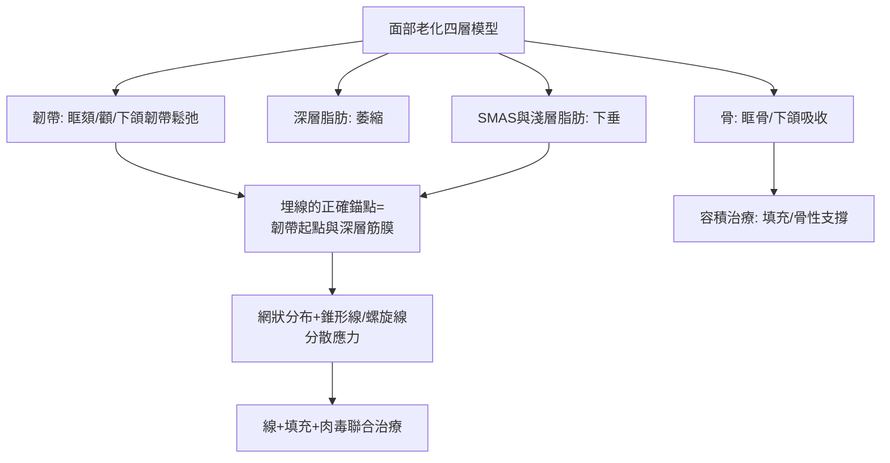

## 2005 - 埋線拉皮（用縫線雕塑臉部：從蠻幹到解剖學的正名之路）

## 案件摘要

**本案的謎題：一種以「把組織拉起來」為原理的技術，為什麼要等解剖學追上來才真正可行？**

1990 年代末至 2000 年代，**線材拉提（thread lift）**問世：以帶倒鉤或齒狀的縫線經皮下埋入，機械性鉤住並上提鬆弛組織。早期產品（俄羅斯 APTOS 線 1990s、Contour Threads 2004–2007）效果短暫、凹凸不平甚至線頭外露，Contour Threads 更在 2007 年退出市場。真正的轉折在兩個方向：**可吸收材料**（PDO/PLLA/PCL）與**面部解剖學革命**（2010 年代確立的 SMAS、韌帶、脂肪隔室體系）——埋線從「盲拉」進化為「以解剖學選點的結構治療」，成為輕醫美時代的主流拉提選項之一。

## 前因 -- 為什麼會有這個案子

- **手術拉皮的門檻**：傳統面部拉皮（rhytidectomy）需全身麻醉、數週恢復，價格高；大量求美者需要「中間選項」。
- **縫線技術的既有資產**：外科縫線材料學成熟（尼龍、PGO、PDO、PLLA）；倒鉤縫線早在 1960 年代用於傷口閉合。
- **俄羅斯的先驅**：Marlen Sulamanidze（1990s）提出 APTOS 線（帶齒聚丙烯線），概念傳播全球。
- **臉部老化的科學重寫**：2000 年代起 Mendelson、Rohrich 等確立：老化不是單純「皮膚鬆」，而是**韌帶鬆弛、深淺層脂肪隔室萎縮與下垂、骨骼吸收**的複合過程——治療必須對症。

## 線索與推理 -- 數學式、程式、理論

**線索一：早期失敗的力學分析。** 第一代倒鉤線的問題是**單點應力集中**：

$$ \sigma_{tissue} = \frac{F_{pull}}{A_{contact}} $$

倒鉤鉤住的組織面積小，拉力集中在少數接觸點——數月內組織被「切」或鬆脫，效果歸零。且不可吸收的聚丙烯線長期留存，帶來異物感與線頭外露。

**線索二：解剖學革命的翻案。** 2010 年代的面部解剖研究（屍體注射染料、影像學）確立了新的操作地圖：



正確的線材設計隨之進化：錐形線（cog type，較大接觸面積）、雙向齒（力量平衡）、網狀多線布局（把 $ F_{pull} $ 分散到 $ n $ 條線與更大的 $ A_{contact} $）：

$$ \sigma_{tissue}^{new} = \frac{F_{pull}/n}{A_{contact}^{cog}} \ll \sigma_{tissue}^{old} $$

**線索三：材料的時間軸也是藥效時間軸。** PDO（聚二氧環己酮）6–8 個月降解；PLLA（聚左乳酸）刺激膠原、維持 1–2 年（Sculptra 為注射劑型）；PCL（聚己內酯）長達 2–3 年（Ellansé）。可吸收線在降解過程中於皮下留下**纖維膠原骨架**——線的機械拉提（即刻）與異物反應的膠原增生（延遲）構成雙重機制：

```python
# 線材的雙階段效果模型
threads = {
    "PDO": {"機械維持": 8,  "膠原增生": "中", "總效期": "12-18月"},
    "PLLA": {"機械維持": 12, "膠原增生": "強", "總效期": "18-24月"},
    "PCL": {"機械維持": 18, "膠原增生": "強", "總效期": "24-36月"},
}
for t, p in threads.items():
    print(t, p)
# 本質: 每一種線都是「物理支撐 + 生物刺激」的複方
```

關鍵推論：埋線技術的興衰證明——**當力學（應力分散）、材料（可吸收+生物活性）、解剖（錨點地圖）三者同時到位，一個曾被判死刑的技術可以復活**。這與 IPL 的劇本相同：理論門檻不能省略，只能補課。

## 結案 -- 後果與影響

- **輕醫美拉提的支柱**：線材拉提成為亞洲（韓國尤盛）輕醫美的主力項目之一，與填充、肉毒組成「無刀抗老三件套」。
- **解剖學的共同遺產**：線材時代的解剖研究同樣造福填充注射（危險區、層次）——面部注射的血管栓塞預防受益於此（`1996-玻尿酸填充登場.md`）。
- **併發症譜系**：凹陷、不平整、線頭外露、暫時性面神經刺激——推動術前評估與技術分級。
- **與手術的分工**：中重度鬆弛仍以手術拉皮為金標準；線材占據輕中度與「不想開刀」的市場——醫美治療階梯的最後一格被填上。
- **一句話結案**：把臉拉起來聽起來像木工，但成功的埋線是解剖學、材料學與力學的三方合約——缺一條款，就回到 2007 年的退場結局。

## 關鍵人物與文獻

- **Marlen & George Sulamanidze**——喬治亞（俄系）醫師，APTOS 線的發明者（1990s）。
- **Bryan Mendelson**——澳洲解剖學家，面部支持韌帶與間隙解剖體系的確立者。
- **Rod Rohrich**——達拉斯德州大學西南醫學中心，面部脂肪隔室理論與現代拉皮分層原則的推動者。
- **Sulamanidze, M.**, "APTOS suture lifting methods" 等系列技術文獻。
- 延伸閱讀：`1996-玻尿酸填充登場.md`、`1917-吉萊斯與一次大戰整形外科.md`
