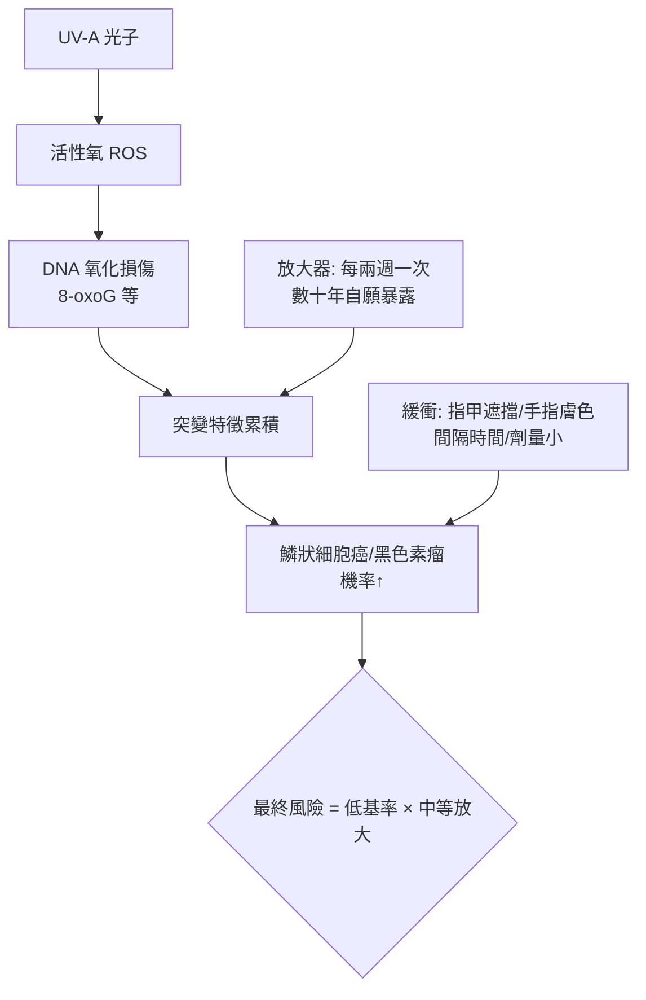

## 2009 - 美甲 UV 燈風險爭議（指尖下的紫外線：一次跨越十年的因果偵查）

## 案件摘要

**本案的謎題：數千萬人每兩週把手放進一盞紫外線燈烤幾分鐘——這到底是安全的，還是另一場「慢性毒物的因果可見性問題」？**

2009 年起，凝膠美甲（gel manicure）以 UV 燈（後改 LED）固化指甲油技術風靡全球。同年，《 Archives of Dermatology》刊登兩位醫師的通訊，報告兩名女性在凝膠美甲後出現手指鱗狀細胞癌或疑似光損傷病例，質疑 UV 固化燈的安全性。此後十餘年，科學界以劑量測量、細胞實驗與流行病學展開一場慢工出細活的因果偵查，最終在 2023 年達成初步共識：**單次風險低，累積暴露不可忽視**——本案成為「慢性、低劑量、可自願選擇的風險」如何被社會處理的教科書案例。

## 前因 -- 為什麼會有這個案子

- **凝膠美甲的化學**：凝膠指甲油含**光起始劑（photoinitiator，如樟腦醌衍生物 HEMA 體系）**，需 UVA（365–405 nm）照射引發自由基聚合，數十秒內固化——比起傳統指甲油的風乾，這是「光化學工程」的勝利。
- **UV 燈的演進**：傳統 UV 燈（4 支 9W 螢光管）→ LED 燈（365/405 nm，更高效）——技術升級同時改變了光譜與劑量，讓早期的暴露數據全部過期。
- **UVA 的醫學前科**：UVA 穿透真皮、產生活性氧、破壞膠原與 DNA（見 `1938-防曬乳誕生.md`、`1962-SPF防曬係數誕生.md`）——防曬科學的核心教訓是「**不曬傷 ≠ 不傷害**」。
- **生活美容的監管縫隙**：美甲沙龍屬於生活服務業，設備不必按醫療器材審查——IPL 案（`1993-脈衝光IPL.md`）的灰色地帶重演。

## 線索與推理 -- 數學式、程式、理論

**線索一：劑量測量的第一波（2009–2013）。** 早期研究以 UV 劑量計實測市售燈具：

$$ H_{UV} = E_{irradiance} \times t_{exposure} \quad (\mathrm{J/cm^2}) $$

2013 年markova 與 Weinstock 等的模擬研究估計：一次凝膠美甲的 UVA 劑量（8–46 J/cm²）**遠高於**同時間戶外日光 UVA 劑量；但反面論據同樣存在——手部皮膚對 UV 的紅斑反應弱、指甲不透光保護甲床、且每次暴露面積極小。**雙方數據都對，問題在於風險的單位怎麼定義**。

**線索二：細胞實驗的第二波（2020–2023）。** 2023 年 1 月，匹茲堡大學 **Alexandra Chang、Ludmil Alexandrov** 團隊在《Nature Communications》發表關鍵研究：以市售 UV 固化燈照射小鼠與人類細胞——

- 照射 20 分鐘（單次沙龍劑量的數倍）即出現細胞死亡；
- 照射累積劑量後，細胞出現與黑色素瘤/鱗狀細胞癌相關的**突變特徵（mutational signatures，SBS 型式）**與活性氧損傷。

```python
# UV 燈風險的劑量—暴露模型 (量級示意)
def lifetime_risk(sessions_per_month, years, J_per_session=30):
    total_J = sessions_per_month * 12 * years * J_per_session
    # 相對日光手背累積 UVA 的倍數 (粗略常數)
    outdoor_J_per_year_hand = 5000
    ratio = total_J / (outdoor_J_per_year_hand * years)
    return f"20年×2次/月: 累積 {total_J:.0f} J/cm² ≈ 日光暴露的 {ratio:.0f} 倍(局部)"
print(lifetime_risk(2, 20))
```

注意：細胞實驗證明**機制上有害**，但不能直接換算**人類流行病學風險**（劑量外推、物種差異、暴露間隔）——這正是本案爭論的核心張力。

**線索三：因果鏈的完整解剖。**



**線索四：社會學的觀察。** 對比本案與鉛白（`-0150-羅馬毒美人鉛白與汞.md`）、石蠟（`1899-石蠟注射悲劇.md`）：風險同樣是「美學收益壓倒健康成本＋慢性不可見＋無監管」。不同的是，現代社會擁有劑量學、細胞生物學與輿論平台——**因果偵查的時間從五百年縮短到十四年**，這是本案最值得記錄的進步。

關鍵推論：UV 美甲燈的科學結論是「低但非零的累積風險」，而理性的對策不是禁用，而是**暴露管理**：縮短時間、防曬手套（只露指甲）、降低頻率。這個結論的形狀，與防曬科學（不叫你不出門，叫你塗 SPF）完全一致——現代醫美風險治理的標準格式就此成形。

## 結案 -- 後果與影響

- **產業回應**：部分沙龍提供 UV 防護手套；LED 燈以更低總能量逐步取代傳統 UV 燈。
- **醫學界的新檢查清單**：皮膚科開始在手背鱗狀細胞癌的問診中加入「凝膠美甲史」。
- **消費者資訊運動**：本案成為科普媒體解釋「劑量決定毒性」的熱門教材。
- **2023 年後續**：Alexandrov 團隊研究登上全球新聞，多家皮膚科學會發表平衡聲明——「不必恐慌，建議防護」。
- **一句話結案**：指尖下的紫外線是又一場慢性毒物故事，但這一次，人類在傷害成為流行病之前就讀懂了劇本——只差社會是否願意照劇本行動。

## 關鍵人物與文獻

- **Carol Adusei（Macquarie 大學）與 Deborah Vernon**——2009 年首篇質疑通訊的作者，開啟本案。
- **Ludmil Alexandrov**——加州大學聖地牙哥/匹茲堡大學生物工程師，突變特徵（mutational signatures）研究先驅。
- **Chang, A. et al.**, "DNA damage caused by ultraviolet emission from nail-drying devices", *Nature Communications* 14:276 (2023)。
- **Curtis, J. et al.**, "Nail unit squamous cell carcinoma and UV nail lamps"（2013 劑量模擬研究）。
- 延伸閱讀：`1938-防曬乳誕生.md`、`1962-SPF防曬係數誕生.md`、`-0150-羅馬毒美人鉛白與汞.md`
