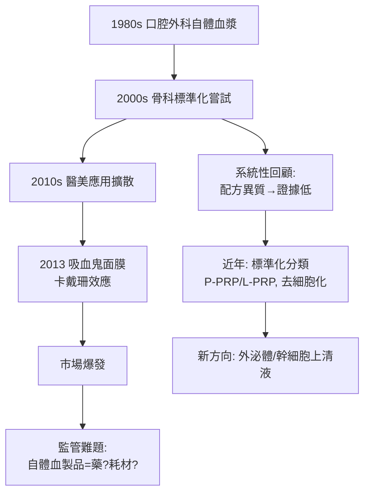

## 2013 - PLT 與吸血鬼面膜（把自己的血抽出來打回臉上：再生醫學的醫美漂流）

## 案件摘要

**本案的謎題：一項沒有專利、成分是「自己」的技術，為什麼反而是醫美史上證據等級最混亂的領域之一？**

2013 年 3 月，金·卡戴珊（Kim Kardashian）在真人秀中接受 **「吸血鬼面膜」（Vampire Facial）**——抽血、離心分離**富血小板血漿（Platelet-Rich Plasma, PRP/PLT）**、以微針滾入面部——照片瞬間瘋傳，PRP 一夕成為全球醫美的爆紅療程。但在此之前的十年，PRP 其實已深耕於骨科（肌腱炎、關節炎）與傷口癒合研究；在醫美領域，它的證據等級長期徘徊於「機制合理、臨床不齊」的灰色地帶。本案追蹤：**當治療材料來自患者自己，科學審查會變得更寬鬆還是更困難？**

## 前因 -- 為什麼會有這個案子

- **血小板的雙重身分**：血小板不只是止血細胞，其 α 顆粒儲存逾 30 種**生長因子**——PDGF、TGF-β、VEGF、EGF——是組織修復的內建藥局。1980 年代起，口腔顎面外科開始使用自體纖維蛋白黏合劑。
- **離心技術的標準化嘗試**：2000 年代，Robert Marx（骨重建）與 Pietro Gentile 等建立 PRP 製備流程；但不同廠商、不同離心轉速/時間，產出物濃度可差 5 倍以上——**「PRP」其實是幾十種不同配方的統稱**。
- **醫美的需求缺口**：抗老治療的極限——填充是「裝修」、肉毒是「斷電」、雷射是「重創修復」，市場渴望「真正再生」的故事。
- **微針技術的成熟**：微針滾輪/微針筆提供經皮輸送通道（並利用可控微創啟動癒合，繼承 `1905-克羅邁爾磨皮術.md` 的原理），PRP 找到了施打方式。

## 線索與推理 -- 數學式、程式、理論

**線索一：PRP 的製備變數空間。** 一管血變成「再生針」的過程中有五個獨立變數：

| 變數 | 範圍 | 影響 |
|---|---|---|
| 抗凝劑 | 檸檬酸鹽/無 | 血小板活化程度 |
| 第一次離心 | 100–500 g | 分層品質 |
| 第二次離心 | 400–1500 g | 血小板濃縮倍數 |
| 血小板濃度 | 基線的 1.5–8 倍 | 過低無效、過高反而抑制（有文獻顯示倒 U 型） |
| 活化方式 | 凝血酶/氯化鈣/不活化 | 生長因子釋放時程 |

$$ E_{clinical} = f(C_{platelet}, C_{GF}, \text{活化時程}) \quad \text{— 每篇論文的 } f \text{ 都不同} $$

這解釋了為何 PRP 臨床試驗**結果互相矛盾**：他們比較的其實是不同的治療。

**線索二：機制的理論根據。** 生長因子驅動纖維母細胞增生與膠原合成：

$$ \text{真皮重塑量} \sim \int_0^{T} [k_1 \cdot C_{PDGF}(t) + k_2 \cdot C_{TGF\beta}(t)] \cdot N_{fibroblast}(t)\, dt $$

```python
# PRP 濃度與膠原增生的「倒U」假說
def collagen_response(conc_fold):
    # 過低無訊號, 適中最佳, 過高受體飽和+發炎抑制
    return max(0, conc_fold * (8 - conc_fold))  # 峰值在 4x
for c in [1, 2, 4, 6, 8]:
    print(f"{c}x 血小板濃度 → 相對膠原反應 {collagen_response(c):.1f}")
```

**線索三：證據等級的偵查。** Cochrane 與系統性回顧的結論（截至 2020s）：PRP 用於**面部年輕化、雄性禿**的證據為低到中等、結果不一致；用於骨科亦然。但市場反應與證據等級脫鉤——吸血鬼面膜的病毒式傳播（2013）與科學評估（持續低落）並行十年：



**線索四：自體材料的監管悖論。** PRP 是「自己給自己」：FDA 視符合 361 豁免條件（最小操作、同部位、即時使用）的自體血製品為低監管項目——**門檻低 = 診所皆可自製 = 配方失控 = 證據無法累積**。悖論的核心：監管寬鬆本是為了方便，代價卻是這門技術永遠長不出金標準。

關鍵推論：PRP 案揭示再生醫學醫美的結構性難題——**材料的生物異質性使試驗無法互相比較**。對照玻尿酸（`1996-玻尿酸填充登場.md`）靠流變學標準化突圍，PRP 的出路只能是製備標準化與成分定義（這正是後來外泌體療法面對的同一考題）。

## 結案 -- 後果與影響

- **再生醫美賽道確立**：PRP 之後，SVF（血管基質層）、外泌體、胚外體等「生物製劑醫美」層出不窮——其中大量項目證據等級更低，PRP 反而成為相對正規的標竿。
- **雄性禿治療的半壁江山**：PRP 注射頭皮成為落髮門診常規選項之一（輔助 finasteride/minoxidil）。
- **醫療與娛樂的邊界案例**：卡戴珊效應證明媒體能在一天內完成一項技術的市場教育——也能在無證據時完成它。
- **標準化的漫長工程**：PRP 分類（P-PRP/L-PRP、白血球多/少）與製備 SOP 推動中，真正的註冊等級試驗仍在累積。
- **一句話結案**：用自己的血治療自己，天然帶有「絕對安全」的光環——但異質性證明，安全的材料不等於有效的療程，證據的債總是要還的。

## 關鍵人物與文獻

- **Robert E. Marx**——邁阿密大學口腔外科教授，PRP 在骨重建中的早期系統應用者。
- **Pietro Gentile**——羅馬第二大學再生外科研究者，PRP 軟組織應用的長期臨床研究者。
- **Kim Kardashian West**——2013 年吸血鬼面膜報導的當事人，醫美史上最有效的（非自願）代言人。
- **Dhurat, R. & Sukesh, M.**, "Principles and methods of preparation of platelet-rich plasma: a review", *Journal of Cutaneous and Aesthetic Surgery* 7:189 (2014)。
- **Puig, C.J. et al. / Cochrane reviews**——PRP 醫美適應症的證據評估。
- 延伸閱讀：`1905-克羅邁爾磨皮術.md`、`1996-玻尿酸填充登場.md`、`2004-飛梭雷射.md`
