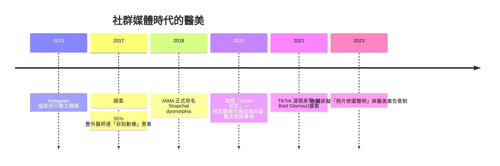

## 2018 - Snapchat 畸形與社群媒體醫美（當濾鏡成為處方箋的視覺依據）

## 案件摘要

**本案的謎題：如果患者指著自己濾鏡後的照片要求手術，醫生治療的是誰的臉？**

2018 年，波士頓大學醫學中心皮膚科醫師 **Jocelyn Wiener 與 Neelam Vashi** 在《JAMA Facial Plastic Surgery》發表評論，正式命名 **「Snapchat 畸形」（Snapchat dysmorphia）**：越來越多求美者不再拿明星照片，而是拿**自己經濾鏡美化後的數位臉**要求手術——從「我想變成別人」變成「我想變成濾鏡裡的自己」。此文引爆醫學界對社群媒體與醫美關係的系統性反思：身體畸形恐懼症（BDD）的新亞型、手術不可達成的期待、以及醫美從醫療行為滑向「數位身分維護」的結構性轉變。

## 前因 -- 為什麼會有這個案子

- **濾鏡技術的普及**：Snapchat（2011）、Instagram（2010）的即時美化濾鏡——磨皮、放大眼睛、縮小下巴——讓「理想臉」成為每個人的日常預覽。
- **自拍心理學的累積研究**：2017 年 JAMA Facial Plastic Surgery 的調查已顯示 55% 的整形外科醫師遇到「只為自拍而求助」的患者；BDD 在整形外科求診者中占比 7–15%，是一般人口的 15 倍。
- **醫美行銷的遷移**：診所的獲客主戰場移至 Instagram/TikTok；術前術後照片、KOL 合作、直播療程成為標配——醫療的商業話術與社群演算法深度綁定。
- **「自拍與手術」的爭議先例**：2013 年起即有「醫師是否應在手術前後拍攝濾鏡化對照照」的專業倫理討論。

## 線索與推理 -- 數學式、程式、理論

**線索一：BDD 的臨床判別邏輯。** 身體畸形恐懼症（Body Dysmorphic Disorder, DSM-5）的核心是**對微小或想像缺陷的先占性關注**。Snapchat 畸形的新特徵是參照物改變：

$$ \text{不滿足感} = f(\text{真實臉}, \text{參照臉}) \quad \text{其中} \quad \text{參照臉}: \text{明星} \to \text{濾鏡後的自己} $$

濾鏡後的自己是一個**無法達成、且每次都會刷新的目標**——病理強度比追星更高，因為「那明明是我」。

```python
# 濾鏡參照 vs 現實自我的落差迭代
face_real = 0.5        # 自我評價
for day in range(5):
    face_filtered = min(face_real + 0.25, 1.0)   # 濾鏡理想
    face_real += (face_filtered - face_real) * (-0.1)  # 落差反噬: 越比較越低
    # 醫美消費 = 试图缩小 gap, 但 gap 由濾鏡定義, 永遠移動
print("自我評價 5 天後:", round(face_real, 3))
```

**線索二：演算法如何工業化不安。** 社群平台的推薦邏輯放大外表內容的曝光，醫美廣告精準投放給「曾搜尋相關詞」者。研究顯示「 cosmetic procedure 」相關內容中未標示商業關係的比例極高——**資訊環境本身就是未申報的廣告**。這與 1962 年 SPF 案的教訓同構：當功效宣稱無法被驗證時，市場會自動劣化（`1962-SPF防曬係數誕生.md`）。

**線索三：時間軸。**



**線索四：Zoom 恐慌（2020）作為自然實驗。** 疫情期間視訊會議讓人每天盯著「廣角鏡頭下歪曲的自己」，多項調查顯示整形與醫美諮詢量不降反升——這證實了自我影像的暴露頻率本身就是醫美需求的**獨立驅動變數**，與審美潮流無關。

關鍵推論：Snapchat 畸形案的深層結論是——**醫美需求的產生機制已經部分外包給軟體**。當醫療決策的起點是演算法生成的影像，醫師的專業責任從「執行技術」擴展為「鑑別需求來源」：篩檢 BDD、拒絕不可能的期待、以及拒絕把濾鏡當術前設計圖。

## 結案 -- 後果與影響

- **醫學界的制度回應**：多國學會發布指引——術前評估應納入「照片來源詢問」與 BDD 篩檢量表；攝影規範禁止術後照片使用濾鏡。
- **法規起步**：挪威（2021）立法要求商業修圖照片標註；英國對醫美廣告加強審查；中國對醫美廣告與「容貌焦慮」行銷展開整治。
- **「濾鏡自由」與審美單一化的文化辯論**：大規模濾鏡使全球審美趨同（大眼、小臉、直鼻），被學者稱為「Instagram face」——醫美從多元修正轉向模板複製。
- **對醫師的倫理升級**：手術不可達成的期待成為新的拒絕理由；「醫美諮詢的第一步是心理評估」從口號變成程序。
- **一句話結案**：當美麗的標準由演算法即時生成，醫學最大的難題不再是「能不能做到」，而是「該不該做」——醫美的未來之戰在心理學與倫理學，不在皮膚與肌肉。

## 關鍵人物與文獻

- **Jocelyn Wiener 與 Neelam Vashi**——波士頓大學皮膚科醫師，2018 年「Snapchat dysmorphia」評論的作者。
- **David Veale**——倫敦國王學院 BDD 研究權威，整形外科中 BDD 篩檢的推動者。
- **Shemesh, R. & Krakow, D. 等**——「selfie 及手術動機」早期量化研究的作者群。
- **Wiener, J. & Vashi, N.**, "#Selfitis and #Snapchatdysmorphia: the rise of body dysmorphic disorder in the age of social media", *JAMA Facial Plastic Surgery* 20(6):443–444 (2018)。
- **Rajanala, S. et al.**, "Selfies—living in the era of filtered photographs", *JAMA Facial Plastic Surgery* 20(6):443 (2018)。
- 延伸閱讀：`2002-肉毒桿菌素美容核准.md`、`2009-美甲UV燈風險爭議.md`、`1989-肉毒桿菌素醫美化.md`
