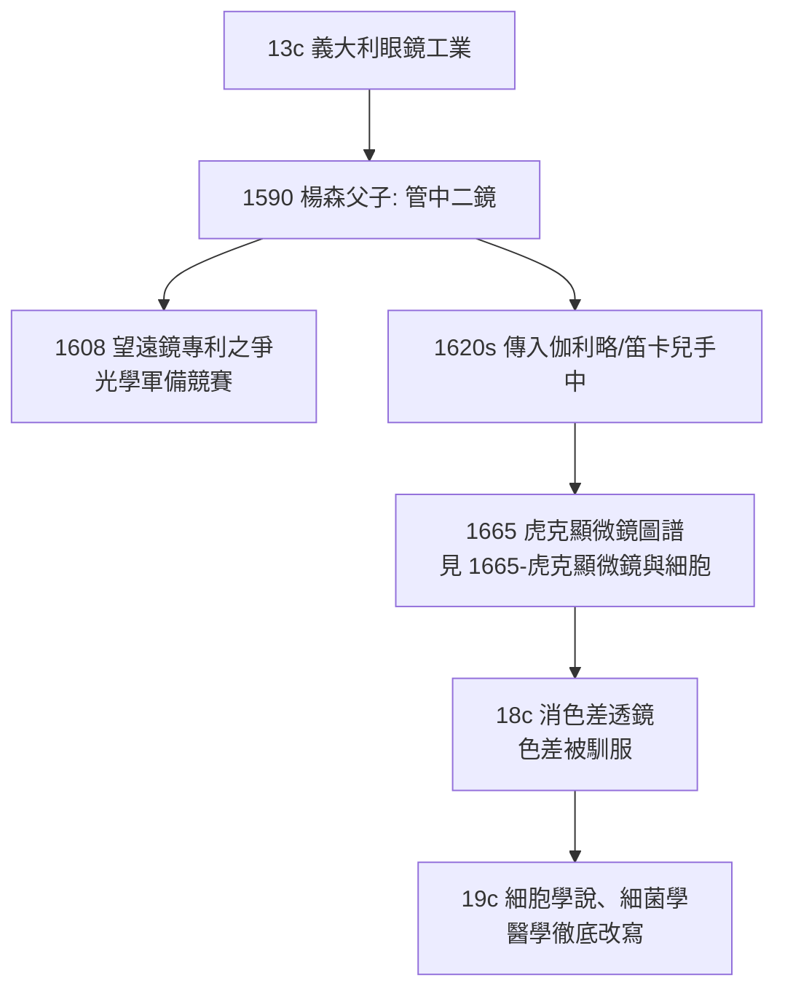

## -1590 - 楊森父子複合顯微鏡（兩片鏡片偷走了上帝的尺度）

## 案件摘要

**本案偵破的是「看見不可見之物」的第一件兇器——複合顯微鏡。**

約 1590 年，荷蘭米德爾堡（Middelburg）的眼鏡製造商 Hans Janssen 與兒子 Zacharias Janssen，在打磨眼鏡片的工坊裡把兩片凸透鏡串進一根金屬管：當物體放在第一片鏡片後面，第二片鏡片再把第一片放大的像再放大一次。放大率約 $ 3\times \sim 9\times $——以今日標準寒酸至極，卻是人類第一次讓「儀器」而非「眼睛」成為感知的仲裁者。本案的真相是：顯微鏡誕生於眼鏡工業的邊角料，而醫學要再等兩百年才學會用它偵查疾病。

## 前因 -- 為什麼會有這個案子

- **眼鏡工業的技術積澱**。13 世紀義大利已有矯正老視的凸透鏡；到 16 世紀，荷蘭與威尼斯的眼鏡工匠手邊累積了大量各種曲率、各種品質的玻璃鏡片——「管中二鏡」的組合，隨時可能在任何人手裡發生。
- **文藝復興的觀察熱**。維薩里（1543，《人體構造七卷》）剛用解剖刀對抗蓋倫權威；「親眼看」正取代「背誦古書」成為醫學的新信仰。但解剖刀的極限是肉眼：$ 0.1\,\mathrm{mm} $ 以下的一切，皆是虛無。
- **軍事與航海的光學需求**。望遠鏡（1608 年荷蘭專利之爭）與顯微鏡是同一組問題的鏡像——一個把遠拉近，一個把小放大。當時記錄含糊，「顯微鏡是楊森父子還是別的荷蘭工匠先做出來」至今仍是懸案，這本身就說明它是工業環境的必然產物而非孤立天才。

## 線索與推理 -- 數學式、程式、理論

**線索一：複合光學的放大原理。** 兩片凸透鏡組成的簡單複合顯微鏡，總放大率近似為兩片放大率之積：

$$ M_{\text{總}} = M_1 \times M_2 = \left(\frac{L}{f_1}\right)\left(\frac{25}{f_2}\right) $$

其中 $ f_1 $ 是物鏡焦距、$ f_2 $ 是目鏡焦距、$ L $ 是鏡筒長度、$ 25\,\mathrm{cm} $ 是明視距離。楊森父子用長焦物鏡＋短焦目鏡，讓像經兩級放大——這就是「複合」（compound）與單片放大鏡（simple）的本質差別。

**線索二：它當時是玩具，不是儀器。** 早期複合顯微鏡有致命缺陷：球面像差與色差（不同波長的折射率不同，$ n(\lambda) $ 隨波長變化）使影像邊緣發出彩色光暈；管愈長放大愈大、像愈糊。結果是——**單片式放大鏡反而先立了戰功**（見 `1676-雷文霍克發現微生物.md` 的單鏡頭顯微鏡），複合顯微鏡要等到 18–19 世紀消色差物鏡問世後才反超。

**線索三：為什麼不是醫生發明的？** 這是本案最辛辣的一筆：改寫醫學的儀器來自眼鏡鋪，不是來自大學醫學院。當時的醫學知識體系（蓋倫式體液論）不需要顯微鏡——它沒有任何「想在 0.1 mm 以下找答案」的問題意識。**儀器先於問題而存在**，問題是後來的人拿著儀器回頭發明的。

## 結案 -- 後果與影響

- **認識論革命**。「感覺的可靠性」從此可被儀器修正——這是實驗科學的哲學基石，影響遠及後世所有「機器讀數 vs 醫生經驗」的爭論（見 `1903-愛因托芬心電圖.md`）。
- **醫學的延期引爆**。1590 年的顯微鏡要等 70 年才被虎克、雷文霍克用出成果，等 200 年才長出細胞學說（1838–39 Schleiden–Schwann–Virchow）與 300 年才長出細菌學（巴斯德、柯霍）——重大儀器的影響往往以世代為單位釋放。
- **荷蘭黃金時代的隱藏主角**。玻璃研磨、鏡片貿易與中產階級市場，讓 17 世紀荷蘭同時供應了望遠鏡、顯微鏡與透鏡工匠——科學儀器史的第一個「產業聚落」。
- **一句話結案**：楊森父子不知道自己製造了未來；他們只是把兩片賣不出去的鏡片插進了一根管子——而這根管子最終插穿了整個古典醫學。

## 關鍵人物與文獻

- **Hans 與 Zacharias Janssen**——米德爾堡眼鏡匠；Zacharias 之女於 1655 年提供的證詞是「1590 年製出第一台複合顯微鏡」的主要（且頗有爭議的）證據來源。
- **Cornelis Drebbel（1572–1633）**——荷蘭發明家，1620 年代在倫敦製作出改良複合顯微鏡並使其在英國科學圈流行，是虎克顯微鏡的直接技術前輩。
- **Galileo Galilei**——1610 年前後把他的望遠鏡反過來看小蟲，並稱之為「occhiolino（小眼睛）」；證明望遠與顯微是同一光學的兩面。
- 現代註腳——現存最早的「楊森顯微鏡」實物（米德爾堡 Zeeuws 博物館）標示製作年代約 1595 年，為三管抽拉式結構，靠伸縮鏡筒對焦。
