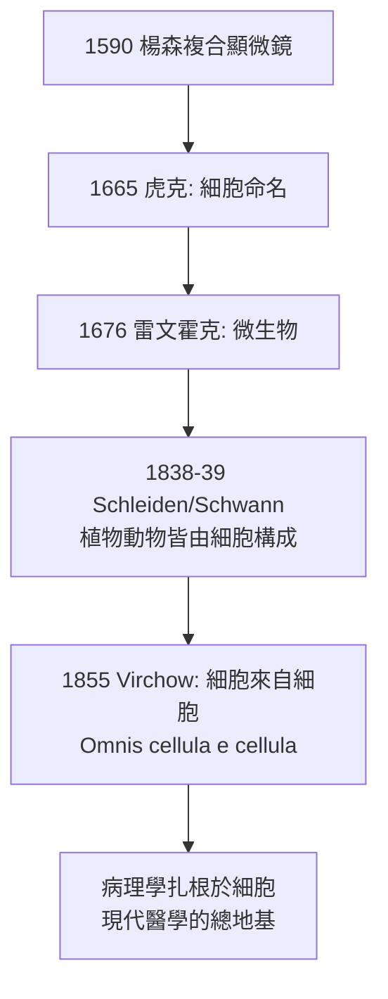

## 1665 - 虎克《顯微圖譜》與「細胞」的命名（小房間裡關著生命的第一原理）

## 案件摘要

**本案偵破的謎題：軟木塞為什麼那麼輕？**

1665 年，倫敦皇家學會的實驗館長 Robert Hooke 用自己改良的複合顯微鏡（三透鏡系統＋油燈＋水球聚光）切了一片軟木塞來看，發現裡面佈滿整齊的小格子，像修道院的僧房。他以拉丁文 cella（小房間）稱之——**cell 一詞誕生**。《顯微圖譜》（*Micrographia*）出版後轟動倫敦，塞繆爾·皮普斯熬夜讀到凌晨兩點，稱之為「我所讀過最巧妙的書」。本案的真相是：虎克看到的其實是**死細胞壁**（軟木是植物死組織），真正「細胞是生命單位」的證據要到 150 年後才補齊——命名者未必是理解者，但沒有命名就沒有理解。

## 前因 -- 為什麼會有這個案子

- **皇家學會的制度化觀察**。1660 年成立的皇家學會需要「可展示的實驗」；虎克身為實驗館長，工作是每週做出令人驚奇的實驗——顯微鏡是他的舞台燈光。
- **複合顯微鏡終於堪用**。楊森式儀器（見 `-1590-楊森父子複合顯微鏡.md`）經 Drebbel 一系改良，虎克再加自制聚光與照明系統，放大率達 $ 30\times \sim 50\times $，足以照出蒼蠅複眼、跳蚤的刺、黴菌的孢子。
- **生物學還沒有「基本單位」概念**。當時的正統仍是蓋倫式體液論與「植物動物由連續組織構成」的直觀印象；沒有人預期生命會有一個像原子那樣的最小積木。

## 線索與推理 -- 數學式、程式、理論

**線索一：儀器設計的偵探學。** 虎克顯微鏡的關鍵不是放大率而是**照明**：他用水球充當聚光鏡、以油燈＋球形水槽集中光線打在標本上。可解析的最小細節由瑞利判據近似給出：

$$ d \approx \frac{0.61\,\lambda}{\mathrm{NA}} $$

$ d $ 為最小可辨距離、$ \lambda $ 為光波長、NA 為數值孔徑。早期透鏡 NA 極小（約 0.1–0.2），理論極限約 $ 2\,\mathrm{\mu m} $ 上下——細菌（約 $ 1\,\mathrm{\mu m} $）恰好落在複合顯微鏡當年的能力之外，這正是雷文霍克的單鏡頭（球面透鏡 NA 可達 0.4 以上）反而能看見微生物的光學原因。

**線索二：命名即立案。** 虎克數了軟木薄片的格子：1 英吋長度約有 1,259 個格子，推算一格邊長約 $ 1/1259 $ 英吋 $ \approx 20\,\mathrm{\mu m} $——他做了**定量的估計**，不是只畫圖。這種「看見＋量測＋命名」的三段式，成為日後一切顯微觀察報告的模板。

**線索三：虎克還看見了「活」的結構。** 同書記載了黴菌的絨毛與孢子（微生物致病性的最早影像線索）、蚜蟲的胎生繁殖——但「細胞內有內容物、細胞會分裂」這兩件事超出當年儀器與概念框架，要交給後繼者。

## 結案 -- 後果與影響

- **詞彙的長期投資**。cell 一詞空出了概念的抽屜；1838 年 Schleiden（植物）、1839 年 Schwann（動物）把細胞提升為生命通用單位，1855 年 Virchow 以「細胞來自細胞」斬斷自然發生論，病理學自此建立在細胞病理學上——整條因果鏈的第一環是軟木塞。
- **科學暢銷書的誕生**。《顯微圖譜》的銅版畫（巨無霸跳蚤、軟木格紋）證明「儀器影像」可以成為大眾文化奇觀——今日醫學影像美學（CT 截面、MRI 影像）的祖宗。
- **虎克的悲劇**。他與牛頓交惡，死後肖像與手稿幾乎全毀；「細胞之父」的名聲長期被後來的細胞學說家遮蔽。
- **一句話結案**：虎克把軟木塞裡的死房間命名為 cell，卻不知道每個房間日後都會被偵查成一整門生命科學的犯罪現場。

## 關鍵人物與文獻

- **Robert Hooke（1635–1703）**——皇家學會實驗館長、建築師（倫敦大火後重建監工）、彈性力學虎克定律（$ F = -kx $）提出者；1665 年出版 *Micrographia*。
- **Marcello Malpighi（1628–1694）**——以顯微鏡解剖蠶蛹、發現微血管（1661），把顯微鏡真正帶進醫學的第一人，被尊為顯微解剖學之父。
- **Nehemiah Grew**——與虎克同期的植物顯微解剖學家，1641–1671 年間的植物解剖圖譜為細胞學說累積材料。
- 原始文獻——Hooke, *Micrographia: or Some Physiological Descriptions of Minute Bodies Made by Magnifying Glasses*, London, 1665（觀察 18「Of the Schematisme or Texture of Cork」）。
