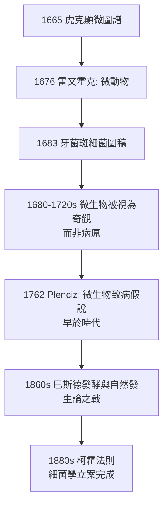

## 1676 - 雷文霍克發現微生物（一個布商在他自己的雨滴裡立案）

## 案件摘要

**本案偵破的是一整個隱形王國——微生物界。**

1676 年，荷蘭台夫特的布料商 Antony van Leeuwenhoek 觀察放入胡椒水數日後的水滴，在單鏡頭顯微鏡下看見成千上萬活生生游動的小東西——「微動物（animalcules）」。他寫信報告倫敦皇家學會，學會先是半信半疑，派出牧師、醫生、律師組成核查團親赴台夫特親眼驗證後，於 1677 年正式立案收錄。本案的真相是：**外行人的手工藝擊敗了專家的光學理論**——雷文霍克的單片式小球透鏡解析度超越當時所有複合顯微鏡，而醫學界要多花 200 年（巴斯德、柯霍）才把這些小動物與疾病定罪為同案。

## 前因 -- 為什麼會有這個案子

- **布商的職業工具**。雷文霍克以放大鏡檢驗布料纖維維生；他自磨的透鏡品質遠超商用產品——大量研磨經驗是最好的光學實驗室。
- **顯微鏡競賽的白熱化**。虎克《顯微圖譜》（見 `1665-虎克顯微鏡與細胞.md`）掀起了歐洲上層階級「用鏡片看一切」的熱潮；雷文霍克是這股熱潮裡唯一一個持續五十年、做了五百多台鏡、寫了三百多封信的人。
- **概念真空**。當時生物學沒有「微小生命」的位置：自然發生論認為腐肉生蛆、污水生蟲是「腐敗」直接產生生命——小生物一旦被看見，反而先被塞進這個舊框架。

## 線索與推理 -- 數學式、程式、理論

**線索一：單鏡頭為何打贏複合顯微鏡。** 每一片透鏡都增加一次像差（球面像差＋色差）；複合顯微鏡 $ 30\times $ 放大下像差放大得更難看。雷文霍克的解法是**單顆極小的高曲率玻璃珠**：曲率半徑 $ R $ 極小的球透鏡焦距

$$ f \approx \frac{nR}{2(n-1)} $$

當 $ R $ 縮到約 1 mm、$ n=1.5 $ 時，$ f \approx 1.5\,\mathrm{mm} $，放大率 $ M \approx 25/f_{\text{cm}} \approx 160\times \sim 270\times $，且僅一個折射面組故像差可控；小球本身兼作聚光，數值孔徑高於複合系統。**理論上「劣等」的簡單設計，因製造極精而勝出**——儀器史的常態。

**線索二：可重複驗證的證詞。** 雷文霍克的信全是「數字＋程序」：他估計一滴水中小動物「比全荷蘭人口還多」，並詳細描述如何培養（胡椒水放三天）、如何觀察。1677 年皇家學會的核查團（包括 Hooke 本人）重做實驗成功——這是**科學史上早期「第三方重現」的標準案例**，也是後世臨床試驗「可重複性」原則的遠祖。

**線索三：他看見了什麼。** 現代史家比對其圖稿確認：他先後記錄了細菌（1683 年牙菌斑中的桿菌、球菌與螺旋體——人類第一次看見細菌）、原生動物、精子（1677，與同學哈姆同時發現）、紅血球的形態、橫紋肌纖維。

## 結案 -- 後果與影響

- **生態認知的爆炸**。人類第一次知道：水中、齒間、腸道裡住著一個看不見的忙碌世界——「乾淨」的定義從此可以談論濃度與繁殖。
- **醫學的百年延遲**。從 1676 到 1860，微生物學是玩具而非武器；原因一是儀器極限（複合鏡解析不了細菌）、二是框架極限（體液論不需要病原概念）。本案證明：**沒有配套的概念與方法，儀器看見的東西不會自動變成知識**。
- **業餘—專家關係的先例**。台夫特布商成為皇家學會會員，證明觀察品質可以跨過階級與學位——但他獨門保密的製鏡術也使他死後技術失傳，其鏡片能力要到 1950 年代才被光學家復原並信服。
- **一句話結案**：雷文霍克沒有解釋他看見的世界，他只是誠實、海量、可重複地報告——而誠實的偵查報告，可以等兩百年再開庭。

## 關鍵人物與文獻

- **Antony van Leeuwenhoek（1632–1723）**——台夫特布商、市政廳管理員；自製 500+ 單鏡顯微鏡，皇家學會通訊會員；「微生物學之父」。
- **Robert Hooke**——複驗其結果的關鍵背書人；1677–1678 年以自己的複合顯微鏡重現微動物，平息質疑。
- **Regnier de Graaf**——台夫特醫生，1673 年把雷文霍克的最初觀察譯成拉丁文寄給皇家學會，是本案的引薦人。
- 原始文獻——Leeuwenhoek 致皇家學會書信集 *Arcana Naturae* 等；1676 年 10 月 9 日信（胡椒水觀察）為微生物發現的立案文件。
- 現代註腳——其保存於烏特勒支大學博物館的兩枚鏡片 2023 年經新式光學量測確認放大率 $ 266\times $、解析度 $ 1.3\,\mathrm{\mu m} $，確證可見細菌。
