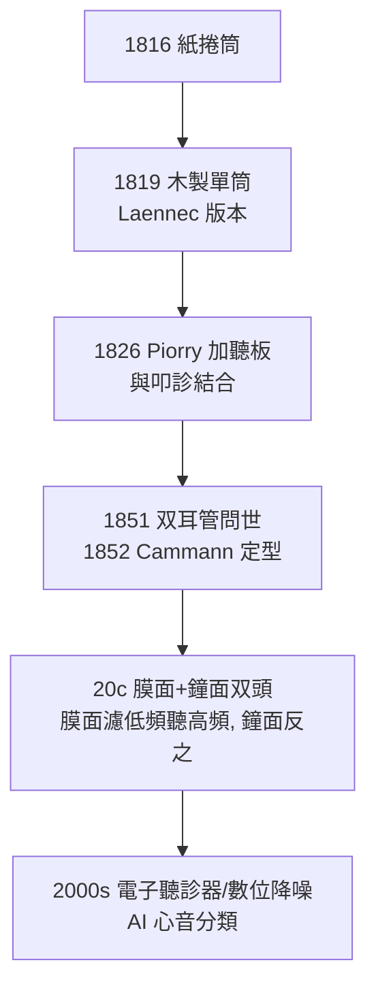

## 1816 - 雷奈克聽診器（一本捲起來的紙，聽見了心臟的自白）

## 案件摘要

**本案偵破的是一個尷尬的物理與社會難題：醫生如何聽見藏在肋骨後的聲音？**

1816 年秋，巴黎 Necker 醫院的 René Laennec 在街上撿到一截紙管；隔日，一位年輕女子因心臟症狀就診，直接以耳朵貼胸聽診既不方便又不合體統——他捲起紙張做成圓筒，一端貼病人心前區、一端貼自己耳朵，發現聲音竟比直接貼耳**更清晰**。他據此製出木製圓筒（單耳、一體式），命名 stéthoscope（希臘文「胸腔檢視器」），並在 1819 年出版《間接聽診法》，建立一套心音—肺音—疾病的對照字典。本案的真相是：聽診器的發明一半是物理（聲音在固體中傳導與聚焦），一半是社會（醫病之間的體面距離）——而它徹底改寫了「診斷」二字。

## 前因 -- 為什麼會有這個案子

- **即時叩診（percussion）是唯一的胸腔探測術**。1761 年維也納的 Auenbrugger 以敲擊胸壁聽回音分辨實變與氣胸，但半世紀無人重視；Laennec 是第一個把它與聽診整合成「體檢系統」的人。
- **直接聽診（immediate auscultation）的困境**。希波克拉底時代就教醫生以耳貼胸；實務上受限於病人體型（肥胖者幾乎無聲）、社會禮儀（尤其女病人）、以及病灶位置——心尖與背部常聽不到。
- **解剖—臨床相關性的新醫學**。巴黎醫學派（Bichat、Corvisart）正在推動「死後解剖驗證生前診斷」；Laennec 的上司 Corvisart 正是把 Auenbrugger 的叩診譯成法文並發揚的人——尋找「與解剖發現對得上的床上證據」是這一派的總任務。

## 線索與推理 -- 數學式、程式、理論

**線索一：為什麼中間加一根管子反而更清楚？** 三個物理機制協同：

1. **固體傳聲**。緊貼胸壁的木質/紙質圓筒壁成為振動的延伸體——胸壁的振動直接傳給筒壁再傳到耳廓，減少聲音在空氣中向四面八方擴散。聲強隨距離的擴散損失近似 $ I \propto 1/r^2 $，管狀導引抑制了橫向擴散。
2. **耳廓隔絕環境音**。聽診器耳端密閉外耳道，環境雜音（醫院走廊、風聲）被物理隔離，等於把信噪比 $ S/N $ 拉高。
3. **聚焦收集面積**。貼胸端收集面大於耳孔，類似拋物面天線的口徑增益。

**線索二：聲音的分類學——Laennec 的字典。** 他把聽到的聲音系統命名並對應解剖發現：

| 聲音 | 特徵 | 對應病灶 |
|---|---|---|
| 水泡音（ronchi/mucous rales） | 液體內氣泡爆裂 | 支氣管炎、肺水腫 |
| 羊鳴音（egophony） | 如山羊叫的共鳴變聲 | 肺實變（肺炎）上緣 |
| 胸膜摩擦音 | 皮革摩擦樣 | 胸膜炎、心包炎 |
| 心音二聲律（lub-dub） | 瓣膜開關 | 正常心動週期 |
| 心雜音 | 週期內持續噪聲 | 瓣膜狹窄／閉鎖不全 |

關鍵方法論：他解剖了因心瓣膜病、肺結核死亡的病人，**把生前聽到的聲音與死後病灶一一配對**——聽診從此不是玄學而是「聲學指紋比對」。

**線索三：聽診器本身的迭代。**

## 結案 -- 後果與影響

- **「儀器中介的診斷」誕生**。醫生與病人之間第一次插入一件儀器，診斷資訊從病人的敘述轉移到儀器傳來的物理信號——這是 19 世紀「客觀化醫學」的第一槍，之後的血壓計（`1896-里瓦羅奇血壓計.md`）、心電圖（`1903-愛因托芬心電圖.md`）都沿此路線前進。
- **心肺醫學的獨立**。心臟病學與肺病學以聽診發現為起點獨立成科；心雜音與瓣膜病的對應，是外科矯正瓣膜（1920s Cutler、1960s 人工瓣膜）的前置偵查。
- **Laennec 的悲劇**。他自己是肺結核病人——他用聽診器研究結核，也在檢查結核病人中染病，1826 年死於本病，年 45 歲。偵探死於自己追查的兇手。
- **陰影面**。聽診技巧高度依賴訓練（聽診者間一致性有限），且病人被「儀器化」的距離感也埋下醫病疏離的伏筆——20 世紀後期「以病人為中心」運動正是對此的反彈。
- **一句話結案**：一根紙捲同時解決了聲學與禮儀兩案，把「傾聽」變成了可傳授、可驗證的偵查技術。

## 關鍵人物與文獻

- **René Théophile Hyacinthe Laennec（1781–1826）**——布列塔尼出身、巴黎 Necker 醫院醫生；1819 年出版 *De l'auscultation médiate*，兩卷本含圖譜；肺結核研究者（「結核」一詞的病理學釐清者）。
- **Jean-Nicolas Corvisart（1755–1821）**——拿破崙御醫、Laennec 的師長；1808 年譯介 Auenbrugger《新發明》並大力推廣叩診。
- **Josef Skoda（1805–1881）**——維也納醫生，1839 年出版以物理聲學系統化叩診與聽診的著作，使聽診成為可教授的科學。
- 原始文獻——Laennec, *De l'auscultation médiate ou Traité du diagnostic des maladies des poumons et du coeur*, Paris, 1819。
- 現代註腳——2016 年《JAMA》研究顯示聽診器上的細菌可超過醫生手掌，成為新的院感議題；200 年前用來守護病人的管子，如今也要被消毒。
