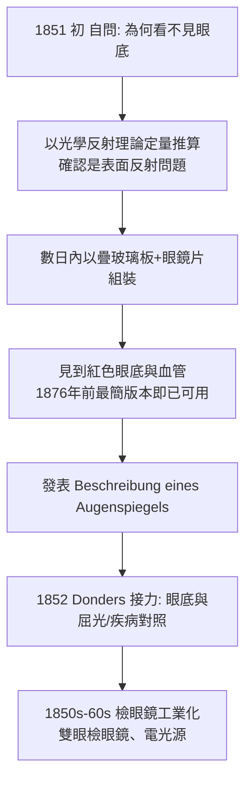

## 1851 - 赫爾姆霍茨檢眼鏡（一面玻璃片和三塊玻璃板，一週破案）

## 案件摘要

**本案偵破的是一個光學悖論：眼睛既是觀察者又擋住自己的視線。**

1851 年，28 歲的柏林生理學助理教授 Hermann von Helmholtz 用一片疊在玻璃板上的透明玻璃、加上三片普通眼鏡片，一星期內造出第一台 **檢眼鏡（ophthalmoscope）**——醫生第一次活生生看見了病人視網膜上的血管與視神經盤。他在回憶中自述：當他把鏡子放到一位同事眼前、「第一次看見鮮紅的視網膜與其中的血管」時，那份震撼無以言表。本案的真相是：檢眼鏡是「理論先行」的儀器——Helmholtz 先用光學原理算出為什麼「看不見」，再依計算造出「看得見」的裝置，成為科學儀器史上最乾淨的一次破案。

## 前因 -- 為什麼會有這個案子

- **千年的老謎**。從蓋倫到 19 世紀，沒有人看過活人眼底；「視網膜上到底有沒有血管」「視神經如何接上眼球」只能靠解剖屍體與動物實驗間接推測。
- **物理學的光學革命**。1818–1851 年間，菲涅耳波動光學、惠更斯原理、反射與折射的定量理論已成熟；Helmholtz 正是把數學物理帶進生理學（生理光學、生理聲學）的先鋒。
- **臨床的迫切需求**。白內障手術已存在數百年，醫生卻從未看過手術對象——晶狀體與眼底；青光眼、視網膜剝離、糖尿病眼底病變全是黑箱。

## 線索與推理 -- 數學式、程式、理論

**線索一：為什麼直接照光看不見眼底？** 病人的瞳孔同時是「入射光的窗」與「醫生反射光的窗」，兩者重疊，角膜與晶狀體的表面反射（約各 2–4% 的鏡面反射）亮度遠超視網膜散射回來的微弱光——就像白天看星星被太陽淹沒。解法只有一個：**把照明光與觀察光分開、且讓兩路光束在眼底精準重疊**。

**線索二：Helmholtz 的裝置。** 三塊疊置的普通玻璃板（Scheibe／疊片）讓燭光側向進入病人瞳孔、而醫生視線穿透疊片直視——玻璃板反光極少但足以照明；再以一片凸透鏡補償病人的屈光（正視眼的眼底成像在無窮遠，醫生以屈光矯正鏡觀看）。本質上，他打開了照明—觀察光路分離的方程：

$$ \text{可視條件: } I_{\text{視網膜散射}} \gg I_{\text{角膜/晶狀體表面反射}} $$

做法是選擇光路幾何使表面反射不進入醫生瞳孔，而眼底散射光（方向雜亂、呈朗伯型散射）恰好有一部分進入醫生瞳孔——一舉反轉信噪比。

**線索三：一週的破案時間表。**

## 結案 -- 後果與影響

- **眼科學一夜成年**。1851 年之前的眼科處理外眼與晶狀體；之後則能診斷視神經炎、視網膜剝離、青光眼視盤變化——Helmholtz 的儀器直接創造了一個現代專科。
- **全身疾病的窗口**。19 世紀末至 20 世紀，眼底成為高血壓、糖尿病、動脈硬化的「活體切片檢查」窗口——人體唯一能直接看見微血管與神經的地方；今日糖網篩檢 AI（2016 年起）仍在這扇窗上工作。
- **醫學物理學的宣告**。Helmholtz 證明：不懂物理的醫學只能看表面，懂物理的醫學可以看見內部——檢眼鏡、聽診器（`1816-雷奈克聽診器.md`）、血壓計（`1896-里瓦羅奇血壓計.md`）共同組成「診斷物理學」的先鋒隊。
- **一句話結案**：不是運氣讓 Helmholtz 一週破案，而是他先把「看不見」寫成了方程式——儀器只是方程式的實物譯本。

## 關鍵人物與文獻

- **Hermann von Helmholtz（1821–1894）**——生理學家與物理學家；能量守恆定律（1847）、生理光學三卷本、神經傳導速度測量（1850）、檢眼鏡（1851）；後任柏林大學物理學教授。
- **Frans Cornelis Donders（1818–1889）**——荷蘭眼科醫生；迅速採用檢眼鏡，建立屈光不正理論與眼底—疾病對照系統，使儀器落地為臨床常規。
- **Albrecht von Graefe（1828–1870）**——德國眼科巨擘；以檢眼鏡診斷青光眼並發明虹膜切除術（1857），眼科學現代化的主要推手。
- 原始文獻——Helmholtz, *Beschreibung eines Augenspiegels zur Untersuchung der Netzhaut im lebenden Auge*, Berlin, 1851。
- 現代註腳——今日免散瞳眼底相機、OCT（光學同調斷層掃描，1991）掃描解析度已達 $ 1\,\mathrm{\mu m} $ 級，能分層看見視網膜各層——Helmholtz 那面疊玻璃的直系後裔。
