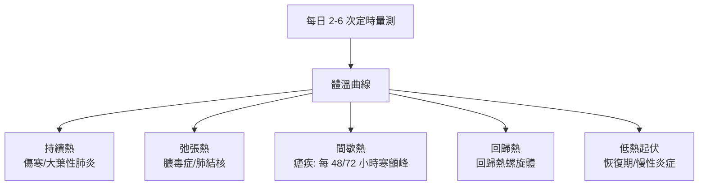

## 1868 - 文德利希體溫計進入病房（把「發燒」從感覺變成數據）

## 案件摘要

**本案偵破的是一個被熱力學偷襲的醫學盲區：病人体溫，兩千年來只靠手掌估計。**

1868 年，萊比錫的 Carl Wunderlich 出版《論傷寒熱病與發燒》，宣布：發燒不是疾病本身，而是**可以用儀器定量追蹤的症狀**；他把在萊比錫醫院以腋下量測的 25,000 名病人、上百萬次體溫讀數建成體溫曲線（fever curve），定出正常範圍約 36.3–37.5 °C、發燒起點 38 °C——這些數字至今仍寫在每一間醫院的護理紀錄單上。本案的真相是：體溫計（Sanctorius 1612 年即有原型）已發明 250 年，卻從未進入病房；Wunderlich 的革命不是發明儀器，而是**強迫醫院接受「每兩小時量一次、畫成曲線」的紀律**。

## 前因 -- 為什麼會有這個案子

- **兩千年的「手測時代」**。希波克拉底以手觸病人皮膚辨熱；蓋倫體液論把發燒視為體液腐敗——沒有數字的必要。醫生的手就是「體溫計」，且從不被質疑。
- **Sanctorius 的孤兒原型（1612）**。威尼斯生理學家 Santorio Santorio 製出玻璃氣泡式測溫器貼在病人身上比較冷熱，但無刻度標準、無臨床追蹤體系，死後無人繼承。
- **熱力學與工業的成熟**。1714 年 Fahrenheit 水銀溫度計、1742 年 Celsius 百分度標尺、19 世紀熱力學（卡諾、克勞修斯）確立「溫度是狀態函數」；德國化學工業則使廉價、刻度一致的玻璃水銀體溫計可以量產。
- **醫院紀錄文化的誕生**。巴黎與維也納的醫院開始系統記錄脈搏、呼吸；「曲線圖」正等待一條新的曲線加入。

## 線索與推理 -- 數學式、程式、理論

**線索一：正常值的統計學。** Wunderlich 的最大突破是把體溫從「個人感覺」變成「母體分布」。用現代語言重述他的結論：

$$ T_{\text{正常}} \sim \mathcal{N}(\mu \approx 37\,^{\circ}\mathrm{C},\ \sigma \approx 0.3\,^{\circ}\mathrm{C}), \quad \text{發燒定義: } T > \mu + 3\sigma \approx 38\,^{\circ}\mathrm{C} $$

這是臨床醫學最早的「正常參考區間」之一——今日所有檢驗報告單上括號裡的正常範圍，血統都指向萊比錫。

**線索二：體溫曲線作為診斷指紋。** 不同疾病有不同的熱型：

瘧疾的間歇熱尤其致命性打臉舊理論：體溫以 48 或 72 小時為週期精確起落——「四體液失調」無法解釋如此精確的生物鐘，而 1880 年 Laveran 在血中發現瘧原蟲、後續證實裂殖體同步破裂與發燒週期吻合——體溫曲線是寄生蟲學的第一份偵查卷宗。

**線索三：儀器紀律的建立。** Wunderlich 規定固定時間量測、固定部位（腋下）、固定時長、必須記錄——量測的是「病人身上的溫度」還是「病房的溫度」？他要求腋窩夾緊 10 分鐘以上以達熱平衡（近似 $ T(t) = T_{\text{core}} - (T_{\text{core}}-T_0)e^{-t/\tau} $）。這種對測量程序的死板規定，正是現代臨床檢驗 SOP 的原型。

## 結案 -- 後果與影響

- **發燒的降格**。從「疾病的本質」降為「一個可量測的症狀」——醫學隨之把發燒曲線與病程、藥效、預後連線；解熱劑（安替比林，1883）與抗感染治療的效果首次有了客觀驗收指標。
- **護理紀錄的骨架**。體溫、脈搏、呼吸（TPR）表單成為病房的地基儀器；今日 ICU 的每小時生命徵象表，仍是 1868 年曲線的子孫。
- **「正常值」的哲學**。Wunderlich 也留下陰影：他的腋下正常值 37 °C 被後世證實系統性偏高（現代人口腔均溫約 36.5–36.8 °C，2017 年 Stanford 研究顯示 19 世紀以來人類基礎體溫在下降）——「正常」是儀器、部位與時代的函數。
- **一句話結案**：體溫計等的不是更靈敏的玻璃，而是一個肯每兩小時看一次玻璃的醫院制度——本質上，Wunderlich 把紀律做成了儀器。

## 關鍵人物與文獻

- **Carl Reinhold August Wunderlich（1815–1877）**——萊比錫大學醫院院長；1868 年出版 *Das Verhalten der Eigenwärme in Krankheiten*；也是把臨床教學改為病床邊教學（Klinik）的代表人物。
- **Santorio Santorio（1561–1636）**——威尼斯/帕多瓦生理學家；1612 年前後製出第一支醫用測溫器，並以自製秤椅研究代謝（定量生理學先驅）。
- **Theodore H. Benzinger 等（20 世紀）**——確立直腸、耳溫（鼓膜，靠近下視丘體溫調節中樞）等核心溫度的意義，修正腋下溫度的系統誤差。
- 原始文獻——Wunderlich, *Das Verhalten der Eigenwärme in Krankheiten*, Leipzig, 1868（英譯 *On the Temperature in Diseases*, 1871）。
- 現代註腳——2020 年 COVID-19 期間紅外線額溫槍與熱成像儀接管公共場所篩檢——體溫這條曲線，如今以每秒萬點的紅外陣列讀取。
