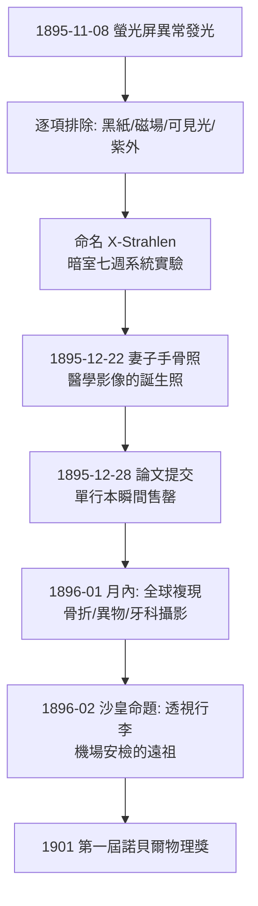

## 1895 - 倫琴發現 X 光（四個月破案，1901 年第一座諾貝爾物理獎）

## 案件摘要

**本案偵破的是一條穿過血肉的未知射線。**

1895 年 11 月 8 日晚，符茲堡大學物理學教授 Wilhelm Conrad Röntgen 在暗室中研究陰極射線管時，發現一公尺外塗著氰亞鉑酸鋇的螢光屏在管子通電時發光——而管子明明包著黑色紙板、理論上無光可透。他連續七週閉門追查這「未知性質的射線」（他自名 X-Strahlen），用 X 光拍下妻子的手骨與婚戒（1895-12-22），1895 年 12 月 28 日提交論文《一種新射線的初步報告》。幾天內全世界實驗室重現成功；1896 年 1 月起，X 光攝影成為醫療工具。本案的真相是：發現本身來自「異常的螢光」這一條不起眼的線索，而 Röntgen 的真正功績是**七週內把偶然變成系統**——物性、穿透力、感光、成像一網打盡。

## 前因 -- 為什麼會有這個案子

- **陰極射線的全球熱**。1850s 蓋斯勒管、1858 年 Plücker 的陰極射線、1876 年 Goldstein 命名 Kathodenstrahlen、1895 年佩蘭證明其帶負電——歐洲物理實驗室人手一支放電管。此前已有至少十幾位研究者（Goodspeed 1890、Lenard 等）拍過「不明霧化底片」或見過異常螢光，但無人立案追查。
- **醫學的黑箱依舊**。內視鏡（見 `1806-博齊尼光導器.md`）只能看管狀孔道；體內實質器官——骨頭、肺、異物、結石——仍然只能推測。骨折要靠觸診與皮膚畸形判斷，異物（槍彈）定位幾乎無解。
- **可重現性的時代條件**。1895 年的物理期刊網絡＋電報＋報紙，使一項發現能在數天內全球複現——這正是本案能從實驗室躍進醫院的制度基礎。

## 線索與推理 -- 數學式、程式、理論

**線索一：異常信號的偵查學。** 破案起點是一個矛盾：螢光屏發光 ⇒ 有射線到達；黑紙遮管 ⇒ 可見光與紫外線出局。Röntgen 系統測試射線性質，得到的判決書：

- 直線行進、不受磁場偏折 ⇒ 不是帶電的陰極射線；
- 穿透紙、木、厚鋁，極易被鉛吸收 ⇒ 密度決定吸收；
- 使底片感光、使氣體導電（電離）；
- 不反射、不折射（當年技術下測不到）⇒ 波長極短的電磁波假說成立。

他還以手掌放在螢光屏前看見自己的骨骼——從「物理發現」到「醫學影像」只隔了一隻手。

**線索二：成像的物理——吸收指數律。** X 光成像的本質是差異吸收。單能 X 光穿過厚度 $ x $、衰減係數 $ \mu $ 的組織：

$$ I = I_0 \, e^{-\mu x}, \qquad \mu \propto \rho \, Z^3 / E^3 $$

骨頭（含鈣，$ Z=20 $）的 $ \mu $ 遠高於軟組織（$ Z \approx 7 $），故底片上骨白肉黑； $ Z^3 $ 與 $ E^3 $ 的三次方依賴，說明了為何要「依檢查部位調整電壓（kVp）」——這一條指數律是 X 光、CT（見 `1971-洪斯菲CT.md`）與整個放射診斷的共同物理根基。

**線索三：從偶然到系統的七週。**

**線索四：X 光的本質最終在 1912 年蓋定。** 勞厄（M. von Laue）以晶體繞射證明 X 光是波長 $ \lambda \sim 0.01\text{–}10\,\text{Å} $ 的電磁波，布拉格父子隨即建立 $ n\lambda = 2d\sin\theta $ 的晶體繞射定律——X 光繞射後來反過來成為破解 DNA 結構（1953）的鑰匙，放射醫學與分子生物學共亨同一束光。

## 結案 -- 後果與影響

- **醫學診斷的視覺革命**。1896 年起骨折、異物、肺結核、胃石有了影像證據；「影像診斷科」自此誕生，且成為 20 世紀所有醫學影像（CT、MRI、超音波、PET）的總源頭。
- **第一時間的犧牲**。早期 X 光技師與醫生以手驗管、無防護曝光，放射性皮膚灼傷、截肢與癌症（Becquerel 的口袋燒傷、多位先驅死於輻射病）促成 1920s–30s 輻射防護學與劑量單位（倫琴、西弗）的建立——倫琴本人拒絕專利並低調，但輻射風險的代價由整個行業償還。
- **科學—大眾—法律的連鎖**。X 光是第一個「實驗室發現數日內變成全球大眾文化與商業噱頭」（X 光眼鏡、透視攝影館）的科學發現，預告了 20 世紀科技傳播的速度與亂象。
- **一句話結案**：Röntgen 的天才不在看見螢光，而在把那點螢光審問了七週——真正的偵探把異常訊號當作案子的開端，而不是儀器的故障。

## 關鍵人物與文獻

- **Wilhelm Conrad Röntgen（1845–1923）**——符茲堡大學物理教授；1901 年首屆諾貝爾物理學獎（無競爭者入圍即獨得）；把獎金捐給大學，拒絕申請專利。
- **Philipp Lenard（1862–1947）**——陰極射線穿透實驗的先驅，其鋁窗管是 Röntgen 的直接技術前輩；後因諾獎爭議與納粹立場身敗名裂。
- **M. von Laue、W. H. Bragg 與 W. L. Bragg**——1912–1913 年以晶體繞射釐清 X 光波動本質（勞厄 1914、布拉格父子 1915 諾獎）。
- 原始文獻——Röntgen, *Über eine neue Art von Strahlen*（Sitzungsberichte der Würzburger Physik.-med. Gesellschaft, 1895-12-28）。
- 現代註腳——Röntgen 夫人 Anna Bertha 的手照現存於德意志博物館，照片註記「這張手照預告了現代醫學」；每年 11 月 8 日為國際放射日。
