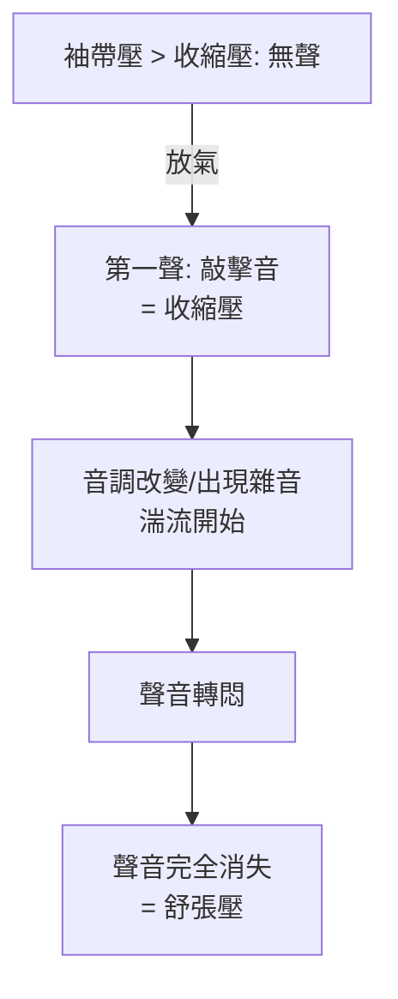

## 1896 - 里瓦羅奇血壓計（給血管裡的壓力立案）

## 案件摘要

**本案偵破的是一個「看不見也摸不準」的物理量：動脈裡的壓力。**

1896 年，義大利都靈的兒科醫生 Scipione Riva-Rocci 發表袖帶式血壓計：一條可充氣的臂帶（內襯橡膠囊）、連接水銀壓力計與打氣球——首次讓血壓成為一個可以無創、重複、讀數記錄的臨床量。1905 年，聖彼得堡的軍醫 Nikolai Korotkoff 加上聽診器，報告充放氣過程中出現的特徵音——Korotkoff 音——自此收縮壓與舒張壓雙雙可測。本案的真相是：血壓計是「壓迫＋平衡＋聽診」的三重推理，而它能改變醫學，靠的是後來的高血壓被證明是頭號殺手。

## 前因 -- 為什麼會有這個案子

- **血壓的認識史**。1733 年 Stephen Hales 以銅管插入馬頸動脈、接玻璃柱——血液升高到 8 英尺 3 英寸，這是史上第一次直接量到血壓；但「插管法」無法用在病人身上。
- **無創測量的先驅**。1854 年 Vierordt、1860s Marey 的脈搏描記器以彈簧與槓桿放大橈動脈搏動，能估收縮壓但誤差大；1880 年 von Basch 做出手壓式血壓計，但需經驗手感、不可靠。
- **臨床動機**。動脈硬化、腎炎（Bright 病，1827）與心臟肥大的關聯已被注意，但沒有任何客觀指標可以量化「血管張力」——處方（放血、硝酸甘油、休息）全憑感覺。

## 線索與推理 -- 數學式、程式、理論

**線索一：平衡原理——壓力對抗壓力。** Riva-Rocci 的幾何很簡單：袖帶充氣加壓，當外部壓力 $ P_{\text{cuff}} $ 恰好等於動脈內壓 $ P_{\text{artery}} $，動脈壁被壓平、橈動脈搏動消失。因此：

$$ \text{搏動消失的瞬間: } P_{\text{cuff}} = P_{\text{收縮壓}} $$

而 $ P_{\text{cuff}} $ 由水銀柱高度直接讀出（$ P = \rho g h $，$ \rho_{\text{Hg}} = 13.6 \times 10^3\,\mathrm{kg/m^3} $）——這就是「mmHg」的由來。他只測到收縮壓；舒張壓的判據要等聲音。

**線索二：Korotkoff 音的流體力學。** 1905 年 Korotkoff 發現：緩慢放氣時，以聽診器放在肘窩動脈上會聽到五個階段的聲音變化：

物理本質：袖帶壓在收縮壓與舒張壓之間時，動脈在心跳週期內被部分壓扁，血流以高流速通過狹窄段，由伯努利原理 $ P + \tfrac{1}{2}\rho v^2 = \text{常數} $，速度 $ v $ 突增處靜壓驟降、局部流場不穩定，形成**湍流與管壁振動**——這就是 Korotkoff 音；當袖帶壓低於舒張壓，動脈全程通暢、層流恢復、聲音消失。診斷的核心是「傾聽湍流的出現與消失」。

**線索三：儀器的標準化接力。**

| 年份 | 人物 | 貢獻 |
|---|---|---|
| 1896 | Riva-Rocci | 袖帶＋水銀柱，僅收縮壓 |
| 1900 | Friedrich von Recklinghausen | 雙層袖帶與寬袖帶建議，減少高讀誤差 |
| 1905 | Korotkoff | 聽診法定出舒張壓 |
| 1907–1914 | Janeway、蘇格蘭軍醫團 | 大規模篩檢，確立「高血壓是疾病前兆」 |
| 1980s– | 電子示波法 | 自動化家用血壓計普及 |

## 結案 -- 後果與影響

- **高血壓成為疾病**。1940s–50s 保險公司精算與 Framingham 心臟研究（1948 起）以大量血壓數據證明：血壓與中風、心梗的劑量—反應關係——沒有量測就沒有流行病學，沒有流行病學就沒有降壓藥產業（1950s 利尿劑、1958 α-甲基多巴、1970s β 阻斷劑與 ACE 抑制劑）。
- **測量誤差的教訓**。袖帶寬度（成人標準 12–13 cm）、體位、白袍高血壓等誤差研究，使血壓測量成為「臨床量測標準化」的教科書案例。
- **一句話結案**：血壓計破案的技巧是「製造可控的湍流，再傾聽它的生滅」——Hales 的馬頸玻璃柱，最後變成了纏在每個人手臂上的布帶與一聲敲擊。

## 關鍵人物與文獻

- **Scipione Riva-Rocci（1863–1937）**——都靈兒科醫生；1896 年在 *Gazzetta Medica di Torino* 發表袖帶血壓計。
- **Nikolai Sergeevich Korotkoff（1874–1920）**——聖彼得堡軍醫院血管外科醫生；1905 年 11 月 8 日在軍醫學會報告聽診法（Korotkoff 音）。
- **Stephen Hales（1677–1761）**——英國牧師與植物生理學家；1733 年出版 *Statical Essays*，第一次直接測量血壓。
- 原始文獻——Riva-Rocci, "Un sfigmomanometro nuovo," *Gazz. Med. Torino*, 1896；Korotkoff, *Izvest. Voenno-med. Akad.*, 1905。
- 現代註腳——2017 年美國 ACC/AHA 指引把高血壓診斷下修至 130/80 mmHg，全球數億人一夜之間「被診斷」——一條 1896 年的布帶，至今仍是世界上使用最頻繁的醫療儀器之一。
