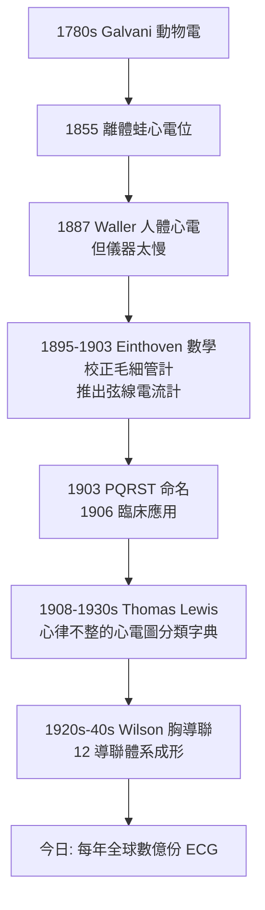

## 1903 - 愛因托芬心電圖（把心臟的電說出來的繩子檢流計）

## 案件摘要

**本案偵破的是一場跑了七十年的追捕：心臟會放電，如何把電流錄下來？**

1903 年，荷蘭萊頓大學生理學教授 Willem Einthoven 發表以「弦線電流計（string galvanometer）」記錄人體心電的方法，錄得 P、Q、R、S、T 波，並以 A、B、C、D、E 命名後改為 PQRST；1906 年起用於臨床診斷心律不整與心肌梗塞，1924 年獲諾貝爾生理學或醫學獎。本案的真相是：心電圖不是一個人的功勞，而是「動物電假說（1780s Galvani）→ 人體心電首次記錄（1887 Waller）→ 儀器靈敏度革命（1903 Einthoven）→ 臨床判讀字典（1920s–30s Lewis 等）」的接力破案，主角是物理學家式的醫生與一條鍍銀石英絲。

## 前因 -- 為什麼會有這個案子

- **動物電之爭（1791）**。Galvani 以蛙腿實驗主張生物有內生電力，Volta 反駁並發明電池——兩人吵出電生理與電學兩門學問；1855 年 Köllicker 與 Müller 在離體蛙心直接量到電位變化。
- **Wallers 的先行記錄（1887）**。倫敦的 Augustus Waller 用毛細管靜電計＋撮影記錄到自己與愛犬 Jimmie 的心電——但他自己也承認曲線「對臨床無用」：儀器反應太慢，波形被攤平。
- **醫學的盲區**。1903 年以前，心律不整（心房顫動、傳導阻滯）只能靠摸脈搏推測；心肌梗塞死前幾乎無從確診——心臟的電語言無人聽懂。

## 線索與推理 -- 數學式、程式、理論

**線索一：心臟是個偶極子。** 心肌去極化波在體內形成一個等效電偶極（電向量），人體是導體容積，體表電位由該偶極分佈決定。Einthoven 三角設定：右臂（R）、左臂（L）、左腿（F）三個肢導構成近似等邊三角形，任兩點電位差即為該導聯電壓：

$$ V_{\mathrm{I}} = V_L - V_R,\quad V_{\mathrm{II}} = V_F - V_R,\quad V_{\mathrm{III}} = V_F - V_L,\quad V_{\mathrm{I}} + V_{\mathrm{III}} = V_{\mathrm{II}} $$

最後一式（愛因托芬定律）至今仍印在每一份 ECG 的質控檢查裡——偵查網的經緯線。

**線索二：儀器的瓶頸與破解。** 毛細管靜電計的汞面移動受表面張力與慣性拖累，頻率響應不足 10 Hz，把 R 波磨平。Einthoven 的解法是超越當時物理儀器的**弦線電流計**：一根直徑約 $ 2\,\mathrm{\mu m} $ 的鍍銀石英絲懸於強磁場（約 1.5 T）狹縫中，心電電流通過時受勞侖茲力

$$ F = B\,I\,L $$

絲線側向偏移，經光學放大投影在移動底片上。石英絲質量極小、張力可調，頻率響應足以忠實記錄 R 波的陡峭上升——這一步是從「看到了」到「看清了」的關鍵。

**線索三：整個系統的工程學。**

**線索四：判讀的字典化。** Einthoven 極為小心地不做過度診斷宣稱；真正把波形對應到疾病的是 Lewis（心房顫動的 f 波、傳導阻滯）與 1930s 的胸導聯系統（Wilson 中心電端）——心肌梗塞的 ST 段抬高、病理性 Q 波成為急救與診斷的黃金標準。**儀器先行、字典後補**：物理偵查在前，病理解釋在後。

## 結案 -- 後果與影響

- **心臟病學的科學化**。心律不整、傳導障礙、心肌梗塞從「摸脈猜測」變成「波形判讀」；1920s-30s 起心導管（見 `1929-福斯曼心導管.md`）、1940s 起起搏器與除顫器，全部以 ECG 為偵查與驗證的中樞。
- **急救與公共衛生的改寫**。救護車上的 12 導聯傳輸、急救室「胸痛中心」的分診規則、以及 1970s 起的動態心電（Holter）、運動心電，都是 1903 年那根石英絲的後代。
- **數據醫學的先聲**。Einthoven 以數學校正另一台儀器的失真（毛細管靜電計的補償演算）——「用數學方法還原被儀器弄髒的信號」，這正是今日影像重建、AI 心電判讀的方法論祖先。
- **一句話結案**：心臟說了一億年的電話，Waller 接到了但聽不清；Einthoven 做了一台聽得清的擴音器，Lewis 把電話內容整理成了檔案。

## 關鍵人物與文獻

- **Willem Einthoven（1860–1927）**——萊頓大學生理學教授；弦線電流計發明人，1924 年諾貝爾生理學或醫學獎（頒於 1925 年度，翌年 1925 頒獎；習稱 1924）。PQRST 命名者。
- **Augustus D. Waller（1856–1922）**——倫敦生理學家；1887 年首次記錄人體心電（自體與愛犬 Jimmie），發明者稱其為「最了解心電圖價值的人之一」。
- **Thomas Lewis（1881–1945）**——倫敦心臟病學家；把 ECG 變成臨床字典，心律不整分類之父。
- **Frank N. Wilson（1890–1952）**——密西根大學；1930s 建立胸導聯（V1–V6）與中心電端，12 導聯體系完成。
- 原始文獻——Einthoven, "Die galvanometrische Registrierung des menschlichen Elektrokardiogramms," *Pflügers Archiv*, 1903。
- 現代註腳——Apple Watch（2018 起）已可記錄單導聯 ECG 並標記心房顫動；1903 年需整間房間、五名技術員操作的儀器，如今縮進一隻手錶。
