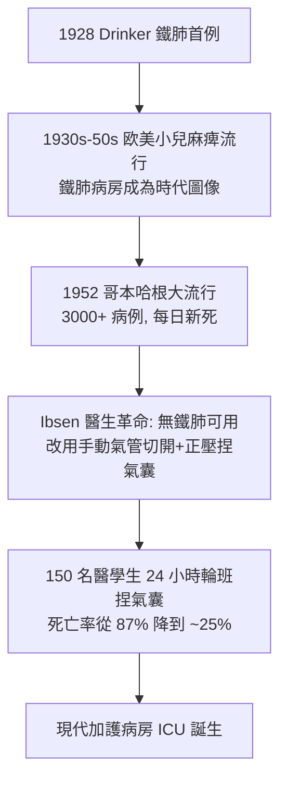

## 1927 - 德林克鐵肺（小兒麻痺流行病與一個現代呼吸器的粗糙祖先）

## 案件摘要

**本案偵破的是一個殘酷的力學難題：肋間肌與橫膈癱瘓後，如何替病人「吹」進空氣？**

1927–1928 年，哈佛的 Philip Drinker 與 Charles McKhann 與 Louis Shaw 開發出**鐵肺（iron lung / Drinker respirator）**：一個密封的金屬圓筒把病人全身（除頸部）罩住，以電動風箱規律地抽氣／打氣——筒內負壓時胸腔被「拉」開、空氣被動吸進肺裡。1928 年首次救治一名脊髓灰質炎（小兒麻痺）呼吸衰竭的女童，1952 年哥本哈根小兒麻痺大流行時鐵肺達到歷史高峰（見「結案」）。本案的真相是：鐵肺的物理是「負壓通氣」——復刻了自然呼吸的力學，卻也暴露了它的所有缺陷，最終被「正壓通氣」的革命取代。

## 前因 -- 為什麼會有這個案子

- **小兒麻痺的流行病學**。1916 年紐約大流行（2.7 萬例、6 千餘死）、1940s–50s 歐美每年夏季大流行；脊髓灰質炎病毒破壞脊髓前角運動神經元，約 5–10% 病人呼吸肌麻痺，數小時內可窒息死亡。
- **負壓通氣的先行者**。1832 年蘇格蘭的 John Dalziel 設計負壓箱；1926 年 Philips Drinker 的同名人 Philip（Stearns）公司與哈佛衛生學院原研究「密閉船艙中毒氣傷患之人工呼吸」，因實驗對象（貓）失敗意外發現負壓箱有效。
- **時代的絕望**。當時唯一的「呼吸器」是徒手拉臂人工呼吸與 Schafer 俯臥壓背法——通氣量不足且無法持續；「呼吸肌癱瘓＝死亡」是鐵一般的事實。

## 線索與推理 -- 數學式、程式、理論

**線索一：負壓通氣的物理。** 自然呼吸的引擎是胸腔負壓：橫膈下降使胸膜腔壓力更負（約從 $ -5 $ 到 $ -8\,\mathrm{cmH_2O} $），肺泡壓低於大氣、空氣流入。鐵肺就是把「胸腔外的空間」變成可控的負壓腔：

$$ \Delta P_{\text{肺泡-口}} = P_{\text{筒內}} - P_{\text{大氣}} \quad (\ P_{\text{筒內}} < 0 \Rightarrow \text{吸氣} \ ) $$

筒內抽至約 $ -20\sim -40\,\mathrm{cmH_2O} $ 時，胸廓被大氣壓「推」向外擴張、肺被牽開吸氣；打氣回正壓則呼氣。它幾乎是自然呼吸的鏡像——物理上忠實，工程上笨重（整個人裝進去、翻身擦澡要搬機器）。

**線索二：通氣量的計算。** 病人所需每分鐘通氣量約 $ V_T \times f \approx 400\,\mathrm{mL} \times 16 \approx 6.4\,\mathrm{L/min} $；鐵肺的風箱行程與頻率須按此設定，但筒內壓同時作用於**全身**——下肢靜脈血被負壓拉向胸腔造成血液滯留下肢、回心血量下降，這是負壓通氣的天生缺陷之一，也是日後正壓革命的物理動機。

**線索三：歷史高峰——1952 年哥本哈根。**

## 結案 -- 後果與影響

- **呼吸衰竭從死刑變成可治療**。1928 年之前「呼吸肌癱瘓＝窒息死亡」；鐵肺證明機器可以長期替代呼吸肌，也催生了「慢性呼吸支持」與居家照護倫理的最早討論。
- **ICU 的助產士**。哥本哈根的「醫學生捏氣囊」是**正壓通氣**的第一場大規模勝利：氣管切開＋手捏氣囊的效率遠超鐵肺，1950s–60s 機械正壓呼吸器（Engström 等）迅速取代負壓機。今日 ICU 呼吸器的所有模式（容量控制、壓力支持、PEEP）都是正壓路線的後代。
- **疫苗把案子終結**。1955 年 Salk 疫苗、1961 年 Sabin 口服疫苗問世後，小兒麻痺病例銳減，鐵肺退場；2020 年代美國僅存極少數終身依賴鐵肺者（如 Paul Alexander，2024 年去世，在鐵肺中生活逾 70 年）。
- **一句話結案**：鐵肺以「把整個人裝進負壓罐」的暴力方式驗證了呼吸力學，卻以自己的笨重指出了正壓通氣的正確方向——一個注定被自己取代的偵大功臣。

## 關鍵人物與文獻

- **Philip Drinker（1894–1972）**——哈佛公共衛生學院工程師／工業衛生學家；與 Shaw、McKhann 於 1928–29 發表鐵肺臨床報告。
- **Louis Agassiz Shaw Jr.**——與 Drinker 合作者的工程搭檔。
- **Bjørn Ibsen（1915–2007）**——丹麥麻醉科醫生；1952 年哥本哈根小兒麻痺流行中建立氣管切開＋手動正壓通氣體系，被尊為「加護病房之父」。
- 原始文獻——Drinker & McKhann, "The use of a new apparatus for the prolonged administration of artificial respiration," *JAMA*, 1929。
- 現代註腳——2020 年 COVID-19 大流行期間，全球呼吸器（正壓）短缺成為新聞焦點；醫史學者則重提 1952 年哥本哈根的「醫學生捏氣囊」作為極端資源不足下的原創方案。
