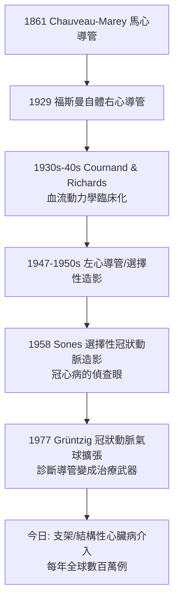

## 1929 - 福斯曼心導管（把自己當第一個病人，與諾貝爾獎等了 27 年）

## 案件摘要

**本案偵破的是人體最後一道禁區：心臟內部。**

1929 年，25 歲的德國外科住院醫師 Werner Forssmann 在 Eberswalde 醫院說服同事把一根導尿管從他自己的肘前靜脈插入 65 公分深，走到手術室以螢光屏確認導管尖端已進入**他自己的右心房**——他隨後還帶著管子走上樓梯做 X 光攝影存證。論文發表後，他被上司申斥、被醫界譏為馬戲團小丑，改行泌尿科；1956 年，他與 Cournand、Richards 共同獲諾貝爾生理學或醫學獎。本案的真相是：心導管最初破案的「偵查儀器」其實只是經驗證明安全的靜脈輸液管＋X 光透視（見 `1895-倫琴發現X光.md`），真正的障礙不是技術，而是「心臟不可侵犯」的百年禁忌。

## 前因 -- 為什麼會有這個案子

- **心臟＝禁地的傳統**。從蓋倫到 19 世紀，觸碰心臟被視為死亡（心跳停止、心包填塞）；心內壓、心輸出量、心腔血氧全部只能以 Fick 原理（1870）從耗氧量與動靜脈血氧差**間接計算**，誤差巨大。
- **Chauveau 與 Marey 的動物實驗（1861）**。法國學者以騎跨式導管經馬頸動脈插入左心室，直接記錄心內壓曲線——福斯曼在圖書館讀到此文，推理：「馬可以，人為什麼不可以？而且經靜脈入右心，比動脈入左心安全得多。」
- **1929 年的醫療條件**。泌尿科導尿管（橡膠、長度足夠）、X 光透視設備、局部麻醉——所有零件都已在庫，缺的只是一個敢把零件串起來插進自己心臟的人。

## 線索與推理 -- 數學式、程式、理論

**線索一：入路的安全性推理。** 福斯曼的選路邏輯（本案最精彩的部分）：

- **靜脈而非動脈**：靜脈壓低（右心房約 $ 0\sim 5\,\mathrm{mmHg} $），拔管後不會大出血；
- **周邊靜脈入路**：肘前靜脈管徑大、直行至上腔靜脈入右心房，路徑幾乎為直線；
- **管徑小於靜脈**、管端圓鈍、以無菌鹽水保持暢通。

他先在屍體上練習，再首次讓同事為他插管，過程中僅以局部麻醉——全程清醒，這本身就是安全性的活體證明（證明不致猝死，否則他走不到 X 光室）。

**線索二：Fick 原理——心導管測量學的靈魂。** 1956 年共同獲獎的 Cournand 與 Richards 之所以被記入本案，是因為他們把福斯曼的「插進去了」變成「量得出來」。以心導管分別取得混合靜脈血與動脈血氧，代入 Fick 方程即可直接計算心輸出量：

$$ CO = \frac{\dot{V}_{O_2}}{C_a_{O_2} - C_v_{O_2}} $$

$ CO $ 為心輸出量、$ \dot V_{O_2} $ 為每分鐘耗氧量、$ C_a, C_v $ 為動、靜脈血氧含量。Cournand–Richards（1930s–40s，紐約貝勒維醫院）以導管系統測量休克、心衰竭、肺心病的血流動力學，創立「循環生理學的臨床化」。

**線索三：從診斷到治療的跳躍。**

## 結案 -- 後果與影響

- **心臟病學的儀器化**。心內壓、血氧、造影、電生理檢查（希氏束電圖 1960s、射頻消融 1980s）全部生長在 1929 年那根導尿管的基座上。
- **介入性心臟病學的誕生**。1977 年德國放射科醫師 Andreas Grüntzig 以球囊導管擴張冠狀動脈，1986 支架問世——「診斷用導管」蛻變為「治療用通道」，今日心梗急救的黃金流程（門—球囊時間）是本案最終極的產業化結局。
- **自體實驗的倫理經典**。福斯曼案與 Barry Marshall 喝幽門螺桿菌（1984）並列醫學自體實驗史；但福斯曼案也提醒：他當年若死在樓梯上，這將是醫療事故而非破案佳話——現代研究倫理（紐倫堡守則 1947 之後）已不容許複製此路徑。
- **一句話結案**：福斯曼以自己為偵查現場，證明了「禁忌」只是還沒被測量過的區域；等了 27 年的諾獎，其實是醫界在補交一份遲到的認罪書。

## 關鍵人物與文獻

- **Werner Forssmann（1904–1979）**——德國外科醫師；1929 年發表 *Über die Sondierung des rechten Herzens*（論右心導管探查）；後改行泌尿科，1956 與 Cournand、Richards 同獲諾獎。
- **André Cournand（1895–1988）**與 **Dickinson Richards（1895–1973）**——紐約哥倫比亞大學／貝勒維醫院；1930s–40s 以心導管建立臨床血流動力學。
- **Auguste Chauveau 與 Étienne-Jules Marey**——1861 年首次以導管記錄馬心內壓，福斯曼的直接靈感來源。
- 原始文獻——Forssmann, *Klinische Wochenschrift*, 1929；Cournand & Ranges, *Proc. Soc. Exp. Biol. Med.*, 1941（Fick 法臨床化）。
- 現代註腳——福斯曼的原始 X 光片與導管存於德國醫學史博物館；他在回憶錄中自述：當年若先請示倫理委員會，「這個案子根本開不了庭」。
