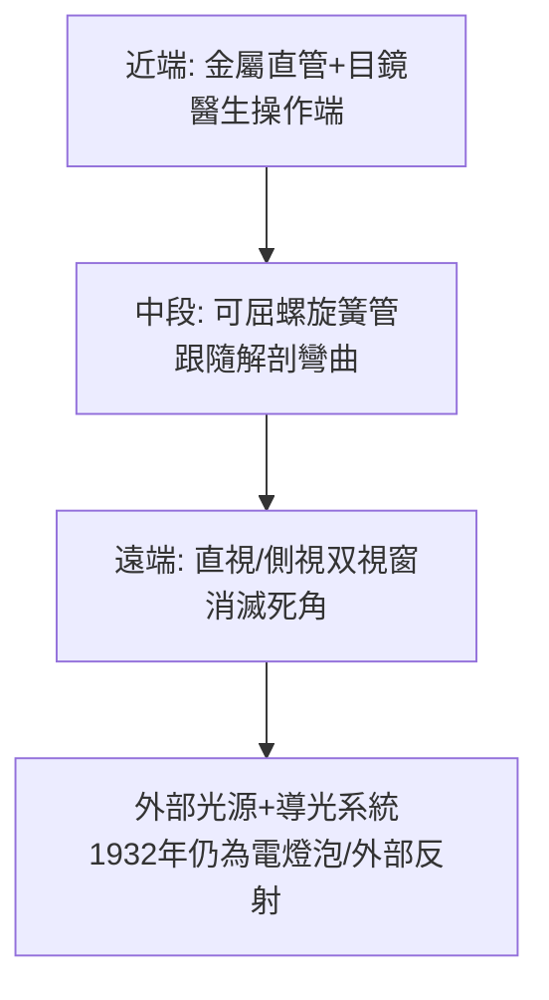

## 1932 - 辛德勒半可屈式胃鏡（與光學師合作的胃部偵查）

## 案件摘要

**本案偵破的是消化道最深的主戰場：胃。**

1932 年，慕尼黑醫生 Rudolf Schindler 與光學技師 Georg Wolf 製出**半可屈式胃鏡（Wolf–Schindler gastroscope）**：近端是一段金屬直管與目鏡，遠端是一段可以隨咽喉與胃的解剖彎曲的柔軟螺旋簧管，內含一串小透鏡傳光與傳像——病人坐著吞下，醫生第一次在活人身上系統地看見胃黏膜的每一個角落。本案的真相是：胃鏡史是「光學×材料×麻醉」三線並進的破案，Schindler 的功績不只是造出儀器，而是寫下第一本「胃內所見—疾病對照」的偵查手冊，讓內視鏡從雜技變成臨床常規。

## 前因 -- 為什麼會有這個案子

- **胃病的黑箱**。1930 年代之前，胃潰瘍與胃癌的診斷靠 X 光鋇餐造影（1898 年起）＋症狀＋洗胃液找癌細胞——早期胃癌幾乎無從確診；「胃鏡」多次嘗試（Kussmaul 1868 以劍吞鐵術為靈感的硬管胃鏡、Mikulicz 1881 改良）皆因太硬太痛、視野死角而失敗。
- **Schindler 的個人動機**。他因胃病臥床接受自己同事的胃鏡檢查失敗（硬管鏡），親身體會「病人不能忍受」是失敗主因——他把改良方向定為「病人可忍受性優先」。
- **材料條件成熟**。20 世紀初的螺旋彈簧管、精磨小透鏡、以及局部／淺麻醉技術，使「柔軟而可視」的組合成為可能。

## 線索與推理 -- 數學式、程式、理論

**線索一：柔軟與可視的矛盾。** 硬直光學管在咽喉與胃底角處會頂穿組織；但纖細柔軟的管子內部又無法排布成像系統。Wolf–Schindler 的解法是**半剛半柔的分段設計**：

視覺上以一串小透鏡（relay lens）把影像沿彎曲管路接力傳出——這是潛望鏡技術的醫用移植（跨界破案：光學師 Wolf 的本業是製作精密內窺光學系統）。

**線索二：判讀字典的建立。** Schindler 於 1923 年先出《胃鏡檢查法》教科書，1932 年儀器問世後持續補充「胃炎分類、潰瘍邊緣特徵、早期胃癌的黏膜表現」——1930s-50s 他在美國（芝加哥、波士頓）訓練了一代胃鏡醫生。胃鏡所見首次成為可教、可考、可比對病理的證據鏈。

**線索三：後續兩次革命。**

| 年代 | 革命 | 內容 |
|---|---|---|
| 1950s–60s | 纖維光學 | Hirschowitz（1957）以光導纖維束傳像，全可屈式胃鏡誕生 |
| 1980s | 電子內視鏡 | CCD 感測器取代纖維束，影像數位化、可記錄可遠距 |
| 1968–1990s | 治療內視鏡 | 息肉切除、止血、支架、ESD——「看見」升級為「動手」 |

光導纖維的物理原理：光在纖核（折射率 $ n_1 $）與包層（$ n_2 < n_1 $）界面發生**全反射**，只要入射角大於臨界角 $ \theta_c = \arcsin(n_2/n_1) $，光便沿纖維蜿蜒前進而幾無損失——數萬根纖維排成束，一根束傳光、一根束傳像，胃鏡從此能任意彎曲而影像不斷。

## 結案 -- 後果與影響

- **早期胃癌的生死線**。日本（1960s 起大規模內視鏡篩檢）把早期胃癌五年存活率推到 90% 以上；今日「胃鏡＋活檢」是上消化道疾病診斷的黃金標準。
- **內視鏡外科的總地基**。半屈式胃鏡證明「柔軟＋可視」可行，是纖維鏡、電子鏡、膠囊內視鏡（2000）與腹腔鏡微創手術的技術臺階。
- **Schindler 的結局**。他因反納粹被迫流亡美國，晚年患帕金森病；1968 年醫界以「胃鏡學的父親」為他舉行致敬會——這位當年被譏為「吞劍雜技醫生」的偵探，最終被追認為器官偵查學的奠基人。
- **一句話結案**：Wolf–Schindler 胃鏡的勝利在於把「病人能不能忍受」放進了工程規格——醫療儀器的成敗，一半在物理，一半在病人的痛苦。

## 關鍵人物與文獻

- **Rudolf Schindler（1888–1968）**——德國／美國胃腸病學家；1923 出版 *Lehrbuch der Magenspiegelung*；1932 年與 Wolf 合作完成半可屈式胃鏡；美國消化內視鏡學會首任主席（1941）。
- **Georg Wolf**——柏林精密光學技師，Wolf 公司創辦人；內視鏡光學工業的先驅之一。
- **Basil Hirschowitz（1925–2013）**——南非裔美國胃腸病學家；1957 年發表纖維胃鏡（與光學家 Curtiss、Peters 合作）。
- 原始文獻——Schindler & Wolf, *Münchener Medizinische Wochenschrift*, 1932；Hirschowitz et al., *Lancet*, 1958（纖維鏡論文）。
- 現代註腳——今日電子胃鏡直徑約 9 mm、前端可四向彎曲 210 度、附送水與活檢通道；「吞下相機」的膠囊內視鏡（Given Imaging, 2001）則把本案帶回「病人只需吞下一顆藥」的極簡終點。
