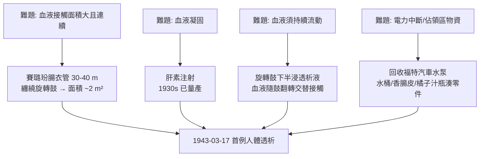

## 1943 - 科爾夫人工腎臟（在德國佔領下的荷蘭，以香腸皮與洗衣機零件造腎）

## 案件摘要

**本案偵破的是人體最複雜的過濾器：腎臟。**

1943 年 3 月，荷蘭 Groningen 的年輕醫生 Willem Johan Kolff 在納粹佔領下完成第一台可用的**人工腎臟（旋轉鼓式透析機）**：以賽璐玢（香腸腸衣）管纏在木製旋轉鼓上，鼓下半浸在透析液中旋轉，使病人血液交替通過膜面與透析液交換廢物；1945 年 9 月以之救治一位 67 歲急性腎衰竭女病人（67 小時、共 80 公升血被處理），病人甦醒並存活。本案的真相是：人工腎臟的物理核心是**透析（彌散＋超濾）**，Kolff 的破案關鍵不在理論（透析原理 1913 年 Abel 已示範），而在材料（賽璐玢）、抗凝（肝素）與工程——以及在被佔領、缺物資的絕境中堅持 17 台失敗的機器。

## 前因 -- 為什麼會有這個案子

- **尿毒症的死刑**。急性腎衰竭（戰傷、擠壓症候群、敗血症）的死亡率接近 100%；病人血液中尿素、鉀、酸堆積，數日至數週內昏迷死亡。二戰爆發使「擠壓症候群」病例暴增，倫敦閃電戰傷患的腎衰竭成為著名臨床難題。
- **理論已備**。1913 年 Johns Hopkins 的 John Abel 以火棉膠膜為犬做血液透析（稱 artificial kidney）；1924–28 年德國 Haas 首次對人透析但未能存活。缺的是：高效抗凝劑（肝素 1930s 量產）、大面積可靠薄膜、與持續動力。
- **Kolff 的觀察**。他的第一位腎衰竭病人是 22 歲青年，緩慢痛苦地死去；他回憶：「既然腎臟是一個過濾器，為什麼不能造一個過濾器來替代它？」——這句話是本案的立案動機。

## 線索與推理 -- 數學式、程式、理論

**線索一：透析的物理。** 血液與透析液隔一層半透膜（賽璐玢，孔徑約數奈米）相向，小分子廢物依濃度梯度彌散通過：

$$ J = -D \frac{dC}{dx} \quad (\text{Fick 彌散定律}), \qquad K_{\text{清除}} = Q_b \left(1 - \frac{C_{out}}{C_{in}}\right) $$

尿素（$ MW \approx 60 $）與鉀離子迅速跨膜；蛋白質與血球被擋住。再以跨膜靜水壓差實現超濾（脫水）。這兩條——彌散＋超濾——至今仍是每一台血液透析機的物理核心。

**線索二：工程的逐項破案。** Kolff 的清單式推理：

前 16 台機器救治 16 例病人全數失敗（多為晚期敗血症病人，腎衰只是死亡的末端）；第 17 例——被納粹通緝的鬥爭者家庭成員 Sofia Maria Schafstadt（「鐵娘子」）——存活並出院。**倖存者偏差的反面教材**：Kolff 之後明言，透析對「可逆性腎衰竭」有效、對末期敗血症無效——適應症的釐清本身就是本案的偵查成果。

**線索三：戰後的擴散。** Kolff 戰後把 5 台機器分送英國、美國、加拿大——「送機器而非申請專利」，使人工腎臟在 5 年內全球開花；1947 年 Merrell 公司改良、1960 年 Scripps 的 Scribner 分流（Quinton–Scribner shunt）解決反覆血管通路問題，慢性腎衰竭病人首次能長期生存，1962 年起「透析選拔委員會」（西雅圖上帝委員會）引發醫療資源分配倫理的大辯論，1972 年美國國會將 ESRD 納入 Medicare 給付——儀器史直接改寫了社會福利史。

## 結案 -- 後果與影響

- **器官替代治療的開山**。人工腎臟證明「臟器功能可以用機器在體外替代」，直接啟發人工心肺（見 `1953-吉貝爾人工心肺.md`）、人工肝、ECMO 等整個體外循環學科。
- **慢性病醫療的經濟學誕生**。長期透析的高成本催生了醫療給付、資源分配與「生命價值」的公共政策辯論——1972 年的美國 ESRD 法案是現代重大疾病全民醫保的原型。
- **Kolff 的第二案**。他晚年再破一案：與 Imamura 製出最早的氣動式人工心臟，並指導了 Willem Kolff 人工器官研究所（猶他大學，人工心臟 Jarvik-7 見 `1982-賈維克人工心臟.md`）——一人兩開器官替代時代。
- **一句話結案**：Kolff 的勝利公式是「理論早已存在＋材料終於出現＋有人願意在廢料堆裡失敗十七次」——人工腎臟不是天才的靈光，而是絕境中的工程學。

## 關鍵人物與文獻

- **Willem Johan Kolff（1911–2009）**——荷蘭 Groningen 醫生、後任猶他大學人工器官研究所所長；1943 年首台人工腎臟、1945 年首例救治成功；獲 2002 年 Lasker 獎（「透析與人工器官之父」）。
- **John Jacob Abel（1857–1938）**——Johns Hopkins 藥理學家；1913–14 年以火棉膠膜做出首個「人工腎臟」動物實驗裝置。
- **Belding Scribner（1921–2007）**與 **Wayne Quinton**——1960 年發明動靜脈分流，使慢性透析可行。
- 原始文獻——Kolff, *De Kunstmatige Nier*（博士論文，Kampen, 1946）；Kolff & Berk, "The artificial kidney: a dialyser with a great area," *Acta Med. Scand.*, 1944。
- 現代註腳——今日全球逾 400 萬人接受透析治療；可攜式／植入式人工腎（ wearable artificial kidney、implantable bioartificial kidney）仍在破案途中——Kolff 留下的問題還沒偵完。
