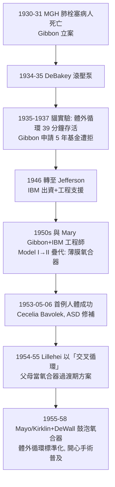

## 1953 - 吉貝爾人工心肺（心臟停跳下的體外循環，開心手術的鑰匙）

## 案件摘要

**本案偵破的是外科最後的禁區：一顆必須停止跳動才能被手術修補的心臟。**

1953 年 5 月 6 日，費城 Jefferson 醫學院的 John Gibbon Jr. 以他與妻子 Mary Gibbon 合作二十餘年研發的**人工心肺機（heart-lung machine）**，為 18 歲女孩 Cecelia Bavolek 進行體外循環下的房間隔缺損修補——26 分鐘完全由機器替代心肺功能，病人存活。這是史上第一例成功的**開心手術**。本案的真相是：體外循環是「膜式氧合＋泵＋熱交換＋過濾」的整合工程；Gibbon 破案花了 23 年（1930–1953），其間失敗的動物實驗以百計——本案是醫療儀器史上「工程師式堅持」的最長偵查。

## 前因 -- 為什麼會有這個案子

- **先天性心臟病與瓣膜病無法觸碰**。1930 年代，心臟內部手術等於死刑；Blalock–Taussig 分流（1944）只能「繞道」而不入心內。要修補房缺、換瓣，必須打開心臟——而心臟一開、腦在數分鐘內缺血即死。
- **Gibbon 的起點（1930–31）**。年輕外科住院醫師 Gibbon 在麻州總醫院值夜班，看著一位膽囊術後肺栓塞的女病人，在摘除血栓的手術台上因循環衰竭死亡——他自問：「若能在手術期間以機器把她的靜脈血抽出、氧合、再泵回動脈，她本可活。」
- **前人的零件**。19 世紀末 Ludwig 與 Frey 的離體器官灌流、1920s-30s Brukhonenko（蘇聯）的離體犬頭灌流實驗、以及 DeBakey 的滾壓泵（1934）——氧合器是缺的那一塊拼圖。

## 線索與推理 -- 數學式、程式、理論

**線索一：氧合是整案的死結。** 成人靜息耗氧 $ \dot V_{O_2} \approx 250\,\mathrm{mL/min} $，機器必須以每分鐘數公升的血流完成等量氧合。Gibbon 嘗試多種設計後採用**薄膜氧合器**：血液以極薄的膜（0.1 mm 級）沿不鏽鋼網屏流下，與氧氣流接觸。氧合速率受 Fick 彌散定律控制：

$$ \dot V_{O_2} = D \cdot A \cdot \frac{\Delta p_{O_2}}{d} $$

$ A $ 是接觸面積、$ d $ 是血膜厚度、$ \Delta p $ 是分壓差——「把血攤成極薄的膜」是提高 $ \dot V_{O_2} $ 的關鍵幾何，也解釋了為何早期機器需要 30 公斤的不鏽鋼屏與數公升的預充量。

**線索二：血液損傷——第二個兇手。** 直接血—氣接觸使蛋白變性、溶血、血小板破壞；抗凝（肝素）過量又致出血。Gibbon 的解法：低溫（降低代謝與所需流量）、精細的泵速與壓力控制、最後輔以氦／氧混和氣。低溫的核心物理是 Arrhenius 型代謝速率下降：

$$ \text{每降 } 10\,^{\circ}\mathrm{C} \text{，耗氧約減半 } (Q_{10} \approx 2) $$

——低溫體外循環使 $ \dot V_{O_2} $ 需求與機器能力之間的差距縮小，這是 1953 年成功案的第一功臣之一。

**線索三：二十三年的時間表。**

**線索四：後繼的氧合器譜系。** 鼓泡式（直接氧氣打泡入血，Kirklin–DeWall 1955）簡單可靠但血液損傷重；膜式氧合器（1960s 起以矽膠膜、後為聚丙烯微孔膜）把血—氣隔開，血液損傷小，成為現代主流——今日的 ECMO（體外膜氧合，1970s 成熟，2020 年 COVID 重症的主力）就是可攜版人工心肺。

## 結案 -- 後果與影響

- **心臟外科從此存在**。房缺、室缺、法洛四聯症、瓣膜置換（1960 年代 Starr–Edwards 人工瓣）、冠狀動脈搭橋（1968 起爆發）——全部站在 1953 年那 26 分鐘體外循環之上；今日全球每年逾百萬例心臟手術。
- **工程—臨床合作的範本**。Gibbon 與 IBM 的合作（1946–1952）是醫學界與產業工程界深度共研的早期經典，預告了後世達文西機器人（見 `1999-達文西手術機器人.md`）式的醫工模式。
- **夫妻偵探**。Mary Gibbon（Mary Hopkinson Gibbon）承擔了動物實驗、手術團隊管理與大量工程判斷，卻長期未被記名——本案也是醫療儀器史中「隱形合作者」的典型檔案。
- **一句話結案**：Gibbon 用二十三年證明「心臟可以被停跳」——代價是數百隻實驗動物、五年基金被拒、與一台三十公斤的不鏽鋼氧合器；本案的兇手從來不是心臟，而是「腦缺氧的四分鐘」。

## 關鍵人物與文獻

- **John Heysham Gibbon Jr.（1903–1973）**——費城 Jefferson 醫學院外科教授；1930 年立案、1953 年首例成功；獲 Lasker 獎（1954）等多項榮譽。
- **Mary Hopkinson Gibbon（1906–2004）**——共同研究者二十餘年；動物實驗與手術管理的核心人物。
- **C. Walton Lillehei（1918–1999）**——明尼蘇達外科醫師；1954–55 年以「交叉循環」（父母為患童供血氧合）過渡，並培養出下一代理論與工程力量。
- **John Kirklin 與 Richard DeWall**——Mayo Clinic 團隊；1955 年鼓泡式氧合器使體外循環可重複、可普及。
- 原始文獻——Gibbon, "Application of a mechanical heart and lung apparatus to cardiac surgery," *Minnesota Medicine*, 1954；Gibbon, *J. Thorac. Surg.*, 1954。
- 現代註腳——2020 年 COVID-19 期間 ECMO 成為重症最後防線的代名詞；人工心肺的氧合膜如今只有數微米厚、預充量不足 200 mL——與 Gibbon 的鋼屏相比，偵查工具縮小了一千倍。
