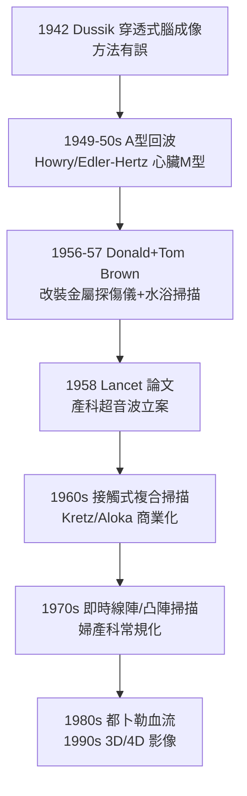

## 1958 - 唐納爾遜產科超音波（從潛艦聲納到子宮裡的胎兒）

## 案件摘要

**本案偵破的是醫學最古老的黑箱：懷孕的子宮。**

1958 年，蘇格蘭格拉斯哥的婦產科醫生 Ian Donald 與工程師 Tom Brown、John MacVicar 在《柳葉刀》發表論文，首次以**脈衝回波超音波**對孕婦腹部成像，並報告區分胎兒囊腫與腫瘤、辨認胎頭的臨床病例——產前超音波診斷自此誕生。本案的真相是：超音波是「潛艦聲納＋工業探傷＋雷達回波」的跨界移植；Donald 的破案動機是一位被誤診為癌症的孕婦（病人死後解剖發現是良性囊腫）——「若能在術前看清子宮內容物，她不必死」，這句遺憾就是立案證詞。

## 前因 -- 為什麼會有這個案子

- **產科的黑箱**。1950 年代以前，胎位、多胎、胎兒大小、胎兒心跳全靠觸診與聽筒；X 光雖可用（1930s 起骨盆測量）卻有輻射風險且對軟組織（囊腫 vs 腫瘤 vs 胎兒）辨別力差。
- **聲納技術的軍事遺產**。一戰的 ASDIC（潛艦聲納）、二戰雷達培養了一整代工程師；超音波在金屬探傷（1940s Sokolov、Firestone）已成熟——「聲波在異質界面的反射」正是醫學成像需要的全部物理。
- **先行者**。1942 年奧地利神經科醫師 Karl Dussik 嘗試以穿透式超音波繪腦室（超音波診斷第一案，但方法有誤）；1949–50s 美國的 Howry、丹麥的 Edler 與 Hertz（心臟超音波，1953）各自起步——產科成像仍是空白。

## 線索與推理 -- 數學式、程式、理論

**線索一：回波的物理。** 換能器以壓電晶體（石英／後來的 PZT 壓電陶瓷）把電壓轉成高頻聲波（診斷用 $ f \approx 2\text{–}15\,\mathrm{MHz} $）射入人體，聲波在聲阻抗 $ Z = \rho c $（密度×聲速）突變的界面部分反射。回波往返時間 $ t $ 與深度 $ d $ 的關係：

$$ d = \frac{c \, t}{2}, \qquad c_{\text{軟組織}} \approx 1540\,\mathrm{m/s} $$

反射強度決定亮度——這就是 B 型（brightness mode）成像。解析度極限由波長決定：$ \lambda = c/f $，故 $ 3\,\mathrm{MHz} $ 時 $ \lambda \approx 0.5\,\mathrm{mm} $，約束了可分辨細節；頻率越高越清晰、穿透越淺——每一個探頭的頻率選擇都是解析度與穿透率的交易。

**線索二：從 A 型到 B 型的儀器演化。**

Donald 團隊第一台機器以水浴（病人腹部浸水槽）匹配聲阻抗、機械臂掃描；1960 年代才改為直接接觸掃描——儀器史同時是「使用便利性」的演進史。

**線索三：唐納德三角準則（1968–1970）的偵查判據。** Donald 與同事建立囊內容物的辨認規則（胎頭回聲、胎心搏動、胎動）以區分：妊娠囊、子宮肌瘤變性、卵巢囊腫、腹水——把「回聲形態學」寫成可傳授的判讀字典，與 Laennec 的聽診字典（`1816-雷奈克聽診器.md`）同一方法論。

## 結案 -- 後果與影響

- **產科學的儀器化**。胎齡估計、多胎、前置胎盤、胎兒畸形篩檢、胎兒生長追蹤——超音波成為全球使用最頻繁的影像檢查之一；1970s 起成為產檢常規，WHO 將其列為基本醫療設備。
- **安全性的勝利**。診斷超音波無電離輻射（與 X 光/CT 相反），可反覆使用於孕婦與胎兒——這一特性使它成為「活體即時窗」，也成為胎兒外科（1981 起胎兒手術）的導航儀。
- **倫理的雙面**。產前性別鑑定與選擇性流產（1980s 亞洲）、胎兒「可視化」對流產倫理的影響——儀器看清了身體，也看出了新的社會難題。
- **一句話結案**：Donald 的靈感是把醫院樓下的鍋爐探傷儀搬上產科病房——醫療儀器史上的許多兇器，原是別的行業的日常工具。

## 關鍵人物與文獻

- **Ian Donald（1910–1987）**——格拉斯哥婦產科教授；皇家空軍雷達軍官出身，1958 年發表產科超音波奠基論文；1973 年受封爵士。
- **Tom Brown（1922–2016）**——格拉斯哥工程師（Kelvin & Hughes 公司），Donald 的技術搭檔，實際設計了首台產科掃描儀。
- **Inge Edler 與 Carl Helmuth Hertz**——1953 年瑞典 Lund 首創心臟超音波（M 型），本案的平行偵查線。
- 原始文獻——Donald, MacVicar & Brown, "Investigation of abdominal masses by pulsed ultrasound," *The Lancet*, 1958。
- 現代註腳——今日掌上型超音波（2010s Butterfly iQ 以 CMUT 晶片取代傳統壓電晶體）已可插入手機；Donald 的水浴槽縮小成了一枚晶片。
