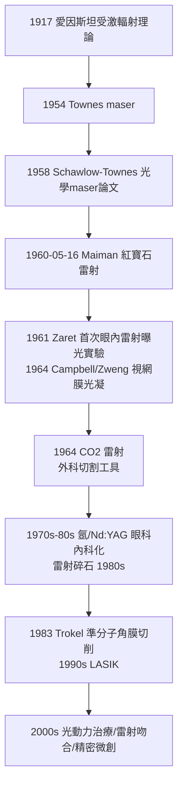

## 1960 - 梅門雷射（受激輻射的醫學化：從物理期刊到手術房只用了幾年）

## 案件摘要

**本案偵破的是「如何讓光變成手術刀」。**

1960 年 5 月 16 日，休斯飛機公司實驗室的 Theodore Maiman 以紅寶石晶體（摻鉻氧化鋁）製出史上第一台**光激射器（laser）**：螺旋閃光燈泵浦紅寶石，產生 694 nm 的相干紅色脈衝光。幾年內眼科（1961–64 視網膜光凝）、皮膚科、外科（1964 Kumar Patel 的二氧化碳雷射，波長 10.6 μm，可切割軟組織）相繼進場——今日的視網膜雷射、近視雷射手術、雷射碎石、光動力治療皆是本案的後代。本案的真相是：醫學雷射的三件套——**相干性、單色性、高能量密度**——每一件都對應一項臨床用途，而它們全部源於 1917 年愛因斯坦預言的受激輻射。

## 前因 -- 為什麼會有這個案子

- **理論先於技術 43 年**。1917 年愛因斯坦在《論量子輻射的量子理論》中推導出受激輻射：處於激發態的原子可被恰當頻率的光子「誘導」放出與入射光完全同相、同頻的光子——這是相干放大的量子力學許可證。
- **微波時代的追捕**。1954 年 Townes（哥倫比亞）以氨分子製出 maser（微波激射器）；1958 年 Townes 與 Schawlow 發表《紅外與光學 maser》理論論文，明確指出光學段可行——全世界的實驗室開始賽跑，Maiman 以「簡單、便宜、快速」的紅寶石方案搶先（其實紅寶石是三能級系統、理論上「更難」，這正是本案的反直覺之處）。
- **醫學的舊工具困境**。手術刀與電刀切割軟組織時出血、感染與沾黏；眼科視網膜破洞只能用熱針或光凝燈——醫學需要「既精準又能封閉血管」的能量遞送工具。

## 線索與推理 -- 數學式、程式、理論

**線索一：受激輻射與粒子數反轉。** 雷射的必要條件是讓激發態粒子多於基態（正常熱平衡下不可能），即「粒子數反轉」，需以泵浦（閃光燈、電流、化學反應）強行灌注能量；再以光學共振腔（兩面鏡子）使光往返增益：

$$ g(\nu) \cdot L > \alpha \quad \Longleftrightarrow \quad \text{增益 > 損耗時振盪} $$

$ g(\nu) $ 是增益、$ L $ 是介質長度、$ \alpha $ 是腔內損耗。Maiman 的洞察是：紅寶石的螢光光譜窄、閾值雖高但脈衝氙燈可瞬間供給——他算對了脈衝這條路，比理論家的連續波偏好更貼近現實。

**線索二：雷射—組織交互作用字典。** 醫學雷射的破案判據是波長選擇：

| 波長/雷射 | 組織吸收者 | 臨床用途 |
|---|---|---|
| 532 nm（倍頻 Nd:YAG，綠光） | 血紅素 | 視網膜光凝、血管病變 |
| 694 nm 紅寶石 | 黑色素 | 最早皮膚/紋身治療 |
| 1064 nm Nd:YAG | 水＋血紅素 | 深層凝固、止血 |
| 10.6 μm CO₂ | 水（強吸收） | 切割軟組織、汽化病灶 |
| 193 nm 準分子（ArF） | 蛋白質直接光化分解 | LASIK 角膜切削 |

關鍵物理：能量密度 $ F = P/(\text{光斑面積}) $，聚焦越小、密度越高——「以光為刀」的本質是用 $ \mu\mathrm{m} $ 級的光斑在組織上達到汽化閾值（約 $ 10^2\text{–}10^4\,\mathrm{J/cm^2} $），同時側向熱損傷控制在微米級。

**線索三：醫學進場的時間表。**

## 結案 -- 後果與影響

- **眼科的徹底改寫**。糖尿病視網膜病變、視網膜剝離、青光眼、白內障後囊混濁（Nd:YAG 囊切）——雷射使「不開刀治療眼底」成為常規；LASIK 則讓數千萬人脫離眼鏡。
- **微創與精準的哲學**。雷射證明「能量可以像手術刀一樣被編程」——與內視鏡（`1932-辛德勒半屈式胃鏡.md`）結合後，腔內雷射手術成為微創外科的重要工具；泌尿科雷射碎石使腎結石從手術變成門診。
- **產業與競賽的教訓**。Maiman 與休斯公司的專利糾紛、與 Bell 實驗室（Townes 陣營）的優先權之爭持續數十年——本案也提醒：基礎理論（愛因斯坦，無專利）、國防資助、公司工程三者的產權切割，本身就是一樁未結的副案。
- **一句話結案**：愛因斯坦 1917 年寫下光子會「呼朋引伴」的方程，Maiman 用一根手掌大的紅寶石把它讀出聲來——醫學聽見的第一句話，是「視網膜上的破洞被焊住了」。

## 關鍵人物與文獻

- **Theodore Maiman（1927–2007）**——休斯研究實驗室物理學家；1960-07-07 記者會宣布；論文被《物理評論快報》快審快發（1960-08）。
- **Charles H. Townes（1915–2015）**——maser 發明人、雷射理論奠基者；1964 年諾貝爾物理學獎（與 Basov、Prokhorov）。
- **Arthur Schawlow（1921–1999）**——Bell 實驗室，1958 與 Townes 共同發表光學 maser 理論；1981 諾獎（雷射光譜學）。
- **Francis L'Esperance、Christian Zweng、Charles Campbell**——1960s 眼科雷射光凝的臨床先驅。
- 原始文獻——Maiman, "Stimulated optical radiation in ruby," *Nature*, 1960；Einstein, *Zur Quantentheorie der Strahlung*, 1917。
- 現代註腳——2023 年諾貝爾化學獎（阿秒雷射脈衝）顯示雷射已深入基礎科學；而全球每年逾千萬例雷射手術的起點，是那根 1 英吋高、外觀像玩具的紅寶石棒。
