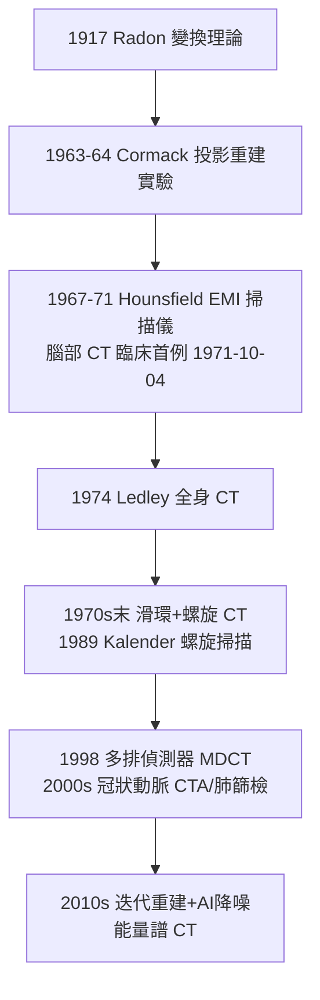

## 1971 - 洪斯菲 CT（電腦＋X 光＝把身體切成薄片）

## 案件摘要

**本案偵破的是 X 光成像的一個百年死角：重疊。**

1971 年 10 月，倫敦 Atkinson Morley 醫院安裝了 EMI 公司工程師 Godfrey Hounsfield 建造的第一台**電腦斷層掃描儀（CT）**；10 月 4 日對第一位病人（疑額葉腫瘤女士）掃描，以約 4.5 分鐘、兩台半導體探測器、160 個角度的穿透測量，重建出世界第一張人腦斷層影像——腦內軟組織第一次被「切片」看見。本案的真相是：CT 的核心不是 X 光（1895 年已有），而是**數學（Radon 變換的逆問題）＋計算機**；Hounsfield 與南非物理學家 Allan Cormack 共獲 1979 年諾貝爾生理學或醫學獎——兩人皆非醫生，本案是「外行偵探」的教科書。

## 前因 -- 為什麼會有這個案子

- **傳統 X 光的結構性缺陷**。X 光片是三維身體在二維底片上的**投影疊加**：肋骨、肺、心臟的影子互相覆蓋，腦內軟組織（吸收差僅約 1–4%）完全不可見。氣腦造影（1918，向腦室打空氣，極痛苦）與血管造影（1927 Moniz）是粗暴的「間接照明」。
- **數學早已備妥**。1917 年奧地利數學家 Johann Radon 證明：函數的所有線積分（投影）可以唯一重建原函數——Radon 變換理論上解決了「由投影重建斷層」的逆問題，只是無人知道它能用來看病。
- **1960s 的計算機條件**。半導體記憶體與運算速度首次讓「數十萬次迭代運算、數分鐘完成」變得可行——CT 的第三塊拼圖（計算力）終於就位。

## 線索與推理 -- 數學式、程式、理論

**線索一：逆問題的偵查邏輯。** 穿過病人某條直線 $ L $ 的 X 光總衰減是線積分：

$$ p(L) = \int_L \mu(x, y)\, ds \quad (\text{Beer–Lambert 指數律的對數形式}) $$

單一投影無法還原 $ \mu(x,y) $；但**多角度的 $ p(L) $ 全體**可唯一決定 $ \mu $——Radon 於 1917 年給出證明。Cormack（1963–64，於南非開普敦與美國 Tufts）以簡化模型與實驗證明可行；Hounsfield（1967–71，EMI 公司，原研究圖案識別）以迭代代數重建法做出實機。

**線索二：窗寬窗位——影像的字典。** CT 值定義為相對水的衰減係數：

$$ \text{HU} = 1000 \times \frac{\mu_{\text{組織}} - \mu_{\text{水}}}{\mu_{\text{水}}} $$

水 = 0 HU、空氣 ≈ −1000、骨 ≈ +1000、脂肪 ≈ −80、腦 ≈ +35、急性出血 ≈ +60——Hounsfield 標尺把「吸收差異」變成可通訊、可儲存、可互比的數據語言，這是影像從照片變成「數據」的關鍵一步（DICOM 標準的直系祖先）。

**線索三：從腦 CT 到全身 CT 的擴散。**

每一步都在同一個 Radon 框架內壓縮時間（4.5 分鐘 → 亞秒）與劑量——偵查效率的指數提升。

## 結案 -- 後果與影響

- **診斷權力的再分配**。腦中風、腦腫瘤、外傷內出血、肺癌篩檢（NLST 2011 證實低劑量 CT 降低肺癌死亡率 20%）——CT 使「解剖級證據」在活體成為常態，放射科成為醫院的中樞神經。
- **劑量的代價**。CT 佔醫療輻射暴露的最大宗（美國約 25% 的醫源輻射），兒童 CT 劑量與二次癌症風險的流行病學研究（2000s 起）催生了劑量最小化與「正當性—最適化」原則——每件偵查武器都有附帶傷害。
- **EMI 的跨界笑話**。CT 是 Beatles 唱片（EMI 是唱片公司）賺來的錢資助出來的——「流行音樂資助了腦部成像」，本案最好的註腳是：革命性醫療儀器可能來自與醫學毫無關係的部門。
- **一句話結案**：Cormack 提供數學、Hounsfield 提供工程、Radon 提供五十四年前的理論——CT 是三份不同時代的口供拼成的一樁破案。

## 關鍵人物與文獻

- **Godfrey Hounsfield（1919–2004）**——EMI 工程師、二戰雷達技師出身；1979 年與 Cormack 同獲諾貝爾生理學或醫學獎。
- **Allan M. Cormack（1924–1998）**——南非出生、Tufts 大學物理學家；1963–64 年發表投影重建的兩篇奠基論文（當年幾無人引用）。
- **Johann Radon（1887–1956）**——維也納數學家；Radon 變換與其逆問題的證明者。
- **Robert Ledley（1926–2012）**——1974 年首台全身 CT（ACTA）。
- 原始文獻——Hounsfield, "Computerized transverse axial scanning (tomography)," *British Journal of Radiology*, 1973；Cormack, *J. Appl. Phys.*, 1963。
- 現代註腳——今日 CT 單圈 0.25 秒、256 排偵測器、亞毫西弗心臟掃描；從 1971 年那張 4.5 分鐘的腦片算起，同樣的數學已跑了一億倍的速度。
