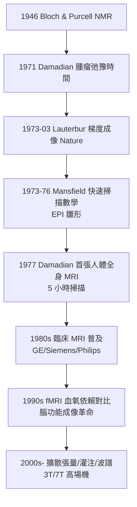

## 1973 - 勞特伯 MRI（用磁場把身體裡的水做成地圖）

## 案件摘要

**本案偵破的是一個化學家的工具如何變成全身的地圖。**

1973 年 3 月，紐約州立大學石溪分校化學系助理教授 Paul Lauterbur 在《自然》發表《以核磁共振成像》（*Image Formation by Induced Local Interactions*）：他在 NMR 譜儀中加入線性梯度磁場，使不同位置的質子具有不同的共振頻率——「位置」由此被編碼進頻率，水的分布第一次被畫成二維圖像（兩支裝水的毛細管）。幾乎同期，Nottingham 的 Peter Mansfield 發展梯度回波的快速成像數學（k 空間與回波平面成像的基礎）。本案的真相是：MRI 是 1946 年 Bloch 與 Purcell 的核磁共振物理、Raymond Damadian 的腫瘤弛豫觀察（1971）與 Lauterbur 的「梯度編碼」巧思的三重接力——1977 年首張人體全身 MRI、2003 年 Lauterbur 與 Mansfield 共獲諾貝爾生理學或醫學獎。

## 前因 -- 為什麼會有這個案子

- **NMR 的化學世襲**。1946 年 Bloch（史丹福）與 Purcell（哈佛）分別偵測到核磁共振（1952 諾獎）；此後三十年 NMR 是化學家的光譜儀（結構鑑定），從未想過「成像」——因為譜儀的均勻磁場恰恰**刻意消除**位置資訊。
- **Damadian 的關鍵觀察（1971）**。紐約下州醫學中心的醫生 Raymond Damadian 測得大鼠腫瘤組織的 $ T_1 $、$ T_2 $ 弛豫時間顯著長於正常組織——他申請專利並提出「以 NMR 檢測癌症」的構想，1977 年製出「可愛的鐵（Indomitable）」全身機器。他證明「信號有診斷價值」，但他的場聚焦式掃描法（逐點掃）太慢，無法實用。
- **臨床的動機**。CT（見 `1971-洪斯菲CT.md`）已證明「斷層影像」的臨床威力，但它有電離輻射、對軟組織對比有限——醫學需要「無輻射的軟組織 CT」。

## 線索與推理 -- 數學式、程式、理論

**線索一：共振的物理。** 氫核（質子）自旋在磁場 $ B_0 $ 中以拉莫爾頻率進動：

$$ \nu_0 = \frac{\gamma}{2\pi} B_0, \qquad \frac{\gamma}{2\pi} \approx 42.58\,\mathrm{MHz/T} $$

施加同頻率的射頻脈衝（RF）可將質子磁化向量翻轉；脈衝停止後，質子經兩個過程回到平衡：縱向恢復（$ T_1 $，與晶格交換能量）與橫向失相位（$ T_2 $，自旋—自旋互作用）——**組織含水與水環境不同 ⇒ $ T_1/T_2 $ 不同 ⇒ 對比**。MRI 的每一張圖，本質是一張「質子密度 × 弛豫時間」的地圖。

**線索二：勞特伯的巧思——梯度即郵遞區號。** 在均勻磁場上疊加線性梯度 $ G_x $：

$$ \nu(x) = \frac{\gamma}{2\pi} (B_0 + G_x x) $$

不同 $ x $ 位置的質子以不同頻率共振——頻率譜就是一維的空間剖面；再以另一方向的梯度與相位編碼，即得二維、三維影像。這一步的哲學意義：**把「害處」（磁場不均）反轉為「資訊」**——CT 的哥哥 X 光靠吸收差，MRI 靠「把位置寫進頻率」。

**線索三：快速成像與臨床化。**

## 結案 -- 後果與影響

- **軟組織診斷的王者**。腦與脊髓（多發性硬化、腫瘤、脊髓壓迫）、關節韌帶、心肌存活、肝膽胰——MRI 以無電離輻射與可調對比（不同序列如 $ T_1 $、$ T_2 $、FLAIR、DWI）成為複雜診斷的最終偵查庭。
- **fMRI：心理學變成可見**。1990 年 Ogawa 的 BOLD 效應使「思考時腦中哪裡耗氧」可被觀測——認知神經科學因此誕生為成像學科。
- **諾獎的遺珠**。Damadian 未獲 2003 年諾獎，公開登報抗議——本案再次顯示：觀察到「信號有用」（Damadian）、想出「如何成像」（Lauterbur/Mansfield）、與做出「臨床系統」（工程師群）之間的功勞切分，是儀器史最難的終審。
- **一句話結案**：MRI 的破案靈感是「故意把磁場弄不均勻」——在科學裡，缺陷的另一個名字常常叫做資訊。

## 關鍵人物與文獻

- **Paul Lauterbur（1929–2007）**——石溪分校化學教授；1973 年《自然》論文；2003 諾獎；其首張影像（兩支水管的「Zeugmatogram」）被同行評審稱「不值得發表」，他執意投稿成功。
- **Peter Mansfield（1933–2017）**——Nottingham 物理學家；梯度與快速成像數學、回波平面成像（EPI）發明人；2003 諾獎。
- **Raymond Damadian（1936–2022）**——下州醫學中心醫師；1971 年腫瘤弛豫觀察、1974 年專利、1977 年首台全身 MRI「Indomitable」；2003 年諾獎遺珠。
- **Felix Bloch 與 Edward Purcell**——1946 年 NMR 發現者，1952 年諾貝爾物理學獎。
- 原始文獻——Lauterbur, *Nature*, 1973；Mansfield & Grannell, *J. Phys. C*, 1973；Damadian et al., *Science*, 1974（人體首例報告）。
- 現代註腳——全球逾 5 萬台 MRI 每年執行上億次檢查；7T 人體 MRI 已進入臨床研究，對比解析度達 $ 100\,\mathrm{\mu m} $ 級——Lauterbur 那兩支毛細管的水，如今映出了思維本身。
