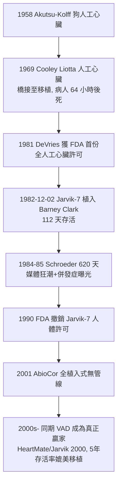

## 1982 - 賈維克人工心臟（Jarvik-7： Barney Clark 的 112 天與器官替代的極限）

## 案件摘要

**本案偵破的是最後的器官替代難題：整顆心臟。**

1982 年 12 月 2 日，猶他大學的 William DeVries 為 61 歲、末期心衰竭的牙醫 Barney Clark 植入**Jarvik-7 全人工心臟**（兩個氣動聚氨酯心室、以 180 kg 的控制台驅動）——Clark 存活 112 天，成為史上首位以人工心臟度過餘生的病人。此後 1984–85 年的案例（William Schroeder 存活 620 天）掀起媒體狂潮，也暴露感染、中風與生活品質的殘酷現實；至 1990 年 Jarvik-7 退出人體使用。本案的真相是：全人工心臟證明了「機器可以泵血」，卻也證明了「人不只是泵血機」——本案以失敗的一半，催生了成功的一半（心室輔助裝置 VAD 與移植制度的改革）。

## 前因 -- 為什麼會有這個案子

- **器官替代的長期戰線**。人工腎臟（`1943-科爾夫人工腎臟.md`）、人工心肺（`1953-吉貝爾人工心肺.md`）已證明機器可短期替代臟器；心臟移植（1967 Barnard 首例）受制於捐贈供體——「每年數萬人排隊、數千人捐心」的落差就是全人工心臟的立案動機。
- **猶他團隊的譜系**。Kolff 本人（人工腎臟之父）1971 年移師猶他建立人工器官研究所；弟子 Robert Jarvik 與 Clifford Kwan-Gett 設計氣動式人工心臟，Tetsuzo Akutsu（日本，1958 年已做過狗的人工心臟實驗）為共同先驅；DeVries 為外科執行者。
- **1982 年的條件與禁忌**。聚氨酯材料、生物相容性、氣動驅動已可行；但免疫排斥（異種移植 1964 Hardy 黑猩猩心臟案）的慘敗使「機器而非異種」成為唯一道德與技術的出路。

## 線索與推理 -- 數學式、程式、理論

**線索一：泵的物理。** Jarvik-7 以氣動隔膜泵驅動，每側心室容量約 100 mL、搏出量可達 $ 5\text{–}10\,\mathrm{L/min} $；驅動壓力右側約 30–50 mmHg、左側 100–150 mmHg。核心血液動力學目標：

$$ Q_{\text{泵}} = HR \times SV \approx 5\,\mathrm{L/min} \quad \text{且 } Q_{\text{右}} \equiv Q_{\text{左}} \text{（平衡）} $$

左右不平衡即肺水腫或休克——人工心臟必須「自動感受回心血量」（Starling 定律的機器版），這是控制系統設計的核心難題，Jarvik-7 以真空吸引輔助充盈近似解決。

**線索二：血液相容性——本案真正的兇手。** 任何異物表面都啟動凝血與發炎：

- 血栓與中風：Clark 植入後曾發生癲癇與疑似卒中；後續案例中風率居高不下，需終身抗凝；
- 感染：經皮驅動導線是細菌的永久通道，Clark 最終死於感染與多器官衰竭；
- 溶血與出血：抗凝過度則顱內出血。

生物相容性的本質是材料科學與血液凝結級聯（纖維蛋白原→凝血酶→纖維蛋白）的對抗——本案證明：**機器造得出一顆泵，造不出一層與血液「和平共處」的內皮**。

**線索三：案例時間表。**

## 結案 -- 後果與影響

- **VAD 的崛起**。全人工心臟的失敗把資源推向「只輔助左心室」的路線：連續流 VAD（2000s HeartMate II 起）使末期心衰竭病人五年存活率逼近心臟移植——「輔助」打敗了「替代」，本案的反面教訓成為正面遺產。
- **倫理的試金石**。Barney Clark 簽署同意書時已意識模糊、家屬承受媒體圍觀；本案與 1980s 的器官分配、臨終同意、媒體倫理辯論，推動了 1990s 研究倫理與 IRB 制度的強化。
- **一句話結案**：Jarvik-7 證明了機器能泵血 112 天，也證明了病人需要的不只是泵血——「替代一個器官」的終極難題，最後被「輔助半個心室」的低調方案破解。

## 關鍵人物與文獻

- **Robert Jarvik（1946–2025）**——猶他大學工程師／醫學生背景；Jarvik-7 設計者；後續開發 Jarvik 2000 微型軸流泵。
- **William DeVries（1943–）**——猶他／後路易維爾外科醫師；共植入 Jarvik-7 於 5 名病人。
- **Barney Clark（1921–1983）**——首位永久性全人工心臟受植者；其同意書與病程錄影成為研究倫理教材。
- **Willem Kolff 與 Tetsuzo Akutsu**——人工器官研究的共同奠基者；Kolff 晚年持續主張「人工心臟終將實用」。
- 原始文獻——DeVries et al., "Clinical use of the total artificial heart," *NEJM*, 1984；Joyce et al., *J. Heart Lung Transplant*（Jarvik-7 長期追蹤）。
- 現代註腳——2010s 起全人工心臟（SynCardia = Jarvik-7 的改名後代；法國 Carmat 生物瓣膜版）僅用於移植橋接；真正的常規救命者，是手錶大小的連續流 VAD。
