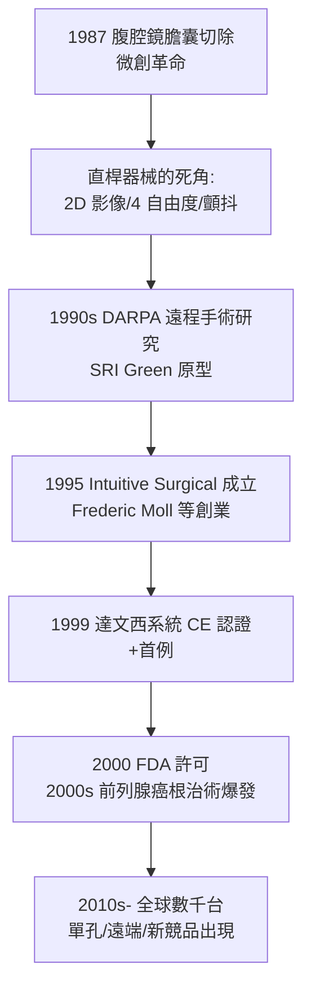

## 1999 - 達文西手術機器人（把外科醫生的手縮小十倍、送進體內）

## 案件摘要

**本案偵破的是外科的幾何極限：人類的手進不了 5 mm 的孔。**

1999 年，加州公司 Intuitive Surgical 的**達文西手術系統（da Vinci）**獲歐洲 CE 認證並完成首例臨床手術（1997 起 IRI SA 系統前身；1999 年後 Prostatectomy 與心臟瓣膜修補等案例累積）；2000 年 7 月獲美國 FDA 許可。系統由三部分組成：外科醫生操縱的主控台（立體 3D 目鏡＋手部感應）、床邊的四臂機器人、以及內視鏡影像系統——醫生的動作被等比縮小、濾除顫抖後，由腕狀關節（EndoWrist，7 自由度）在手術腔內重現。本案的真相是：達文西並非「AI 自動開刀」，而是**遙操作（teleoperation）＋放大鏡＋抖動濾波**的組合；它的破案關鍵是美國國防部的遠程戰地手術研究與 NASA 的遙操技術轉民用。

## 前因 -- 為什麼會有這個案子

- **腹腔鏡的痛苦成長**。1987 年首例腹腔鏡膽囊切除（Philippe Mouret，法國）引爆微創革命，但直桿器械的局限隨之曝露：二維平面影像、器械僅 4 自由度（喪失手腕的靈巧）、醫生反手操作、長時間疲勞與顫抖放大。
- **軍方的遠程手術夢**。1980s–90s 美國國防先進研究計畫署（DARPA）資助「戰地遠程手術」研究（SRI International 的 Green 等人）：士兵在戰場，外科醫生在後方——遙操作機器人因此獲得研發資金；1990s NASA 也投入遠程醫療。
- **跨界技術合流**。工業機械臂（精確伺服控制）、電視內視鏡的 3D 成像、觸覺／力回饋感測、個人電腦即時控制——四條線在 1990s 中期同時成熟，醫療機器人成為它們的交點。

## 線索與推理 -- 數學式、程式、理論

**線索一：遙操作的數學。** 主控台的手部運動 $ \mathbf{x}_m(t) $ 被縮放比例 $ s $ 後映射為器械尖端運動：

$$ \mathbf{x}_s(t) = s \cdot \mathbf{x}_m(t) + \mathbf{f}_{\text{filter}}(\mathbf{x}_m) $$

典型 $ s = 1/3 \sim 1/5 $：醫生移動 3 cm，器械尖端移動 1 cm——動作被「微雕化」；低通濾波器 $ \mathbf{f}_{\text{filter}} $ 消除 $ 6\text{–}10\,\mathrm{Hz} $ 的生理性手顫（藥師型 tremor），這在顯微手術中本是不可及的穩定度。

**線索二：7 自由度的意義。** 人類手腕有約 6–7 個自由度；直桿腹腔鏡器械只有 4 個（進退、旋轉、開合、軸向擺動）——在縫合打結時「手腕不存在」是最大的痛點。EndoWrist 腕狀末端在器械尖端再加 2–3 個自由度，使「體內縫合」恢復開刀般的靈活：

**線索三：臨床證據的拉鋸。** 達文西前列腺根治術（2000s 成為美國主流，取代開放與腹腔鏡）的優勢主要在出血量、住院天數與尿控恢復；但總體腫瘤學結果與傳統手術相當、費用顯著更高——本案提醒：**儀器的「技術優勢」不等於「臨床結果優勢」**，醫療器械的價值必須以隨機對照與成本效益判定，這一課至今仍在辯論。

## 結案 -- 後果與影響

- **微創外科的第二階段**。達文西使「體內精密縫合、深部淋巴清掃、心臟瓣膜微創修補」成為常規；全球已安裝逾萬台、每年逾 200 萬例手術。
- **醫工產業的典範**。Intuitive Surgical 由外科醫生（Frederic Moll）創業、以 DARPA 技術為底、以專利與耗材（EndoWrist 為一次性）建立商業模式——「儀器＋耗材」的商業設計成為醫療器械業的標準劇本。
- **遠程手術的未竟之案**。2001 年法國紐約跨大西洋遠程膽囊切除（Lindbergh 手術）證明技術可行，但延遲與規管使其止步示範；5G 時代正在重審此案。
- **一句話結案**：達文西把外科醫生的手送進了 8 mm 的套管——它沒有取代醫生，而是證明了「醫生的手」可以被複製、縮小與濾顫；本案尚未終審，AI 與自動化縫合正在排隊上庭。

## 關鍵人物與文獻

- **Frederic Moll（1950s–）**——外科醫生、Intuitive Surgical 共同創辦人；此前創辦腹腔鏡器械公司 Origin，本案的商業與臨床總策劃。
- **Philip Green**——SRI International 研究員；1980s–90s 的遙操作手術原型（Green Telepresence Surgery System）是達文西的直接技術祖先。
- **Rogers、Guthart 等 Intuitive 工程團隊**——EndoWrist、3D 立體內視鏡與主從控制的實際設計者。
- 原始文獻——Guthart & Salisbury, "The Intuitive telesurgery system," *ICRA*, 2000；Binder & Kramer, "Robotically-assisted laparoscopic radical prostatectomy," *BJU Int.*, 2001。
- 現代註腳——2018 年起單孔 SP 系統、軟體鏡機器人與中國、韓國新機型陸續進場；「誰先實現完全自主縫合」的競賽，已從工程問題變成監管與倫理問題。
