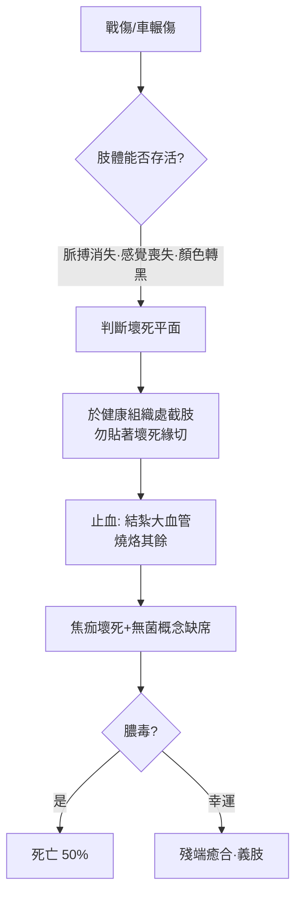

## 1363 - 肖利亞克《大外科》與中世紀截肢（在麻醉與無菌之前的黑暗手術）

## 案件摘要

**本案的手術室沒有麻醉、沒有無菌，只有一桶滾油和一塊燒紅的烙鐵。**

1363 年，教廷御醫 Guy de Chauliac（肖利亞克）在亞維儂寫成《大外科》（*Chirurgia Magna*），全書七卷、拉丁文+多語譯本風行三百年，是中世紀最具權威的外科教科書。其中截肢術的記載殘酷而精確：在健康組織處環形切皮、結紮或燒灼血管、以燒烙止血，並首次系統討論「截肢平面的選擇」——寧可高位犧牲，不可殘端壞死。這是骨科在「切除與重建」兩極中，第一次被迫面對終極問題：**什麼時候，保住命比保住肢體更重要？**

## 前因 -- 為什麼會有這個案子

- **百年戰爭與黑死病**：肖利亞克本人 1348 年染上鼠疫並倖存，留下史上最早的鼠疫臨床描述；戰場箭傷、馬蹄輾壓與戰後壞疽讓截肢從禁忌變為常規。
- **火藥時代的序章**：火器傷即將登場（14 世紀末），戰創的毀碎程度遠超刀劍，截肢需求即將爆炸。
- **外科的社會地位**：當時外科屬「手工藝」，被大學內科醫師視為賤業；肖利亞克以教廷醫師身分寫書，是外科知識被學院化、文本化的關鍵一步。
- **古典傳承的斷裂**：希臘羅馬的復位學（`-0400-希波克拉底復位術與牽引桌.md`）經阿拉伯（Avicenna、Abulcasis）輾轉留存，Abulcasis 的燒灼止血術是肖利亞克的直接來源。

## 線索與推理 -- 背後的理論

截肢的核心難題是**出血**。在無法結紮細小血管的時代，四種止血法並用：壓迫、結紮（粗血管）、燒烙（cautery）與腐蝕藥。肖利亞克繼承 Abulcasis 的實用分類：表層出血用藥蝕、深部用烙鐵。燒烙的生物學代價：

$$ \text{燒烙溫度} \; (100\text{–}1000^\circ C) \Rightarrow \text{組織蛋白凝固} + \text{焦痂屏障} \Rightarrow \text{止血}, \text{但} \; \text{三度燒傷} $$

焦痂止血有效，卻製造大片壞死組織——細菌溫床，膿毒與「醫院壞疽」的入口。這是手術死亡率高達 50% 的結構性原因；真正的解藥要等 Lister（`1867-Lister無菌術拯救開放性骨折.md`）。

肖利亞克的「平面推理」深具病理學洞見：壞死不是刀切到哪停到哪，而是**隨血管栓塞向近端蔓延**；因此截肢平面必須預估在可見壞死緣之上——這是「安全邊距」概念的濫觴，今日腫瘤切除與壞死清創仍在使用同一邏輯。

## 結案 -- 後果與影響

- **文本的統治**：《大外科》被抄成多種方言譯本，法國外科學派（其學生們）在長達兩世紀中「言必稱肖利亞克」——他在序言中還抄了希波克拉底的名言「沒有刀也沒有火能治我們治不了的病」，展現古典傳承意識。
- **義肢的萌芽**：截肢存活者增加，催生 15–16 世紀的鐵製義肢（如 Götz von Berlichingen 的機械鐵手）——重建外科的需求端被截肢創造出來。
- **向麻醉時代的痛苦鋪路**：中世紀截肢的恐怖記錄（有人統計行刑式手術須「一分鐘內完成」）成為 1846 年麻醉革命（`1846-麻醉降臨與骨科手術革命.md`）最強的道德動員令。
- **止血技術的接力**：燒灼 → Ambroise Paré 的結紮+蝦油敷料（1536 年戰場經驗，直接批判滾油）→ Halsted 血管鉗與止血法——止血技術的每一步都在削減截肢死亡率。

## 關鍵人物與文獻

- Guy de Chauliac（約 1300–1368）——亞維儂教廷御醫，先後侍奉 Avignon 教宗。
- Abulcasis（al-Zahrawi, 936–1013），《醫術》(al-Tasrif)——燒灼與器械圖譜的來源。
- Ambroise Paré（1510–1590）——文藝復興戰創外科革命者，廢滾油、復興結紮。
- *Chirurgia Magna*, 1363；現代英譯 Margaret S. Ogden, *The Cyrurgie of Guy de Chauliac*（1971）。
