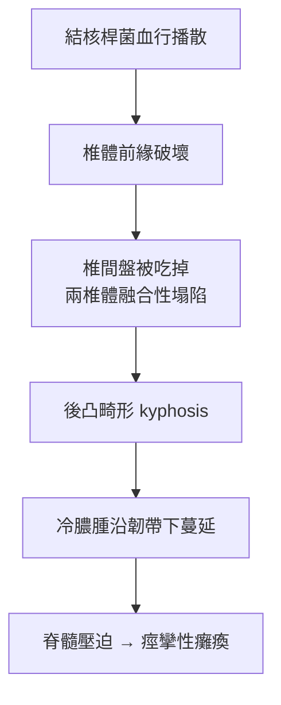

## 1768 - Pott 骨折與描述性骨科（從馬背上摔下來，替骨折分類奠基）

## 案件摘要

**本案的第一現場，是 1756 年倫敦牛津街的一匹受驚馬。**

Percivall Pott 從馬上摔落，遠端脛腓骨複雜骨折。他坐在冰冷石板上等來杠架送醫，並在康復期間寫下《Some Few General Remarks on Fractures and Dislocations》（1768）——書中以他之名傳世的「Pott 骨折」、以及對脊柱結核（Pott's disease）的經典描述，開啟了「描述性骨科」時代：**先精確描述骨折型態，才有精確的分類、預後與治療決策。**

## 前因 -- 為什麼會有這個案子

- **18 世紀倫敦的外傷生态**：馬車、馬匹與工坊讓複雜骨折常見，而治療仍是江湖混合體——開放性骨折幾乎等於死刑（要等 Lister，`1867-Lister無菌術拯救開放性骨折.md`）。
- **St Thomas 醫院的師承**：Pott 是該院外科醫師，其學生 John Hunter 繼續把外科推向生理學；Pott 以精細臨床觀察聞名。
- **文本權威已倒**：維薩留斯與 Hunter 學派讓「實證描述」成為可能；Pott 是最早把這方法用於骨折分類的人之一。
- **截肢的陰影**：當時複雜骨折常直接截肢；Pott 的志業正是證明「多數肢體可以保住」。

## 線索與推理 -- 背後的理論

Pott 骨折的推理樣板：他描述「脛骨遠端三分之一與腓骨同斷、足向背側移位」的特定型態，並與單純踝扭傷鑑別——關鍵不是疼痛程度，而是**畸形型態與骨擦音的觸診解讀**。這是「型態決定治療」思想的首例：不同型態需要不同復位向量與固定策略。（今日的 Lauge-Hansen / AO 分類仍是同一邏輯的精密化。）

他對脊柱結核的描述同樣經典：椎骨破壞 → 韌帶下蔓延 → 後凸畸形（駝背）→ 脊髓壓迫癱瘓。病理鏈：

力學上，Pott 還討論了「為何骨折常在固定後再移位」：肌肉的動態張力始終存在，靜態夾板無法對抗痙攣——這正是牽引術（`1907-Steinmann牽引術.md`）後來要解決的問題。

## 結案 -- 後果與影響

- **骨折命名學時代**：Colles（`1814-Colles骨折與描述骨折學.md`）、Bennett、Dupuytren、Monteggia……一個世紀的「以人名為骨折命名」浪潮由 Pott 掀起——每個名字都是一份臨床推理的壓縮檔。
- **脊柱結核的治療史**：從 Pott 的休息+制動，到 1895 年後抗結核藥物時代的手術清創，Pott's disease 至今仍是骨科感染章節的教科書案例。
- **「保守優先」的傳統**：Pott 主張多數骨折不必手術——這條保守路線與後來 AO 手術路線（`1958-AO學派與內固定原則.md`）的百年論戰，是骨科史的主旋律。
- **職業安全意識的萌芽**：他 1775 年發表關於掃煙囪童工陰囊癌的報告，是職業癌的開山之作——臨床觀察方法學的外溢。

## 關鍵人物與文獻

- Percivall Pott（1714–1788）——St Thomas 醫院外科醫師。
- *Some Few General Remarks on Fractures and Dislocations*, London, 1768。
- John Hunter（1728–1793）——其學生，英國外科生理學之父。
- F. G. N. Dicharry 對 Pott 骨折定義的史學釐清：Pott 描述的其實包含 Pott's 三角與雙踝骨折，現代「Pott 骨折」一詞多有混用——描述性骨科的命名，從一開始就不精確。
