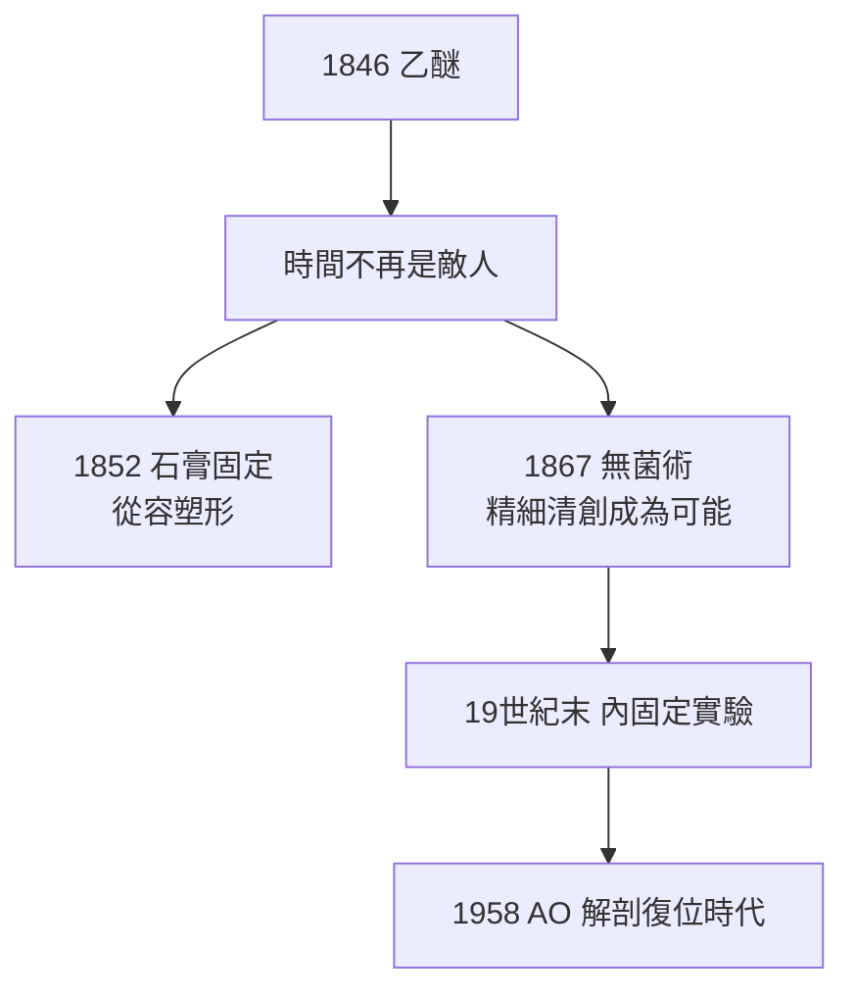

## 1846 - 麻醉降臨與骨科手術革命（從「一分鐘屠殺」到從容的工藝）

## 案件摘要

**本案的案發現場，是 1846 年 10 月 16 日波士頓麻省總醫院的乙醚圓頂教室。**

William T. G. Morton 讓牙科病人 Elliot Frost 吸入乙醚後，外科主任 John Collins Warren 切除其頸部腫瘤，病人全程無痛。Warren 說出那句傳世的話：「Gentlemen, this is no humbug.」四天後骨科第一次受惠：George Hayward 以乙醚麻醉完成截肢。此前的截肢是「按住病人、一分鐘內鋸完」的競速賽；此後，骨科醫生第一次有時間**思考**——復位可以慢慢對位、血管可以仔細結紮、創傷解剖可以精細辨認。麻醉不會讓手術更安全，但它讓「安全手術」成為可被設計的目標。

## 前因 -- 為什麼會有這個案子

- **手術的物理上限**：疼痛使病人掙扎、休克與虛脫；外科醫生被逼成「快槍手」——倫敦 Robert Liston 以 28 秒截肢聞名（傳聞因太快而鋸掉助手手指、病人與助手皆死，此為後世訛傳，但反映其速度崇拜）。
- **疼痛的道德困境**：外科界普遍認為疼痛是「手術必須之惡」，甚至有「疼痛有益恢復」的辯護；宗教界反對麻醉的理由（尤其產科）持續數十年。
- **前驅物**：笑氣（Davy, 1800）、乙醚「興奮劑派對」（ether frolics）、Crawford Long 1842 年私下使用但未發表——社會已在使用，只是醫學未承認。
- **骨科的瓶頸尤其尖銳**：骨折復位與大關節手術需要病人放鬆、靜止——正是無麻醉時代最不可能的條件。

## 線索與推理 -- 背後的理論

乙醚的藥理：脂溶性分子改變神經膜離子通道，抑制皮質與丘腦的傳導——「意識與痛覺可被化學關閉」在 1846 年是不可思議的宣告。而對骨科而言，麻醉帶來的是**肌鬆**（早期乙醚的順行性遺忘+一定程度的肌肉放鬆）：痙攣的肌肉鬆弛後，希波克拉底式牽引復位（`-0400-希波克拉底復位術與牽引桌.md`）終於可以溫柔進行。

$$ \text{手術可行性} \propto \frac{\text{可用操作時間}}{\text{病人掙扎度}} \xrightarrow{\text{麻醉}} \infty $$

麻醉的隱藏代價也要偵查：早期氯仿與乙醚的死亡報告（1850 年代起）、John Snow 的劑量學改良（吸入麻醉定量）、以及「麻醉讓外科變大膽→手術範圍暴增→感染死亡率反升」的弔詭——這個弔詭正是 Lister 無菌術登場（`1867-Lister無菌術拯救開放性骨折.md`）的直接推手：**麻醉解決疼痛，卻放大了感染問題**。

## 結案 -- 後果與影響

- **骨科手術譜系爆炸**：從截肢擴展到畸形矯正、截骨術（osteotomy，如 19 世紀後半的膝外翻矯正）、腫瘤切除與植骨——「保肢外科」成為可能。
- **截肢率斷崖式下降**：壞疽肢體不再是唯一選項；複雜骨折的保肢率隨麻醉+無菌+石膏三連擊而翻轉。
- **戰場醫學的改寫**：美國內戰（1861–65）已普遍使用氯仿麻醉——南北戰爭成為麻醉時代第一場大規模外傷試驗場，截肢死亡率從拿破崙戰爭的 ~40% 降至約 26%。
- **醫學倫理新議題**：知情同意、麻醉意外責任、以及「手術適應證應由疾病決定而非由技術可能性決定」的現代命題。

## 關鍵人物與文獻

- William T. G. Morton（1819–1868）——牙醫，乙醚公開演示者；死後墓碑刻著「在他之前，外科是痛苦；在他之後，疼痛被征服」。
- John Collins Warren（1778–1856）——MGH 外科主任。
- Crawford Long（1815–1878）——1842 年最早使用乙醚手術但遲至 1849 年才發表。
- John Snow（1813–1858）——麻醉科學化之父（也是流行病學英雄）。
- Richard J. Wolfe, *Tarnished Idol: William Thomas Green Morton and the Introduction of Surgical Anesthesia*（2001）。
