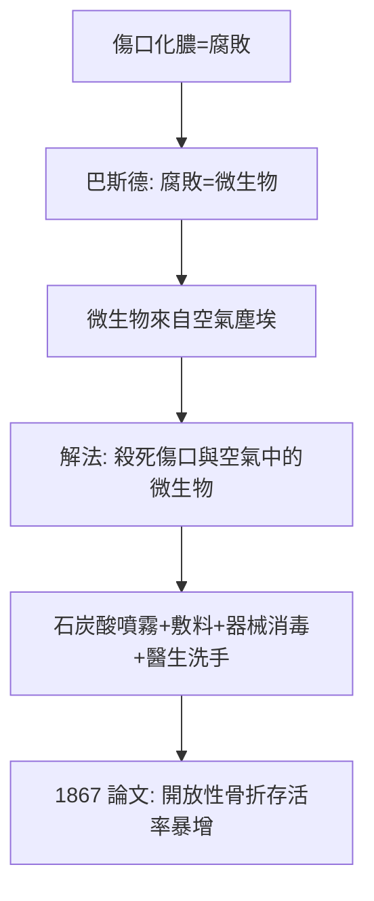

## 1867 - Lister 無菌術拯救開放性骨折（從「要麼癒合要麼截肢」到「要麼治癒」）

## 案件摘要

**本案的證物，是一張格拉斯哥的污水處理報告——和一瓶石炭酸。**

1865 年，格拉斯哥外科教授 Joseph Lister 讀到巴斯德的腐敗實驗：腐敗不是「氧的化學作用」，而是微生物作祟。他隨即推理：傷口化膿（「laudable pus」）不是必然，而是細菌污染——殺死它們，開放性骨折就能免於截肢。1865 年 8 月他用石炭酸處理一名開放性脛骨骨折少年（James Greenlees），傷口一期癒合；1867 年發表《On the Antiseptic Principle in the Practice of Surgery》，宣告「醫院壞疽、丹毒、敗血病——可以被消滅」。**這是骨科從「截肢科」走向「重建科」的分水嶺。**

## 前因 -- 為什麼會有這個案子

- **開放性骨折的死刑判決**：19 世紀中葉，開放性骨折的死因是膿毒而非創傷本身；「醫院病」（hospital gangrene）讓大城市醫院死亡率高達 45%，外出接生與在戶外截肢反而較安全——當時的「房間空氣污濁說」（miasma）解釋不了為何清洗有用。
- **巴斯德的挑戰**：1861–64 年巴斯德以鵝頸瓶證明微生物來自空氣中的塵埃，並提出加熱、過濾殺滅法——Lister 直接引用。
- **石炭酸的來源**：從煤焦油提取的石炭酸（phenol）已被用於卡萊爾的污水除臭，Lister 知道它對牛隻寄生蟲有效。
- **李斯特的個人動機**：恩師 Syme 的愛丁堡傳統要求「外科醫生親手負責每一個傷口」；Lister 對「明明縫合了卻化膿」的不甘，是這樁懸案的原始衝動。

## 線索與推理 -- 背後的理論

Lister 的推理鏈完整得像偵探小說：



其劑量學的殘酷與偉大：石炭酸原液腐蝕皮膚，他用 1:20–1:40 稀釋液浸敷料、5% 噴霧灑空氣（後被證明非必要）、器械與縫線浸石炭酸。生物學原理今日一目了然：phenol 變性細菌膜蛋白與酶，濃度×時間決定殺菌效果。

$$ \text{殺菌效果} = C_{\text{phenol}} \times t_{\text{接觸}} \quad (\text{CT value 概念的 19 世紀雛形}) $$

對骨科的特殊意義：**開放性骨折 = 骨頭與外界相通 = 細菌直接污染松質骨與髓腔**。無菌術之前，唯一「治療」是早期截肢；無菌術之後，清創＋復位＋固定成為標準——這正是日後所有內固定（`1902-Lambotte外固定器.md`、`1958-AO學派與內固定原則.md`）的邏輯前提：**沒有無菌，任何金屬植入物都是殺人凶器。**

```python
# 開放性骨折的感染風險模型（Gustilo 分類的史前邏輯）
def infection_risk(wound_size_cm, contamination, soft_tissue):
    base = 0.02 + 0.01*wound_size_cm + 0.3*contamination + 0.25*soft_tissue
    return min(base, 0.95)   # 無菌術前: 接近 1 → 截肢

# Lister 之後: 清創+抗生素+穩定固定 → 三型骨折存活率 > 95%
```

## 結案 -- 後果與影響

- **截肢率的斷崖**：Lister 病房的開放性骨折死亡率從 ~45% 降至 <10%；截肢從「常規選項」降級為「最後手段」。
- **手術範圍的解放**：麻醉（`1846-麻醉降臨與骨科手術革命.md`）解決疼痛、無菌解決感染，骨科手術從此只受想像力限制——19 世紀末截骨術、植骨術、早期內固定全面實驗。
- **觀念的長征**：Lister 的「抗敗性」（antiseptic，殺已入之菌）經德國的 Karl Thiersch、Ernst Bergmann 演化為「無菌術」（aseptic，阻止菌進入：蒸汽滅菌、手套、手術衣）——1890 年 Halsted 引入橡膠手套。
- **格拉斯哥的教訓**：Lister 反覆強調醫院建築與通風也重要——現代「醫院感染控制」的遠祖；他的石炭酸噴霧最終被拋棄，但「以理論指導實踐、以數據檢驗理論」的方法永存。

## 關鍵人物與文獻

- Joseph Lister（1827–1912）——格拉斯哥、愛丁堡、倫敦 King's College 外科教授；菌名 *Listeria* 以他命名。
- Louis Pasteur（1822–1895）——理論供應者。
- James Greenlees——第一位被石炭酸治癒的病人，11 歲，脛骨開放骨折，1865 年 8 月 12 日。
- *On the Antiseptic Principle in the Practice of Surgery*, BMJ, 1867。
- Lindsay Granshaw 與 Christopher Lawrence 的 Lister 研究史學。
