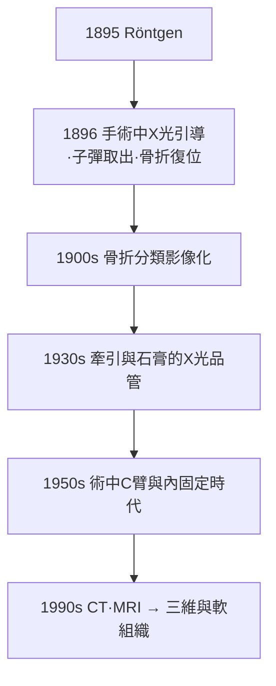

## 1895 - 侖琴發現 X 光（骨科診斷：從猜測到看見）

## 案件摘要

**本案的第一張照片，拍的是一隻戴戒指的手——骨骼與婚戒同框，外科從此換了一雙眼睛。**

1895 年 11 月 8 日晚，符茲堡大學物理學教授 Wilhelm Conrad Röntgen 在暗室中研究陰極射線，發現塗有鉑氰化鋇的紙屏在 2 米外發光——某種未知射線穿透了紙、木、甚至金屬。他把手放在射線與螢光屏之間，看見自己的指骨。12 月 22 日拍下妻子 Anna Bertha 的手，婚戒清晰可見。1896 年 1 月論文《On a New Kind of Rays》出版後，全球震動：**骨折診斷從觸診推測變成直接成像**——骨科史上最大的一次診斷革命，只用了一個冬天就完成全球部署。

## 前因 -- 為什麼會有這個案子

- **1870–90 年代的物理學準備**：真空泵改良、陰極射線管（Crookes 管）普及、感光乳劑進步——X 光是「踩在物理基礎設施上」的發現。
- **診斷的百年困境**：Colles（`1814-Colles骨折與描述骨折學.md`）的觸診再精湛，也看不見：骨痂是否形成？鋼針是否到位？髖部骨折有無移位？——粉碎性骨折與深部脫位的分類長期是「猜謎」。
- **戰傷的催化**：1896 年起軍方立即採用（意阿戰爭 1896 年首次戰地 X 光）；子彈定位是第一殺手級應用。
- **倫理的紅利與陰影**：早期無防護，X 光技師手指潰爛截肢——放射防護的誕生與物理學、醫學同步。

## 線索與推理 -- 背後的理論

X 光成像的物理：高速電子撞擊鎢靶 → 韌致輻射連續譜+特性輻射；骨（含鈣，高原子序數）吸收係數遠高於軟組織——這個**衰减差異**就是對比度：

$$ I = I_0 \, e^{-\mu x} \quad (\mu_{\text{骨}} \gg \mu_{\text{軟組織}}) $$

```python
# 骨與軟組織在 X 光下的衰減差
import math
def transmitted(mu, x):
    return math.exp(-mu * x)

soft = transmitted(mu=0.2, x=5)   # 軟組織 5 cm
bone = transmitted(mu=1.5, x=3)   # 骨 3 cm
print(f"軟組織穿透率 {soft:.2f}, 骨穿透率 {bone:.2f}")
# → 片子上骨是白影、軟組織近乎透明 → 骨折線一目了然
```

對骨科的診斷學意義（當年的「推理範式革命」）：
1. **骨折的客觀化**：移位、成角、粉碎程度可被測量與記錄——分類學（AO 等）獲得數據基礎。
2. **癒合的可監測性**：骨痂、遲延癒合、不連接（nonunion）從臨床猜測變成影像判讀。
3. **復位的品管**：石膏（`1852-馬他森石膏繃帶.md`）與內固定（`1958-AO學派與內固定原則.md`）的結果可以立即核驗——閉環控制誕生。
4. **隱藏骨折的偵破**：髖部隱匿骨折、骨腫瘤、骨髓炎、Pott 病的椎體塌陷（`1768-Pott骨折與描述性骨科.md`）從此現形。



## 結案 -- 後果與影響

- **1901 年第一屆諾貝爾物理學獎**頒給 Röntgen；他拒絕專利，堅持 X 光屬於人類。
- **「Röntgen 狂熱」**：1896 年起全球糖心 X 光鞋店（兒童試鞋輻照）、X 光瘦身儀等濫用氾濫，催生 1920–30 年代的輻射防護立法——科技濫用的教科書案例。
- **骨科專業的成人禮**：診斷客觀化使骨折治療結果可比較、可統計——20 世紀骨科成為「用數據說話」的外科分支。
- **影像族譜**：1972 年 CT（Hounsfield）、1977 年 MRI、1980 年代術中 C 臂與導航——X 光開啟的「看見之門」，最終讓骨科進入三維規劃與機器人時代。

## 關鍵人物與文獻

- Wilhelm Conrad Röntgen（1845–1923）——第一屆諾貝爾物理學獎（1901）；units「倫琴」以他命名。
- Anna Bertha Röntgen——史上第一位 X 光受檢者，「我看見了自己的骨頭」。
- Eduard Haschek 與 C. T. Lindenthal——1896 年第一張手部 X 光斷層式影像。
- *On a New Kind of Rays*, Sitzungsberichte der Würzburger Phys.-Med. Gesellschaft, 1895。
- Bettyann Kevles, *Naked to the Bone*（1997）——醫學影像的社會史。
