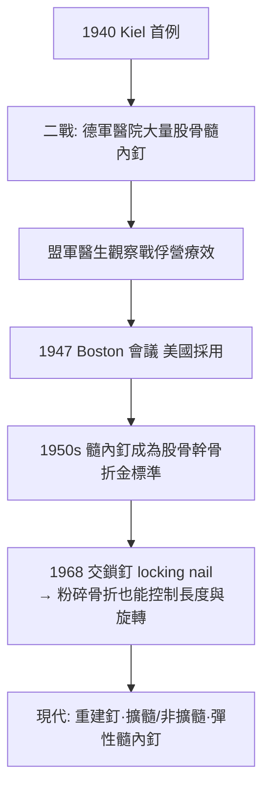

## 1940 - Kuntscher 髓內釘（從傷兵的股骨裡，鑽出骨科革命）

## 案件摘要

**本案的手術檯，設在德國空軍醫院的石板病房；兇器，是一根不鏽鋼 V 型釘。**

1940 年，德國外科醫師 Gerhard Küntscher 在 Kiel 發表閉合式髓內釘：不切開骨折處，從股骨大轉子頂鑽開髓腔，逆行打釘、順行穿過骨折線，讓長針在骨髓腔內**內在夾板**（internal splint）般撐住整段骨幹。病人術後幾天就能起身，數週後帶著穩定的腿走路——在石膏與臥床牽引（`1907-Steinmann牽引術.md`）統治的時代，這是奇蹟。二戰中德軍傷兵大量受惠，戰後盟軍醫生從戰俘營與德國醫院「帶回」這項技術——**現代骨折手術的主流技術，是從戰火裡走私出來的。**

## 前因 -- 為什麼會有這個案子

- **髓腔作為天然通道的百年夢想**：1916–18 年英國 Hey Groves 已用象牙棒固定股骨；1931 年 Smith-Petersen 用三翼釘固定股骨頸——「從骨內部固定」的想法早已在空氣中。
- **保守療法的代價**：股骨骨折牽引臥床 2–3 個月，併發症（肺炎、血栓、僵硬、短縮）在戰時尤不可承受——德國需要「快收快走」的傷兵。
- **Küntscher 的工程直覺**：他提出三大洞察——①髓腔管徑固定，是天然的對位模具；②釘的彈性與骨的咬合可自我穩定；③閉合穿針不暴露骨折端，保留骨膜血供。
- **不鏽鋼的成熟**：耐腐蝕鋼材與精密拉拔工藝（醫療級 316L 前身）使長釘得以量產。

## 線索與推理 -- 背後的理論

髓內釘的力學本質：**中心負載（load-sharing）**。鋼板是偏心固定，負荷經板傳遞；髓內釘位於骨的中軸，彎矩臂極短：

$$ M = F \times d_{\text{至中性軸}} \quad \text{鋼板: } d \approx r + t \; ; \quad \text{髓內釘: } d \approx 0 \Rightarrow M_{\text{釘}} \ll M_{\text{板}} $$

中心放置使釘承受的彎矩遠小於鋼板，故可用細長植入物承受大負荷，且與骨**分享**負荷（load sharing）而非全部遮蔽——應力遮蔽（stress shielding）遠輕於鋼板，正好順應 Wolff 定律（`1892-Wolff定律.md`）。

```python
# 中心 vs 偏心固定的彎矩比較
def bending_moment(force, offset):
    return force * offset

plate = bending_moment(500, 0.03)   # 鋼板在骨表面
nail  = bending_moment(500, 0.005)  # 髓內釘近中軸
print(f"鋼板彎矩 {plate:.1f} vs 髓內釘彎矩 {nail:.1f} N·m")
# → 6 倍差距，解釋了髓內釘的力學優勢
```

閉合穿針的生物學推理同樣深刻：不切開骨折端→骨膜與周圍軟組織血供保全→**二期骨痂癒合**照常進行。這個「生物學固定」（biological fixation）概念，日後成為 AO 學派自我修正的鑰匙（`1958-AO學派與內固定原則.md`）、橋接鋼板與 MIPO 微創技術的哲學母題。



## 結案 -- 後果與影響

- **住院時間斷崖**：股骨骨折從「臥床 10 週」變成「術後 1 週持拐行走」——20 世紀骨折治療最大的效率革命。
- **擴髓的世紀辯論**：擴髓（reaming）增大釘-骨接觸與可置入粗釘，但破壞髓內血供與脂肪栓塞風險——RECON、SIC 等試驗纏鬥數十年，成為骨科循證經典戰場。
- **交鎖釘的補完**：1968 年 Klemm–Schellmann 交鎖螺釘補上「長度與旋轉控制」，粉碎骨折不再禁忌——髓內釘統治骨幹骨折至今。
- **戰爭與醫學的灰色傳播**：Küntscher 因納粹軍醫身分戰後被抑制授獎，技術本身卻靠敵我醫生的職業交流擴散——醫學史最典型的「技術比人先越獄」。

## 關鍵人物與文獻

- Gerhard Küntscher（1900–1972）——Kiel、Flensburg 外科教授；*Praxis der Marknagelung*（1950）為奠基教科書。
- Richard Maatz、Lorenz Böhler——德奧髓內釘推廣系統。
- Ernest Hey Groves（1872–1944）——髓內固定的英國先驅。
- Mariano Rocca 等的交鎖釘演化史；Gustav Klemm 與 Hans Schellmann（1968–70）。
- W. D. Fischer 對「戰後髓內釘西傳」路徑的史學重建。
