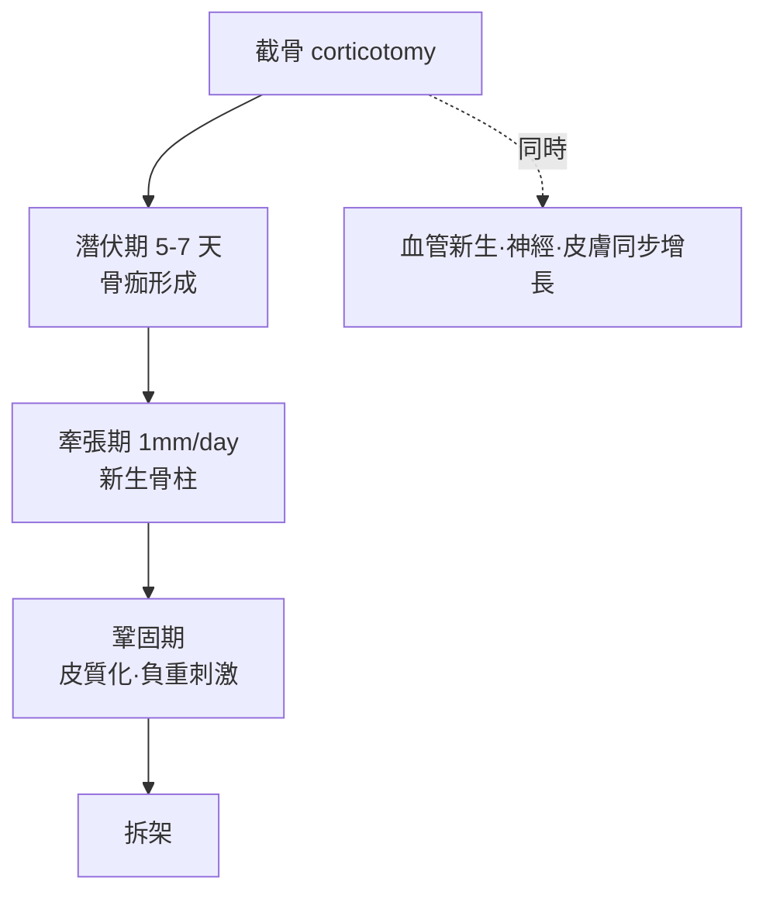

## 1951 - Ilizarov 牽張成骨（讓骨頭自己長出 17 公分）

## 案件摘要

**本案的案發地，是西伯利亞庫爾干的一間小醫院；兇器，是自行車輪圈改造成的鋼環。**

1951 年，西伯利亞骨科醫師 Gavriil Abramovich Ilizarov 用交叉克氏針（直徑 1.5 mm）張緊於金屬環上、環與環之間以螺桿連接，發明了環式外固定器。當他發現病人以這裝置**緩慢牽張**（每天 1 mm）斷骨時，骨頭竟沿牽張方向新生——「牽張成骨」（distraction osteogenesis）就此誕生。在 X 光都匱乏的西伯利亞，他治好了戰後滿地的骨不連、慢性骨髓炎與侏儒症患者，讓缺 17 公分的腿長回原長。這項技術 1980 年代才被西方「重新發現」，並被稱為「骨科的文藝復興」。

## 前因 -- 為什麼會有這個案子

- **戰後蘇聯的外傷荒漠**：二戰遺留大量骨不連、畸形癒合與慢性骨髓炎患者；大城市之外，傳統骨移植與石膏幾乎無能為力。
- **西伯利亞的資源限制**：庫爾干沒有先進器械與影像設備——Ilizarov 只能用最簡材料（自行車鋼圈、克氏針、螺桿）設計，反而催生「極簡而力學嚴謹」的構造。
- **張力–應力假說的孕育**：他觀察到環式固定下緩慢牽張時，新骨、血管、神經、皮膚皆同步增生——「組織在張力-應力下生成」的生物學假說成形。
- **時間線上的巧合**：1951 年首例後，他花了近 20 年在鐵幕內系統化；1968 年蘇聯衛生部才認可庫爾干 KNIIELOT 研究所。

## 線索與推理 -- 背後的理論

牽張成骨的階段論與力學處方：

$$ \text{牽張速率} \; 1\, \text{mm/day（分 4 次牽張）} \Rightarrow \text{纖維骨痂} \xrightarrow{\text{牽張}} \text{柱狀新骨沿牽張軸排列} \xrightarrow{\text{鞏固期}} \text{皮質化} $$

「每日 1 mm」是黄金劑量：太快→纖維性不連接；太慢→提早固化斷裂。分次牽張（每 6 小時 0.25 mm）則模擬生理生長節律——**劑量學成為生物學工程的教科書**。

```python
# 牽張成骨劑量控制
def distraction(daily_mm, total_gap_mm, fractions_per_day=4):
    if daily_mm != 1.0:
        return "偏離黃金劑量：>1.5 纖維不連接，<0.5 提前固化"
    days = total_gap_mm / daily_mm
    return f"牽張期 {days:.0f} 天 + 鞏固期約 {total_gap_mm*2:.0f} 天/公分"
```

環式構造的力學奧秘：**張緊的細針**（預張力 >1000 N）以極小直徑提供高剛度，多平面多環組成「幾何可調桁架」，容許軸向微動（刺激骨痂，Wolff 定律，`1892-Wolff定律.md`）同時阻擋剪切。Ilizarov 的三效合一：**穩定固定 + 微動刺激 + 血供保全**（細針不破壞髓內循環、不需暴露骨折端）。



## 結案 -- 後果與影響

- **1980 年西方的震撼**：義大利 Camera 山區病例（Armeli）與 1987 年會議讓西方骨科界「重新發現」；與會者形容為「來自另一星球的骨科」。AO 學派被迫承認：剛性不是唯一的穩定。
- **應用爆炸**：畸形矯正（脛骨內翻、馬蹄足）、骨缺損重建（車禍、腫瘤切除後）、肢體延長（侏儒症、外傷短縮）、慢性骨髓炎的「骨段搬移」（bone transport）——把「截掉感染的骨頭再自己長回來」變成標準手術。
- **顱顏領域的移植**：1990 年代起顎骨牽張（McCarthy, 1992）成為顱顏外科常規——骨科技術跨科繁殖。
- **蘇聯與西方的知識鴻溝**：Ilizarov 因語言與鐵幕，遲至 1980 年代末才獲國際聲譽（1987 年起國外講學）；庫爾干研究所成為「全球骨科朝聖地」——知識傳播的地理學教訓。

## 關鍵人物與文獻

- Gavriil Ilizarov（1921–1992）——庫爾干實驗矯形與修復外科研究所創所所長；蘇聯院士，1992 年過世時技術已全球化。
- Valery Shevtsov、Vladimir Shevtsov 等門徒與 KNIIELOT 學派。
- Carlo Mauri——義大利登山家，1980 年赴庫爾干治癒脛骨假關節，成為西方的活體見證。
- *Transosseous Osteosynthesis*（Springer, 1992）——Ilizarov 的英文總結。
- A. R. Green 的牽張成骨生物學綜述（1994）與 Paley 的畸形矯正數學化（CORRECT 規則）。
