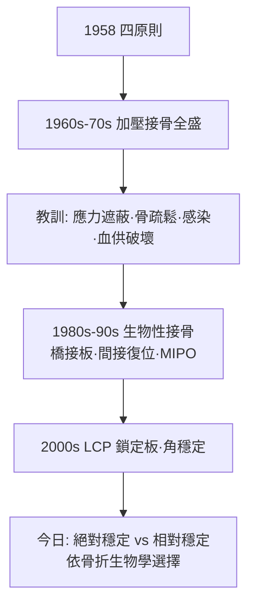

## 1958 - AO 學派與內固定原則（一群瑞士外科醫生，把骨折手術變成一門工程科學）

## 案件摘要

**本案的兇器，是一箱標準化器械，和一份寫在 1958 年的「四原則」。**

1958 年，13 位瑞士外科醫師（以 Maurice E. Müller 為核心）在達沃斯成立 Arbeitsgemeinschaft für Osteosynthesefragen（AO，骨接合研究學會），隨即發表骨折治療四原則：①解剖復位；②堅強內固定（以加壓為核心）；③無創操作保護軟組織；④早期無痛活動與功能訓練。配合自建的標準器械廠（AO/ASIF Instrumentarium）與長期文獻管理中心（今 AO Foundation 的 Dokumentationszentrum），AO 把骨折治療從「各家土法」變成**可教、可量、可傳播的工程學**。今日全球多數骨折手術的語彙——加壓鋼板、張力帶、拉力螺釘、LCP 鎖定板——都誕生於這個學派。

## 前因 -- 為什麼會有這個案子

- **保守療法的臨床天花板**：牽引與石膏（`1907-Steinmann牽引術.md`、`1852-馬他森石膏繃帶.md`）癒合率可觀，但「關節僵硬、短縮、臥床併發症」在工業化與保險制度下越來越不可接受——工人要回崗位，病人要下床。
- **Küntscher 的刺激**：髓內釘（`1940-Kuntscher骨髓內釘.md`）證明「手術+早期活動」可行，但對關節內與粉碎骨折仍有空缺。
- **瑞士的獨特條件**：小國多語、外科傳統深厚（Robert Danis 的比利時加壓接骨學是思想源頭）、達沃斯的山地醫院聚集了一群熱血年輕外科醫師。
- **材料工藝的成熟**：冷作不鏽鋼、精密螺紋加工、以及戰後瑞士精密機械業——器械標準化的產業基礎。

## 線索與推理 -- 背後的理論

AO 的核心發明是「加壓」（compression）：以拉力螺釘與動力加壓板（DCP）把骨折端壓緊，使斷端間隙趨近零——因此**一期骨癒合**（primary/direct healing）：不需要骨痂，骨細胞直接跨越緊貼的斷端（contact healing）或小縫隙（gap healing）重建哈弗系統。

$$ \text{斷端間隙} \to 0 \; ; \; \text{骨折端應變} \; \varepsilon = \frac{\Delta L}{L} \to 0 \Rightarrow \text{一期骨癒合（無骨痂）} $$

（Perren 的應變理論：組織只能在低於其耐受應變的環境中分化——這是「剛性固定讓骨直接癒合」的微觀力學解釋。）

```python
# AO 四原則的決策樹
def ao_decision(fracture):
    if fracture.intraarticular:
        return "解剖復位 + 絕對穩定（拉力螺釘+加壓板）"
    elif fracture.diaphyseal_simple:
        return "髓內釘或加壓板，早期活動"
    else:  # 粉碎性
        return "橋接固定（相對穩定，保血供）→ 二期骨痂癒合"
```

學派的自我革命同樣精彩：1970–80 年代，大量鋼板下骨疏鬆病例被確認——**應力遮蔽**（stress shielding，鋼板分走應力→骨廢用性吸收，Wolff 定律反噬，`1892-Wolff定律.md`）與**血供破壞**（廣泛暴露骨膜）成為 AE 的兩大教訓。AO 於是演化出「生物性接骨」（biological osteosynthesis）：橋接鋼板、間接復位（以牽張器復位而不碰骨折端）、PCP/LCP 鎖定板（螺釘鎖進板，板骨間不需加壓接觸，保護骨膜血供）——「從堅強到生物」的範式轉移，就寫在 AO 自己的教科書修訂史裡。



## 結案 -- 後果與影響

- **骨折治療的全球化標準**：AO 分類（Müller, 1987/1990）成為國際通用語言；達沃斯課程每年培訓數千外科醫師；AO Foundation 今日已是全球最大骨科學術與教育組織之一。
- **循證的誕生**：AO 文獻中心（DOC）建立長期隨訪資料庫——「每個植入物的失敗都成為下一代的設計參數」，這種迭代文化是骨科工程學的引擎。
- **辯論的遺產**：與 Ilizarov（`1951-Ilizarov牽張成骨.md`）的「剛性 vs 彈性」、與保守派的「手術 vs 保守」，最終都收斂為「依骨折生物學與病人需求個體化選擇」——現代骨科的折衷主義。
- **商業與倫理的陰影**：AO 與 Mathys、Straumann 等瑞士廠商的深度綁定，開啟「學會+廠商」利益糾葛的百年議題；器械專利與培訓費用的透明化至今仍是骨科倫理的常設議題。

## 關鍵人物與文檔

- Maurice E. Müller（1918–2009）——靈魂人物，後以財富成立 Maurice E. Müller 基金會推動骨科教育。
- Robert Schneider、Martin Allgöwer、Hans Willenegger——四原則的共同作者與早期推手。
- Robert Danis（1880–1962）——比利時「加壓接骨術」（coapteur）思想源頭。
- Stephan Perren——達沃斯 AO 研究所（AOI）所長，應變理論與 LCP 的科學推手。
- *Technique of Internal Fixation of Fractures*（1963）及歷版 AO 教科書；*AO Manual of Fracture Management* 系列至今持續修訂。
