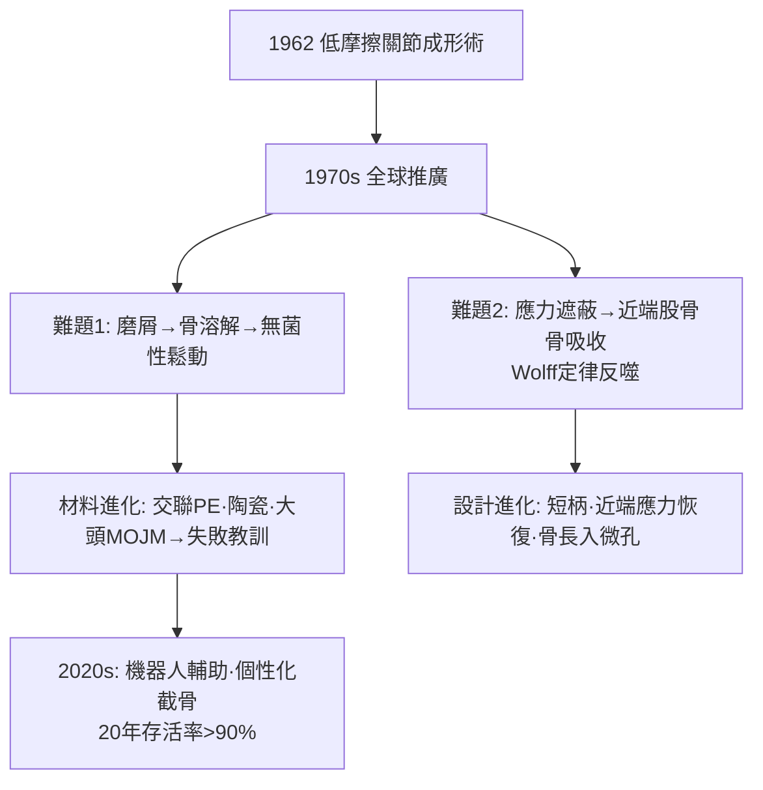

## 1962 - Charnley 人工髖關節（用摩擦力學，換掉疼痛的關節）

## 案件摘要

**本案的兇器，是一枚直徑 22 mm 的不鏽鋼球頭、一杯聚四氟乙烯（後改超高分子聚乙烯 UHMWPE）的臼杯，和一罐自凝式壓克力骨水泥。**

1962 年，英國 Wrightington 醫院的 John Charnley 把低摩擦的人工髖關節投入常規使用：小直徑金屬頭+聚合物臼杯、PMMA 骨水泥固定、層流手術室+防護隔離衣。他算清了摩擦扭矩與磨損的物理帳，放棄「大頭仿生」的直覺，選擇「小頭低磨損」的反直覺工程。此後每年全球逾百萬人工關節置換，讓關節炎患者從輪椅回到高爾夫球場——**骨科史上影響人類生活品質最深遠的發明。**

## 前因 -- 為什麼會有這個案子

- **既往假體的連環失敗**：1940 年代起 Wiles、McKee 等金屬對金屬大頭假體，因摩擦扭矩過大、磨屑致鬆動與異物反應，多數慘敗；切骨矯形與關節固定術只能止痛不能重建功能。
- **Charnley 的滑膜切除與壓縮固定術經驗**：他在 Wrightington 專攻髖關節，深知「疼痛的來源是軟骨下骨與滑膜，而非關節本身」——假體只需解決「無痛活動面」。
- **材料的意外線索**：他從一位鐘錶匠口中得知 PTFE 的低摩擦係數；從牙科 PMMA 自凝骨水泥（ dentist acrylic）聯想到固定問題。
- **感染的教訓**：早期假體感染率高，他親手設計層流通風手術室（與 Howorth 合作）與全身隔離手術衣——把 Lister 原則（`1867-Lister無菌術拯救開放性骨折.md`）推進到空氣動力學時代。

## 線索與推理 -- 背後的理論

Charnley 的第一性原理是**摩擦扭矩**：

$$ T = \mu \times F \times r \quad \Rightarrow \quad \text{球頭半徑 } r \text{ 減半} \Rightarrow \text{扭矩減半} $$

大頭（32–42 mm）雖仿生，卻使扭矩與磨損體積（Archard 定律：磨損體積 $ \propto $ 滑動距離×負荷，與半徑無關但扭矩與線速度 $ \propto r $ ）暴增；他選 22 mm 小頭——「小而穩、低摩擦」戰勝「大而仿生」。

```python
# Charnley 的摩擦扭矩決策
def torque(mu, load, r):
    return mu * load * r

print("32mm 頭:", torque(0.05, 2500, 0.016))  # 大頭: 2.0 N·m
print("22mm 頭:", torque(0.05, 2500, 0.011))  # 小頭: 1.4 N·m
```

骨水泥固定的力學：PMMA 是非骨水泥型「灌漿」——把假體與骨小樑交鎖，靠**大接觸面積分散應力**；缺點是聚合熱、殘留單體與**骨水泥病**（界線層骨吸收）。而 UHMWPE 臼杯的磨屑（亞微米顆粒）引發巨噬細胞介導的骨溶解——「磨屑病」成為此後半世紀假體界面的核心難題（→ 陶瓷對陶瓷、交聯聚乙烯、金屬對金屬的百年材料競賽）。



## 結案 -- 後果與影響

- **生活方式的革命**：髖膝關節炎從「終極殘疾」變成「可置換的零件問題」；全球每年逾 300 萬人工關節置換，10–20 年存活率普遍 >90%。
- **生物材料力學成為學科**：磨損學（tribology）、骨水泥流變學、介面骨長入（osseointegration）——骨科工程學的第三支柱（與 Wolff 定律、無菌並列）。
- **Charnley 的科學方法**：他是史上少數同時完成「理論計算→材料試驗→器械設計→手術技術→長期文獻追蹤」全鏈條的外科學家；Wrightington 成為全球朝聖地。
- **翻修手術的誕生**：假體會失敗——「翻修外科」（revision surgery）與登錄制度（national joint registries，瑞典 1979 年首創）成為新的監管與學術支柱。

## 關鍵人物與文獻

- Sir John Charnley（1911–1982）——Wrightington 醫院；1975 年拉斯克獎。
- Harry Craven——其 1958–61 年的技師搭檔，製作首代 PTFE 假體。
- Gordon Howorth——層流手術室工程合作者。
- Charnley, J., *Acrylic Cement in Orthopaedic Surgery*（1970）；*Low Friction Arthroplasty of the Hip*（1979）。
- Ling, R. S. M. 與 Exeter 學派——骨水泥技術的持續改良；Malchau & Herberts 的瑞典關節登錄研究。
