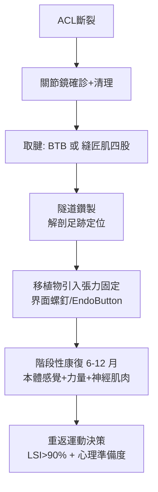

## 1982 - 關節鏡輔助 ACL 重建（十字韌帶斷裂：從運動生涯終結到數月復出）

## 案件摘要

**本案的案發現場，是籃球場與足球場：球員急停、膝內翻外旋，「啪」一聲——前十字韌帶（ACL）斷裂。**

20 世紀中葉，ACL 斷裂幾乎等於運動生涯終結：半月板切除後膝關節快速退化，「跳躍者膝」成為職業運動員的宿命。1970–80 年代，關節鏡技術（`1960-Watanabe關節鏡.md`）+ 自體腱重建（骨-髕腱-骨，BTB）+ 韌帶生物癒合研究三者合流，1980 年代初北美與歐洲同步確立「關節鏡輔助 ACL 重建」標準術式。1982 年前後，隨著新一代器械（定位器、界面螺釘）與術後加速康復方案成熟，ACL 重建成為全球最常見的運動醫學手術——**讓職業運動員與普通人都能重返賽場。**

## 前因 -- 為什麼會有這個案子

- **1950s 的診斷革命**：Don O'Donoghue（《Treatment of Injuries to Athletes》, 1959）確立「聯合損傷」與運動傷害的系統分類；Lachman 試驗（1976 Torg）與 MRI（1980s）讓 ACL 斷裂可早期確診。
- **生物力學的覺醒**：1960–70 年代實驗室測出 ACL 承受脛骨前移與旋轉穩定的核心角色；未治療 ACL 斷裂→半月板繼發撕裂→骨性關節炎的因果鏈被確認。
- **重建材料的競賽**：1917 年 Ernest Hey Groves 的首例重建（以闊筋膜）之後，合成材料（碳纖維、Gore-Tex、Dacron）在 1970–80 年代大舉失敗（磨屑、斷裂），轉向自體/異體腱。
- **關節鏡平台就緒**：Watanabe 的鏡頭、動力刨削器與灌注系統（`1960-Watanabe關節鏡.md`）使「在 1 cm 切口內完成韌帶重建」技術上可行。

## 線索與推理 -- 背後的理論

重建的力學核心是**隧道定位**：股骨隧道應位於足跡（footprint）中心偏後下——歷史上「等長點」（isometry，活動全程張力恆定）的教條被解剖單束/雙束研究修正：ACL 實為兩束（前內束 AM、後外束 PL），各在不同屈曲角提供穩定。

$$ \text{移植物強度} \; (BTB \approx 2900\, N) > \text{ACL 生理負荷峰值} \; (\approx 1700\, N) \Rightarrow \text{足夠的安全係數} $$

```python
# ACL 重建的張力學
def graft_check(tensile_strength=2900, peak_load=1700):
    safety = tensile_strength / peak_load
    return f"安全係數 {safety:.1f} → " + ("可用" if safety > 1.5 else "不足")

print(graft_check())   # 1.7 → 可用
```

癒合生物學的三階段：**壞死期**（0–6 週，移植物中心缺血）→ **爬行替代**（6–12 週，血管與細胞長入，最脆弱）→ **韌帶化**（1–2 年，膠原重塑）。這解釋了「為何 6 個月內重返賽場是自殺」——現代重返運動（RTS）決策綜合時間、力量對稱指數（LSI >90%）與神經肌肉訓練。



## 結案 -- 後果與影響

- **運動醫學成為次專科**：ACL 重建的爆發催生運動醫學會（AOSSM、ESSKA）、隊醫制度、以及「職業運動員的醫療基礎設施」——現代職業體育的醫療後盾由此成形。
- **女性與兒童的新戰場**：女性運動員 ACL 損傷率是男性 2–8 倍（神經肌肉控制差異）→ 神經肌肉預防訓練（FIFA 11+）成為公共衛生級措施；兒童骨未成熟病例催生「保生長板」術式。
- **過度手術的反思**：丹麥 Delaware–Oslo ACL Cohort（2010s）與 SANE 試驗顯示部分慢性單純 ACL 斷裂者以康復為主即可——「手術 vs 康復優先」的爭論，正是骨科循證的當代樣板。
- **技術持續進化**：解剖雙束、全內（all-inside）、异體腱、橋接修補（BEAR 補片，2020s FDA 批准）——「重建」與「原生修補」的邊界正在被重新談判。

## 關鍵人物與文獻

- Don O'Donoghue（1905–1985）—— Oklahoma，「運動醫學之父」。
- Kenneth Jones 與 Clancy——1980 年代 BTB 重建標準化的推手。
- Freddie Fu 與 John Feagin——解剖重建與 ACL 自然史的代表學者。
- Jack C. Hughston——聯合損傷與膝不穩分類的奠基者。
- Arne Kristiansen, Lars Engebretsen 與 Delaware–Oslo 隊列——「手術非唯一解」的循證轉折。
