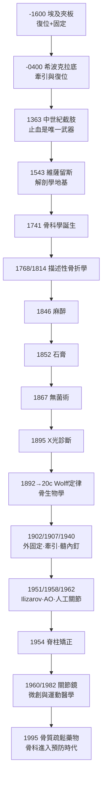

# 骨科的歷史 —— 讓骨頭長回原位的四千年偵探史

> 本書是「醫學史」系列的一冊。全書以「推理探案」方式書寫：每一篇都是一樁懸案——謎題（如何讓斷骨復位、癒合、重建？）、前因、線索與推理、結案（後果與影響）。背後的理論武器包括骨生物學、Wolff 定律、應力遮蔽、生物材料力學、無菌原則等。

## 全書年表

| 年份 | 案件 | wiki 檔案 |
|---|---|---|
| -1600 | Edwin Smith 紙草：史上第一份骨折病歷與埃及夾板 | `-1600-EdwinSmith紙草與埃及夾板.md` |
| -0400 | 希波克拉底復位術、牽引桌與希氏長凳 | `-0400-希波克拉底復位術與牽引桌.md` |
| 1363 | 肖利亞克《大外科》：中世紀截肢與燒灼止血 | `1363-肖利亞克截肢術與中世紀戰傷.md` |
| 1543 | 維薩留斯《人體構造》：骨科的解剖學地基 | `1543-維薩留斯骨骼圖譜.md` |
| 1741 | Nicolas André 創立「Orthopaedia」一詞 | `1741-André創立骨科學.md` |
| 1768 | Pott 骨折與描述性骨科 | `1768-Pott骨折與描述性骨科.md` |
| 1814 | Colles 骨折：骨折命名學與遠端橈骨 | `1814-Colles骨折與描述骨折學.md` |
| 1846 | 乙醚麻醉：骨科手術從屠殺到工藝 | `1846-麻醉降臨與骨科手術革命.md` |
| 1852 | 馬他森石膏繃帶：固定的材料力學 | `1852-馬他森石膏繃帶.md` |
| 1867 | Lister 無菌術拯救開放性骨折 | `1867-Lister無菌術拯救開放性骨折.md` |
| 1892 | Wolff 定律：骨骼是會算結構力學的活組織 | `1892-Wolff定律.md` |
| 1895 | 侖琴發現 X 光：骨折診斷革命 | `1895-侖琴發現X光.md` |
| 1902 | Lambotte 外固定器：鋼針固定骨折的先聲 | `1902-Lambotte外固定器.md` |
| 1907 | Steinmann 牽引針與骨折牽引術 | `1907-Steinmann牽引術.md` |
| 1940 | Kuntscher 髓內釘：德軍傷兵營裡的革命 | `1940-Kuntscher骨髓內釘.md` |
| 1951 | Ilizarov 牽張成骨：讓骨頭自己長出 17 公分 | `1951-Ilizarov牽張成骨.md` |
| 1954 | Harrington 手術：脊柱側彎矯正元年 | `1954-Harrington脊柱側彎矯正.md` |
| 1958 | AO 學派：解剖復位、堅強內固定、早期活動 | `1958-AO學派與內固定原則.md` |
| 1960 | Watanabe 關節鏡：不開刀看關節 | `1960-Watanabe關節鏡.md` |
| 1962 | Charnley 人工髖關節：摩擦力學的勝利 | `1962-Charnley人工髖關節.md` |
| 1982 | 關節鏡輔助 ACL 重建與運動醫學 | `1982-關節鏡輔助ACL重建.md` |
| 1995 | Alendronate：骨質疏鬆的化學防線 | `1995-Alendronate與骨質疏鬆.md` |

## 主線索一覽

## 四大理論支柱

1. **骨生物學**：骨是活的組織，靠骨母細胞（成骨）與破骨細胞（吸收）的偶聯不斷重塑；骨折癒合經歷血腫、肉芽、骨痂、重塑四期。
2. **Wolff 定律**（1892）：骨小樑沿主應力線排列，負荷決定骨形態——這是牽引、負重訓練、牽張成骨與骨質疏鬆預防的共同理論根。
3. **固定的力學光譜**：從夾板、石膏（彈性固定，允許微動刺激骨痂）到 AO 堅強內固定（絕對穩定，一期骨癒合，但承受應力遮蔽風險），再到髓內釘與橋接鋼板（生物性固定）——骨科史就是「穩定」與「生物學」的拉鋸史。
4. **無菌原則**（1867 Lister 之後）：骨科植入物是細菌的溫床，感染意味著取出內固定、骨頭失去支架——無菌是所有手術革命的前提。

## 如何閱讀

每篇 wiki 均含：**案件摘要 → 前因 → 線索與推理（含數學式、程式碼、mermaid 圖）→ 結案（後果與影響）→ 關鍵人物與文獻**。年份檔名西元前用負數（如 `-1600`）。

姊妹冊：`../性病的歷史/`、`../生理醫學史/`。
