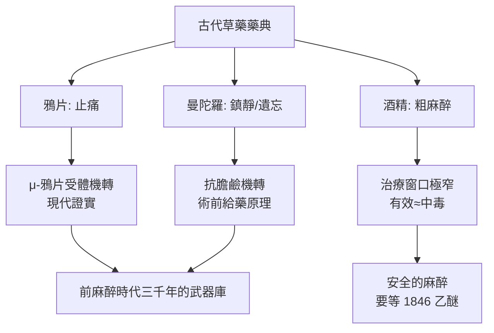

## -1550 - 埃伯斯紙草鴉片之夜（人類第一次把「睡去不痛」寫進處方箋）

## 案件摘要

**本案偵破了醫學史上最古老的一樁懸案：疼痛如何第一次被藥物「關機」。**

約西元前 1550 年，埃及醫生在《埃伯斯紙草》（Ebers Papyrus）——一本長達 20 公尺、收錄 700 多種處方的醫學巨著——中，記載了以**鴉片（opium）**止痛、以**曼陀羅（mandrake）**與**埃及蓮**製作安眠藥方的紀錄。這是人類文明史上第一批「讓病人睡去、讓疼痛沉默」的書面證據。麻醉學的種子並非誕生於手術室，而是誕生於祭司、廚房與藥草園之間——人類靠味覺試毒式的經驗累積，發現某些植物能切斷身體與意識之間的痛覺電報線。

## 前因 -- 為什麼會有這個案子

- **痛是演化的警報器，也是手術的死刑**。沒有麻醉的時代，切割、烙鐵、鑽顱都必須在完全清醒下進行；速度是唯一的麻醉——古代外科醫師以「30 秒截肢」聞名。
- **草藥帝國的三巨頭**：鴉片（罌粟，止痛）、曼陀羅（致幻與鎮靜）、酒精（粗淺鎮靜）。三者構成此後三千年的「前麻醉時代」武器庫。
- **紙草醫學的制度化**。埃及已有專業醫生階層（伊姆霍特普傳統），處方被抄寫、傳承、驗證——草藥知識第一次脫離巫術，進入「劑量與製法」的技術記錄。

## 線索與推理 -- 數學式、程式、理論

**線索一：罌粟鹼的分子間諜。** 現代化學揭開了這些草藥為何有效——鴉片含有嗎啡（morphine）與可待因（codeine），它們的結構恰好模擬人體自身的內生性鴉片肽（見 `1975-內生性鴉片與腦啡肽.md`），能扣住神經元上的 μ-鴉片受體：

$$ \text{嗎啡} + \mu\text{-受體} \;\Rightarrow\; \text{關閉鈣通道、開啟鉀通道} \;\Rightarrow\; \text{痛覺訊號在脊髓背角被「靜音」} $$

**線索二：曼陀羅的抗膽鹼偽裝。** 曼陀羅含東莨菪鹼（scopolamine）與阿托品，屬抗毒蕈鹼藥物——它們阻斷乙醯膽鹼受體，產生鎮靜、遺忘與譫妄。中世紀與文藝復興的「睡眠海綿」（spongia somnifera，見 `0200-華佗麻沸散之謎.md` 同時代傳統）正是曼陀羅＋鴉片＋莨菪的配方，其藥理至今仍是**術前給藥**（鎮靜＋止涎）的原理。

**線索三：劑量是天才與毒藥的鴻溝。** 草藥時代最大的難題是**治療窗口極窄**：

```python
def therapeutic_window(effect_dose, toxic_dose):
    # 治療指數 = 中毒劑量 / 有效劑量
    return toxic_dose / effect_dose

print(therapeutic_window(10, 15))   # 草鴉片粗提物: 1.5 → 非常危險
print(therapeutic_window(100, 10_000))  # 現代標準化藥物: 100 → 安全可控
```

有效即中毒——這解釋了為什麼古代「麻醉」幾乎總是伴隨昏迷、呼吸抑制與死亡的賭博，也解釋了為什麼真正安全的麻醉要等到 1846 年的乙醚示範（見 `1846-乙醚日莫頓公開示範.md`）才問世。

**線索四：痛覺電報的古代認知。** 埃及人認為疼痛是「瓦赫圖」（一種病邪之火）；希波克拉底學派則視之為體液失衡的訊號。無論解釋為何，實務策略一致：**與其理解疼痛，不如讓病人睡著**——這正是麻醉科千年來的第一條執業守則。



## 結案 -- 後果與影響

- **處方文化的誕生**。紙草紀錄確立了「劑量＋製法＋適應症」的格式，是兩千年後藥理學表格的祖先。
- **鴉片的雙面遺產**。從帕拉塞爾蘇斯的「鴉片酊 laudanum」到嗎啡提純（1805 年 Sertürner），再到海洛因悲劇——止痛與成癮的糾纏延續至今日的鴉片類危機。
- **草藥不等於劣質**。現代麻醉藥中：嗎啡源自罌粟、阿托品源自顛茄、肌肉鬆弛劑源自箭毒（見 `1942-箭毒與肌肉鬆弛劑.md`）、丙泊酚的靈感源自酚類植物成分——本案的草藥清單，就是麻醉科的分子寶庫目錄。
- **一句話結案**：人類學會麻醉，不是從理解神經開始，而是從「有些人吃了這種草就不痛了」的田野筆記開始——科學是後來的驗屍報告。

## 關鍵人物與文獻

- **埃伯斯紙草（約前 1550）**——喬治·埃伯斯 1862 年購得，現藏萊比錫大學；藥理學史的元年文物。
- ** Dioscorides（約 60 年）**——《藥物論》（De Materia Medica）系統記載曼陀羅與鴉片的外科用途，「以曼陀羅酒使患者無知覺而切割」。
- **華佗（約 140–208）**——同時代的東方平行案件，見 `0200-華佗麻沸散之謎.md`。
- **Friedrich Sertürner（1805）**——從鴉片提純嗎啡，以睡神 Morpheus 命名，開啟植物鹼化學與精準給藥的時代。
