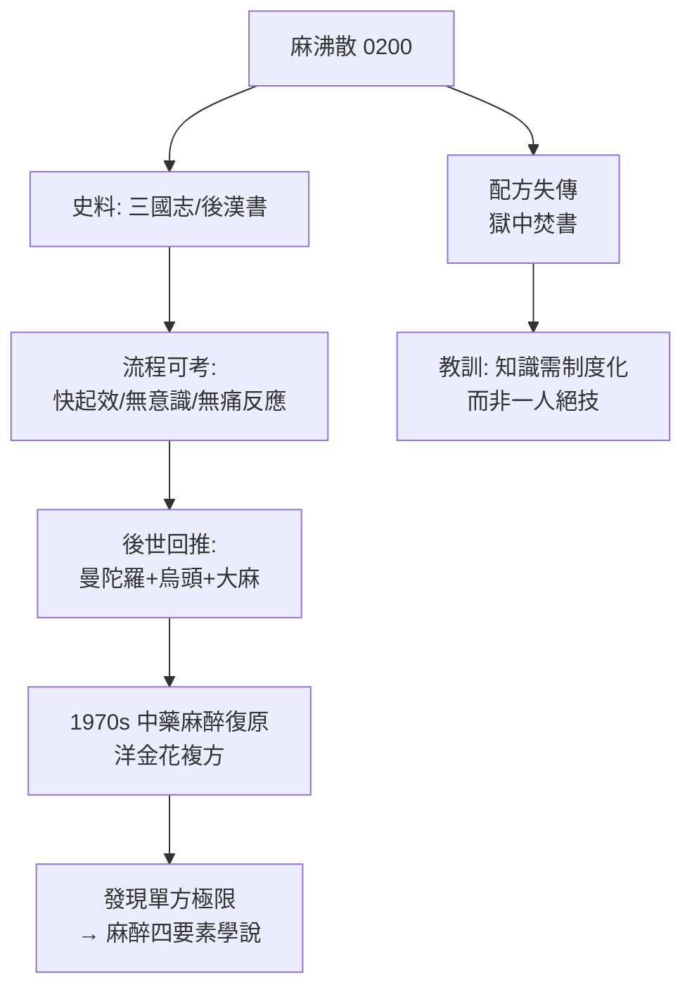

## 0200 - 華佗麻沸散之謎（東方第一個「手術不痛」的失傳配方）

## 案件摘要

**本案偵破了中國醫學史上最著名的失傳發明：華佗的麻沸散。**

東漢末年（約 2 世紀末至 208 年），沛國譙縣醫師華佗以「麻沸散」使病人醉臥無知覺，再行**刳破腹背、抽割積聚**的腹腔手術，縫合後敷以神膏，四五日創癒、一月平復——《三國志·華佗傳》與《後漢書》均有明確記載。這是世界醫學史上最早有姓名、有手術流程描述的全身麻醉案例，比乙醚公開示範（見 `1846-乙醚日莫頓公開示範.md`）早了一千六百餘年。然而配方隨華佗之死而失傳，成為醫學史最著名的一樁「證據滅失案」。

## 前因 -- 為什麼會有這個案子

- **戰亂創傷的外科需求**。東漢末年軍閥混戰、傷兵滿營——「刳破腹背」的外科正是戰地醫學的產物；華佗本人即以行軍醫療見聞聞名。
- **草藥武器庫已經備妥**。此時大麻（火麻）、曼陀羅（後世稱洋金花/風茄）、烏頭（附子）均已入藥：《神農本草經》已記烏頭「其汁煎之名射罔，殺禽獸」——麻醉性藥物在中國藥典裡早有席位。
- **華佗的醫學身份**。他同時精通方藥、針灸、外科與導引（五禽戲），是「內外兼修」型的醫師——而外科在儒家「身體髮膚受之父母」的文化下本是絕路，麻沸散正是讓外科成為可能的前提技術。

## 線索與推理 -- 數學式、程式、理論

**線索一：史料的精確度。** 《三國志》記載的流程驚人地現代：

> 若病結積在內，針藥所不能及，當須刳割者，便飲其麻沸散，須臾便如醉死，無所知，因破取。

「須臾如醉死，無所知」——意即：**起效快、意識消失、對傷害刺激無反應**。這三條正是現代麻醉評估的原始版 Guedel 分期（見 `1920-格德爾麻醉分期.md`）第三期。

**線索二：配方推理。** 麻沸散原方失傳，後世本草與醫家（宋代竇材《扁鵲心書》之睡聖散、元代危亦林《世醫得效方》的草烏散、日本華岡青洲 1804 年的通仙散）以文獻鏈回推，最可能的成分組合為：

| 候選藥物 | 主要成分 | 藥理角色 |
|---|---|---|
| 曼陀羅（洋金花） | 東莨菪鹼 | 鎮靜、遺忘、抗乙醯膽鹼 |
| 烏頭/附子 | 烏頭鹼 | 鈉通道阻滯（局部/全身毒性） |
| 大麻 | THC/CBD | 鎮痛、欣快 |
| 茉莉根/酒 | — | 賦形與增效 |

**線索三：現代驗證實驗。** 1970 年代起中國開展「中藥麻醉」復原研究：以洋金花製劑（主要成分東莨菪鹼）加氯丙嗪、哌替啶組成複方靜脈麻醉，曾在數以萬計的手術中使用。其機轉屬**抗膽鹼能中樞抑制**：

$$ \text{東莨菪鹼} \uparrow\!\!\downarrow \text{中樞 M 受體活性} \;\Rightarrow\; \text{意識與記憶編碼受損} \;\Rightarrow\; \text{遺忘性鎮靜} $$

其不足同樣是教科書級：中藥麻醉**鎮痛不全、肌鬆不佳、甦醒緩慢**——恰是後來藥理學把麻醉拆解為「鎮靜＋鎮痛＋肌鬆＋遺忘」四要素的原因（見 `1942-箭毒與肌肉鬆弛劑.md`）。

```python
# 麻醉的「四要素分解」——華佗單方 vs 現代複方的比較
def anesthesia_score(sedation, analgesia, relaxation, amnesia):
    return min(sedation, analgesia, relaxation, amnesia)

huatuo = anesthesia_score(sedation=0.8, analgesia=0.5, relaxation=0.4, amnesia=0.8)
modern = anesthesia_score(sedation=0.95, analgesia=0.95, relaxation=0.95, amnesia=0.95)
print(huatuo, modern)  # 木桶效應: 手術可行性由最弱要素決定
```

**線索四：失傳的方式比配方更可疑。** 華佗因不願為曹操服務而下獄處死，「佗臨死，出一卷書與獄吏曰：此可以活人……吏畏法不受，佗亦不強，索火燒之」。案卷被焚——知識壟斷於一人、無徒弟分傳、無制度保存，是古代科技失傳的三大元兇。



## 結案 -- 後果與影響

- **外科的可能性證明**。麻沸散證明「手術可以不痛」在技術上是可達的——但缺乏劑量標準化與安全記錄，始終無法制度化傳承。
- **東亞的麻醉傳統鏈**。危亦林（1345）以草烏散行整骨麻醉並記載「先量病人老少強弱」調整劑量——這是個體化給藥的最早文獻；日本華岡青洲 1804 年以曼陀羅複方完成世界首例全麻乳房切除術（早於乙醚示範 42 年），自稱承華佗之脈。
- **與西方案件的平行與分歧**。西方走的是「吸入性氣體＋可重複公開示範」路線（見 `1800-戴維笑氣報告.md`），東方走「口服複方＋個體經驗」路線——**可公開重複**最終成為醫學驗證的分水嶺。
- **一句話結案**：華佗證明了謎題有解，卻把答案燒掉了；科學史因此得到一條鐵律——沒有被公開重複的發明，等於不曾發生。

## 關鍵人物與文獻

- **華佗（約 140–208）**——外科、麻沸散與五禽戲；《三國志·方技傳》為本案核心證詞。
- **陳壽（233–297）**——《三國志》記載手術細節，史料可信度高於演義。
- **危亦林（1277–1347）**——《世醫得效方》草烏散，整骨麻醉與劑量個體化。
- **華岡青洲（1760–1835）**——1804 年通仙散全麻手術；其妻加惠與母親以身試藥中毒身亡/致殘，是麻醉自體實驗倫理的東方悲劇（對照 `1898-比爾自體實驗脊椎麻醉.md`）。
