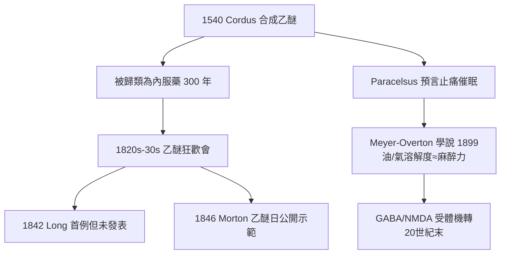

## 1540 - 乙醚的誕生（甜油之謎：一款麻醉劑被發明了三百年卻無人問津）

## 案件摘要

**本案偵破了麻醉史上最離奇的「證據在場卻無人報案」案：乙醚早在 1540 年就被合成，卻直到 1846 年才被用作麻醉劑——中間整整三百年。**

1540 年，德國植物學家兼藥劑師**瓦勒里烏斯·科爾達斯（Valerius Cordus）**發表《硫磺之甜油》（*De artificiosi extractione olei vitrioli*）一文，描述以硫酸與乙醇蒸餾製得「硫磺甜油」（oleum vitrioli dulce）——這就是**乙醚（diethyl ether）**的第一次實驗室合成。同時期，瑞士醫生帕拉塞爾蘇斯（Paracelsus）也以類似方法取得此液體，並留下一句被後世反覆咀嚼的預言：它「能緩解疼痛且產生沉睡，讓雞睡而不死」。乙醚的合成是確定的，它的麻醉力也已被點出——然而「手術麻醉」這一步，人類還要再等三百年。

## 前因 -- 為什麼會有這個案子

- **煉金術的蒸餾技術**。16 世紀蒸餾術日益精進，科爾達斯的貢獻是**可重複的製備流程**——精確記錄硫酸比例、溫度與蒸餾步驟，這使乙醚合成成為可以傳授的技術，而非偶然發現。
- **「甜油」被當成藥**。三百年間乙醚在藥房中是內服藥劑：治咳嗽、絞痛、痛風，是「Spiritus vini vitriolici」（硫酸酒精精）。沒有人想到讓病人吸入它。
- **哲學障礙：疼痛被視為必要之惡**。直到 18 世紀，基督教文化仍普遍認為疼痛是神的管教（「在生產上得救」）；醫學界則擔心無痛手術會使病人失去求生鬥志——觀念的天花板壓住了技術的天花板。
- **娛樂先於醫學**。18 世紀末至 19 世紀初，乙醚與笑氣在英美成為「狂歡會」（frolics）的助興毒品——見證其效果的觀眾成千上萬，卻在馬戲與展場而非手術室（見 `1844-笑氣狂歡與韋爾斯拔牙.md`）。

## 線索與推理 -- 數學式、程式、理論

**線索一：分子身世。** 乙醚結構簡單得驚人——兩個乙基夾著一個氧：

$$ CH_3CH_2{-}O{-}CH_2CH_3 \quad (\text{沸點 } 34.6^\circ C) $$

沸點低、揮發性高、化學穩定、可燃但可控——它幾乎是「為吸入麻醉而生」的分子。問題從來不是藥物不存在，而是**吸入給藥這個概念**不存在。

**線索二：為什麼三百年無人報案？** 推理給出三個嫌疑犯：

| 嫌疑犯 | 證詞 | 判決 |
|---|---|---|
| 路徑依賴 | 乙醚已是「內服藥」，分類學把它鎖死在腸胃道 | 主犯 |
| 觀念桎梏 | 疼痛=神的管教；無痛=違反自然 | 從犯 |
| 混合製品 | 早期乙醚混有雜質（二氧化硫），內服尚可、吸入刺鼻 | 從犯 |

**線索三：麻醉作用機轉的百年追兇。** 乙醚為何讓人無知覺？這個問題本身花了 170 年。1899 年 Hans Meyer 與 1901 年 Charles Overton 提出經典的 **Meyer–Overton 脂質學說**：麻醉效能與藥物在橄欖油的溶解度成正比——麻醉藥溶入神經元膜脂質，擾亂離子通道功能：

$$ \text{MAC} \times \text{油/氣分配係數} \approx \text{常數} $$

其中 **MAC（最低肺泡有效濃度）**是麻醉強度的標準量度：50% 病人對切皮刺激不動的肺泡濃度。乙醚 MAC 約 1.9%、氟烷約 0.75%——溶解度越大，所需濃度越低。20 世紀末研究進一步鎖定分子目標：麻醉藥增強抑制性 GABA<sub>A</sub> 受體、抑制興奮性 NMDA 受體——麻醉不是「催眠全身」，而是**精準篡改突觸的開關語言**。

**線索四：溶解度的物理偵查學。** 為什麼乙醚誘導慢（15 分鐘以上）、病人痛苦掙扎？因為它的**血/氣分配係數**高（0.89 仍有爭議空間，實際約 12）——血液像大海，肺泡氣體像小溪，藥物要灌滿大海才能推高動脈濃度：

```python
def induction_time(blood_gas_coef):
    # 血/氣分配係數越大 → 誘導越慢
    return blood_gas_coef  # 乙醚 12 vs 地氟烷 0.45 → 快 25 倍以上

print("乙醚:", induction_time(12), "→ 慢誘導、甦醒也慢")
print("地氟烷:", induction_time(0.45), "→ 快進快出、可控性高")
```

這組「分配係數」參數日後成為現代麻醉藥設計的核心指標（見 `1956-氟烷吸入麻醉革命.md`）。



## 結案 -- 後果與影響

- **發明≠應用**。本案的核心教訓：一個分子從「存在」到「被使用」之間，隔著分類習慣、文化觀念與一次公開表演。科學史上重大突破常常不是「無中生有」，而是「視角翻轉」。
- **Paracelsus 的雞**。他讓公雞吸入乙醚「睡而不死」的實驗，是史上第一例動物麻醉實驗記錄——動物實驗、化合物、可重複流程，麻醉學的三大件在 1540 年已齊備，只欠一個「拿來做人」的臨門一腳。
- **Crawford Long 的 1842 年秘密**。美國喬治亞州的 Long 在狂歡會中觀察乙醚效果後，1842 年 3 月 30 日用乙醚切除頸部腫瘤——比莫頓早四年，但他未發表，導致優先權爭議纏訟終生（對照 `1846-乙醚日莫頓公開示範.md`）。
- **一句話結案**：乙醚等了三百年不是因為化學不夠好，而是因為沒有人問對問題——破案的鑰匙常常不是新證據，而是新的問法。

## 關鍵人物與文獻

- **Valerius Cordus（1515–1544）**——29 歲死於瘧疾；其合成流程 1543 年出版於紐倫堡，是藥典化學的先驅。
- **Paracelsus（1493–1541）**——硫磺甜油的醫藥推廣者，「劑量決定毒性」名言的作者。
- **Hans Meyer 與 Charles Overton（1899/1901）**——脂質學說，麻醉藥理第一條定量定律。
- **Crawford Long（1815–1878）**——1842 年乙醚麻醉首例，遲至 1849 年才發表。
- 現代註腳——乙醚如今已被安全藥物全面取代（易燃、誘導慢、噁心率高），但「ether」一詞仍以 anesthesia 的古希臘詞源（aisthēsis 的否定前綴）統領整個學科之名。
