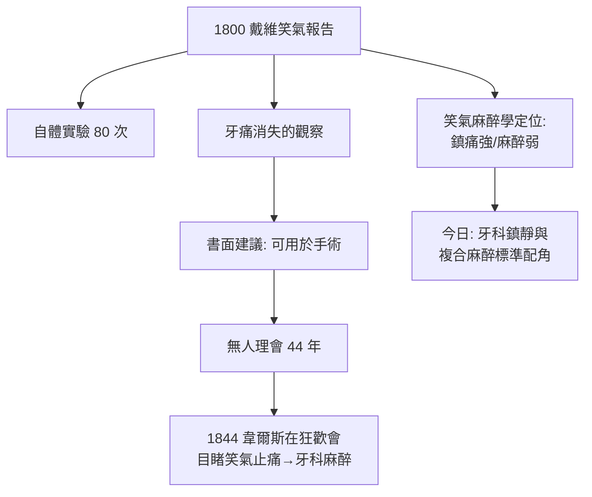

## 1800 - 戴維笑氣報告（「一氧化二氮也許能用在外科手術上」——被遺忘的建議）

## 案件摘要

**本案偵破了麻醉史上最令人扼腕的「建議被無視」案：1800 年，21 歲的亨弗里·戴維親自實驗笑氣後，白紙黑字寫下麻醉應用建議，卻無人理會四十四年。**

1800 年，英國化學家**亨弗里·戴維（Humphry Davy）**出版《化學與哲學研究，主要涉及一氧化二氮》（*Researches, Chemical and Philosophical; Chiefly Concerning Nitrous Oxide*）。他在 1799–1800 年間吸入笑氣約八十次、記錄自身體驗，並觀察到一個關鍵現象：吸入笑氣後，他的**牙痛消失了**。他在書中寫下麻醉史上最著名的一句被無視的話：

> 「由於一氧化二氮似乎能夠破壞身體疼痛，它也許可以用在外科手術上，在過程中不會產生大量血液流失。」（As nitrous oxide in its extensive operation appears capable of destroying physical pain, it may probably be used with advantage during surgical operations...）

這是第一次由受過訓練的科學家，以系統性自體實驗提出**吸入麻醉**的正式書面建議——而整個醫學界對此沉默了四十四年。

## 前因 -- 為什麼會有這個案子

- **氣體化學革命的黃金年代**。1770–1800 年，Priestley、Lavoisier、Cavendish 相繼發現氧、氮、笑氣——「空氣不止一種」的世界觀剛被顛覆，新型氣體成了科學界的明星。
- **Pneumatic Institution 的藥物偵探所**。戴維任職於布里斯托的氣動學研究院（Thomas Beddoes 創立），使命正是「測試新氣體能否治病」——人類第一個吸入藥物篩選實驗室。
- **笑氣的社交化**。氣動院先後讓戴維、詩人柯勒律治（Coleridge）與無數志願者吸入笑氣；「笑氣派對」迅速成為中產階層的娛樂——這條娛樂線後來直接餵養了 1844 年的牙科麻醉發現（見 `1844-笑氣狂歡與韋爾斯拔牙.md`）。
- **當時的疼痛觀**。外科手術靠烈酒、鴉片與速度；「化學氣體能消除手術痛」在當時聽來近乎巫術。

## 線索與推理 -- 數學式、程式、理論

**線索一：系統性自體實驗的範本。** 戴維的方法在 1800 年堪稱前無古人：

| 步驟 | 內容 | 現代對應 |
|---|---|---|
| 純化氣體 | 硝酸銨熱解、除雜 | 藥物純度控制 |
| 控制吸入 | 定量、記錄劑量與次數（約 80 次） | 劑量—反應研究 |
| 記錄主觀 | 詳細描述欣快、疼痛消失、聽覺異常 | 量表化主觀報告 |
| 交叉驗證 | 請詩人柯勒律治等志願者複試 | 多受試者重複 |

**線索二：笑氣的藥理偵查。** 笑氣（N₂O）的麻醉學身份至今特殊：它是**鎮痛強、麻醉弱**的氣體。MAC 高達 104%（常壓下無法單獨達成麻醉），卻有出色的鎮痛與抗焦慮作用：

$$ \text{N}_2\text{O} \Rightarrow \text{刺激內生性鴉片肽釋放 + 拮抗 NMDA 受體} \Rightarrow \text{鎮痛/抗焦慮/遺忘} $$

這解釋了戴維牙痛消失的機轉，也解釋了為何笑氣至今仍是牙科鎮靜（「笑氣鎮靜」）與複合麻醉的標準配角——它從來不是主角，但從未退場。

**線索三：為什麼建議被無視？** 三個推理：

1. **戴維本人離場**——1801 年他轉任皇家研究院，全力投入電化學（電解發現鉀、鈉），放棄了氣體醫學；建議的提出者不再追蹤。
2. **外科界的觀念鎖死**——疼痛被視為「生命的火花」，倫敦外科大家們公開反對手術無痛化。
3. **娛樂污名**——笑氣在派對上的醜態（狂笑、跌倒）使醫學界視之為江湖把戲，「馬戲場裡的東西進不了手術室」。

```python
# 「建議的半衰期」——從提出到應用的延遲
def delay(published, adopted):
    return adopted - published

print("笑氣麻醉:", delay(1800, 1844), "年")   # 44 年
print("乙醚麻醉:", delay(1540, 1846), "年")   # 306 年
# 教訓: 沒有臨床擁護者持續推動, 建議會沉底
```

**線索四：戴維的學生接力。** 電化學巨匠戴維的助手正是**法拉第（Michael Faraday）**——法拉第 1818 年也在《Quarterly Journal of Science》記載乙醚吸入可致麻醉，同樣無人理會。兩代化學巨星先後按下了同一個門鈴，卻沒人開門。



## 結案 -- 後果與影響

- **自體實驗倫理的源頭**。戴維以自己為第一受試者的傳統，延續到韋爾斯拔牙（1844）、比爾脊椎穿刺（見 `1898-比爾自體實驗脊椎麻醉.md`）與華岡青洲（見 `0200-華佗麻沸散之謎.md`）——麻醉學幾乎是由醫者的身體「試」出來的學科。
- **鎮痛與麻醉的分流**。戴維的觀察最早揭示了 N₂O「鎮痛而不深度麻醉」的特性——今日麻醉科「鎮靜/鎮痛/肌鬆/遺忘可分別調控」的思維，源頭即此。
- **娛樂與醫學的雙生線**。笑氣派對的群眾基礎成為 1840 年代麻醉發現的「流行病學土壤」——一項技術能否落地，社會文化環境比實驗室更關鍵。
- **一句話結案**：戴維寫下了答案，但問題在四十四年後才被問出來——科學史上最貴的不是未知，而是**已知卻無人採用**。

## 關鍵人物與文獻

- **Humphry Davy（1778–1829）**——電化學之父、安全礦燈發明者；1800 年笑氣報告是他的第一本科學著作。
- **Thomas Beddoes（1760–1808）**——氣動學研究院創辦人，「氣體醫學」的推手；其子即詩人 Thomas Lovell Beddoes。
- **Samuel Taylor Coleridge（1772–1834）**——《古舟子詠》詩人、笑氣志願受試者，留下「如同心靈在純粹喜悅中」的體驗記錄。
- **Michael Faraday（1791–1867）**——1818 年乙醚吸入記錄，兩代化學家同案未破。
