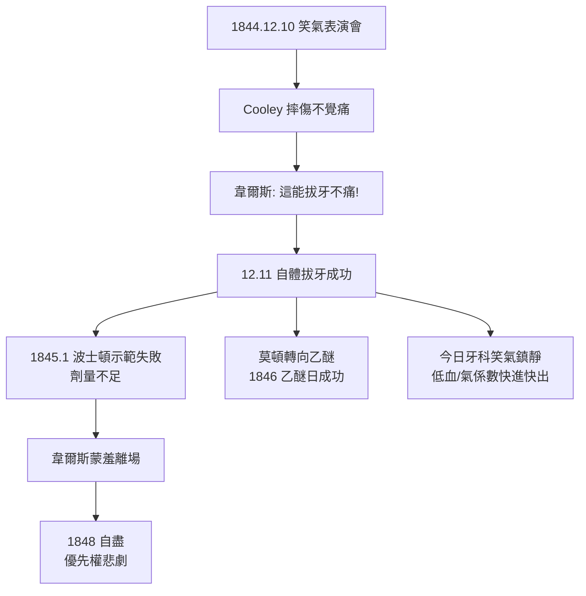

## 1844 - 笑氣狂歡與韋爾斯拔牙（一場巡迴表演上的意外發現）

## 案件摘要

**本案偵破了麻醉學最戲劇性的現場破案：1844 年 12 月 10 日，牙醫霍勒斯·韋爾斯（Horace Wells）在康乃狄克州哈特福德的笑氣表演會上，從一個摔傷自己卻不覺得痛的觀眾身上，看出了麻醉的秘密。**

1844 年 12 月 10 日晚，巡迴表演者**加德納·昆西·科爾頓（Gardner Quincy Colton）**在哈特福德的 Union Hall 舉辦「有趣氣體展覽會」：付費志願者吸入笑氣後在台上跌撞狂笑、逗樂全場。藥房店員 Samuel Cooley 吸入後衝撞桌腳、小腿被劃出血——**但他渾然不覺**。觀眾席上的韋爾斯醫師立刻聯想到自己的牙痛恐懼：如果笑氣能讓人摔傷不痛，能不能讓人**拔牙不痛**？次日，科爾頓為韋爾斯本人施吸笑氣，韋爾斯請同事拔除自己一顆智齒——全程無痛。他隨即宣布：「拔牙的新紀元到了。」

## 前因 -- 為什麼會有這個案子

- **笑氣的娛樂產業化**。科爾頓原是學生，中途輟學改行巡迴展演笑氣——「燈氣狂歡」是 1840 年代美國的通俗娛樂，觀眾動輒數百人。工業化城市化帶來的牙病流行，使拔牙（不麻醉、靠剃刀般的速度）成為全民恐懼。
- **戴維建議沉睡 44 年**（見 `1800-戴維笑氣報告.md`）——醫學界沒有採用的概念，卻在一場馬戲式表演中被一個牙醫「看見」。
- **波士頓的麻醉競賽氛圍**。1840 年代波士頓–哈特福德–羅徹斯特地區，韋爾斯、威廉·莫頓（William Morton）、查爾斯·傑克遜（Charles Jackson）三人環繞麻醉發明權的愛恨情仇，構成本案的連續劇背景。

## 線索與推理 -- 數學式、程式、理論

**線索一：現場證人鏈。** 本案的偵查完全符合經典刑偵邏輯：

| 時間 | 證據 | 推理 |
|---|---|---|
| 1844.12.10 晚 | Cooley 摔傷無痛 | 藥物→痛覺缺失的因果觀察 |
| 1844.12.11 晨 | 韋爾斯自體拔牙無痛 | 可重複驗證（n=1，但是自己） |
| 1844–45 | 韋爾斯臨床拔牙 12–15 例成功 | 病例系列 |
| 1845.1 | 波士頓麻省總醫院公開示範 | 失敗——病人痛喊，韋爾斯被噓為「江湖騙子」 |

**線索二：失敗的原因——劑量科學的缺席。** 韋爾斯的波士頓示範失敗，現代推斷是**笑氣濃度不足或提早拔管**：笑氣 MAC 高達 104%（見 `1800-戴維笑氣報告.md`），需要接近純氧替代的吸入方式才可能深度麻醉；在空氣中混合吸入只能達到鎮痛鎮靜深度。韋爾斯沒有 MAC 的概念，也沒有量化的吸入裝置——他輸在劑量學，而非輸在概念。

```python
def nitrous_anesthesia_depth(fraction, MAC=1.04):
    # 吸入濃度不足 MAC → 無法保證手術麻醉深度
    depth = "鎮痛/鎮靜" if fraction < MAC else "手術麻醉"
    return f"FiN2O={fraction:.0%}: {depth}"

print(nitrous_anesthesia_depth(0.80))  # 空氣中最高約 80% → 只能鎮靜鎮痛
print(nitrous_anesthesia_depth(1.10))  # 需高壓或低氧環境(不可行) → 正解是複合麻醉
```

現代的解法是**複合麻醉**：笑氣 60–70% + 揮發性麻醉藥 + 阿片類，各取所長——單一藥物時代不可能成功的配方，組合起來成為標準。

**線索三：優先權悲劇。** 韋爾斯被噓後放棄推廣，轉而由其前合夥人莫頓以乙醚完成 1846 年示範（見 `1846-乙醚日莫頓公開示範.md`）。韋爾斯此後窮盡餘生爭取發明權——1848 年在紐約被捕（據傳向街頭女性潑硫酸），服氯仿自盡於牢房，年僅 33 歲。1880 年代美國牙醫學會追認他為麻醉先驅；1910 年法國醫學院將他與莫頓並列致敬。

**線索四：現代笑氣鎮靜的藥理定位。** 今日笑氣用於牙科與產科鎮痛（50% N₂O/50% O₂ 的 Entonox），機轉為刺激內生性鴉片肽與拮抗 NMDA 受體，優勢是**血/氣分配係數極低（0.47）→ 起效與甦醒都以分鐘計**：

$$ \text{N}_2\text{O: 血/氣係數 } 0.47 \;\Rightarrow\; \text{快進快出} \;\Rightarrow\; \text{病人走進來、笑著走出去} $$



## 結案 -- 後果與影響

- **麻醉發現權的三方混戰**。韋爾斯（笑氣）、莫頓（乙醚）、傑克遜（化學顧問）的訴訟與互控持續數十年，無一人善終——莫頓 1868 年鬱鬱而終，傑克遜晚年在精神病院度過二十年。發明權之爭成為科學史倫理教材的固定章節。
- **牙科先於外科**。麻醉由牙醫而非外科醫生實現——因為牙痛是全民共感、拔牙是「小手術」，試錯成本低。邊緣場景反而成為革命的起點。
- **韋爾斯的遲來正名**。ADA（美國牙醫學會）每年頒發 Horace Wells 獎；哈特福德市在 Bushnell 公園為他立像——雕像基座刻著他宣布的話：「拔牙的新紀元」。
- **一句話結案**：破案的人不是醫學教授，而是坐在表演會觀眾席上、被自己的牙痛折磨的牙醫——重大線索永遠出現在有準備的眼睛面前。

## 關鍵人物與文獻

- **Horace Wells（1815–1848）**——哈特福德牙醫，笑氣麻醉的發現者與第一位殉道者。
- **Gardner Quincy Colton（1814–1898）**——巡迴表演者、後改行行醫，晚年以笑氣麻醉行醫並協助韋爾斯正名。
- **William T. G. Morton（1819–1868）**——韋爾斯前合夥人，乙醚日的主角（見 `1846-乙醚日莫頓公開示範.md`）。
- **Charles T. Jackson（1805–1880）**——化學家，向莫頓提供乙醚建議，日後三方爭訟的火藥引信。
- 現代註腳——笑氣因溫室效應（N₂O 是強效溫室氣體）與環境污染議題，2010 年代起在部分醫療系統中被逐步限用——麻醉學第一次面對「藥物的環境成本」。
