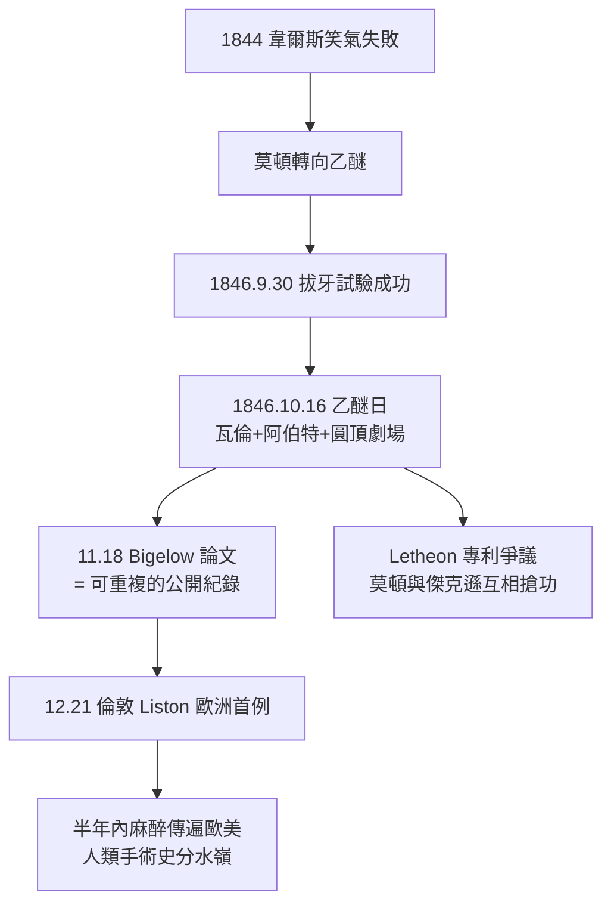

## 1846 - 乙醚日莫頓公開示範（乙醚圓頂劇場：現代麻醉的生日）

## 案件摘要

**本案偵破了醫學史上最著名的公開表演：1846 年 10 月 16 日，威廉·莫頓在麻省總醫院乙醚圓頂劇場（Ether Dome），以乙醚麻醉病人完成頸部血管瘤切除——現代麻醉學的正式誕生日。**

1846 年 10 月 16 日（星期五）上午十點，麻省總醫院外科圓頂劇場座無虛席。外科主任**約翰·柯林斯·瓦倫（John Collins Warren）**準備為印刷工人**愛德華·吉爾伯特·阿伯特（Edward Gilbert Abbott）**切除頸部血管瘤。年輕牙醫**威廉·湯瑪斯·格林·莫頓（William T. G. Morton）**攜帶一只裝有乙醚的玻璃球與吸入器登場。阿伯特吸入乙醚後失去知覺，瓦倫順利完成手術。阿伯特甦醒後說出的那句話，成為麻醉史的世紀證詞：

> 「我並沒有感受到疼痛，雖然我知道手術正在進行。」（I did not experience pain, although I knew the operation was performing.）

瓦倫轉向觀眾席宣布：「紳士們，這不是騙術。」（Gentlemen, this is no humbug.）——與韋爾斯一年前被噓下台的同一座劇場、同一句指控，被當場反轉。

## 前因 -- 為什麼會有這個案子

- **韋爾斯失敗的前車**。1845 年韋爾斯在同一劇場以笑氣示範失敗（見 `1844-笑氣狂歡與韋爾斯拔牙.md`）；莫頓是其前合夥人，深知失敗原因在於鎮痛深度不足——他需要比笑氣更強的藥。
- **化學家傑克遜的指點**。莫頓向哈佛化學教授查爾斯·傑克遜請教，傑克遜提及乙醚以及自己吸入後的麻木體驗。莫頓改用**純乙醚＋封閉吸入器**路線。
- **試驗的完整鏈**：1846 年 9 月 30 日，莫頓先以乙醚成功為病人 Eben Frost 拔牙（有牙科同行見證）；再以小狗、自家的狗與自己反覆試驗——這是一條「動物→自己→病人→公開」的驗證鏈，比韋爾斯的直接臨床跳躍嚴謹得多。
- **瓦倫的絕望需求**。這位 72 歲的外科大師一生見證無數病人在清醒下被切割——他願意再給「騙術」一次機會。

## 線索與推理 -- 數學式、程式、理論

**線索一：吸入器是隱藏的關鍵。** 莫頓的設計是把乙醚海綿封入玻璃球、以口鼻罩密閉吸入——這解決了兩個技術死結：

1. **純度與濃度可控**——非空氣稀釋，吸入的是高濃度乙醚蒸氣；
2. **不對旁人散逸**——旁觀者「看不到藥、聞不到味」，一度還帶來保密的商業策略（他申請專利並命名為 Letheon，企圖壟斷——後遭醫學界集體抵制，專利被唾棄，麻醉成為全人類共享的公共財）。

**線索二：乙醚的麻醉學參數。** 以現代藥理反推這次示範為何成功：

| 參數 | 乙醚數值 | 臨床意義 |
|---|---|---|
| MAC | 約 1.9 vol% | 效價中等，密閉吸入可達 |
| 血/氣分配係數 | 約 12 | 誘導慢（10–15 分鐘）但平順 |
| 油/氣分配係數 | 約 65 | 溶解度高→麻醉維持穩（Meyer–Overton） |
| 治療窗口 | 較寬 | 與氯仿不同，不易猝死（見 `1847-辛普森氯仿與產科麻醉.md`） |

**線索三：Guedel 分期的即時驗證。** 1846 年示範呈現的病人狀態，日後被 Guedel（見 `1920-格德爾麻醉分期.md`）整理為分期理論——從誘導期興奮，進入第三期（手術麻醉期）後瞳孔固定、呼吸規律、對切皮無反應。麻醉從「把人弄睡」升級為**可控的深度儀表**。

```python
# 1846 示範的時間軸覆核（依現代麻醉紀錄格式）
events = [
    ("10:10", "吸入乙醚開始"),      # 誘導期: 興奮、嗆咳
    ("10:20", "病人失去知覺"),      # 進入 Guedel 第三期
    ("10:30", "瓦倫切開腫瘤"),      # 手術刺激→無體動/無血流劇變
    ("10:55", "手術完成"),          # 約 25 分鐘切割
    ("11:00+", "病人甦醒, 自述無痛") # 關鍵證詞
]
for t, e in events: print(t, e)
```

**線索四：新聞傳播的速度。** 《波士頓醫學與外科期刊》（今《新英格蘭醫學期刊》前身）11 月 18 日刊登 Henry Jacob Bigelow 的《吸入硫醚在手術中的應用》——這篇文獻把示範轉化為**可重複的公開紀錄**。12 月起倫敦 Robert Liston（「史上最快的刀」）以乙醚完成歐洲首例無痛截肢，說出名言：「這美國人的把戲，先生們，不是幻術！」（This Yankee dodge beats mesmerism hollow.）



## 結案 -- 後果與影響

- **外科的物理限制被解除**。麻醉前，手術速度至上、範圍極小（截肢、表淺腫瘤）；麻醉後，外科開始追求**精細、深部、長時間**——麻醉與外科是共生的雙螺旋，麻醉科的獨立性由此埋下伏筆。
- **「公開可重複」的範式**。乙醚日確立了醫學重大發明的驗證標準：公開場地、獨立見證者、媒體與期刊紀錄。華佗燒書（見 `0200-華佗麻沸散之謎.md`）與 Long 未發表（見 `1540-乙醚的誕生與甜油之謎.md`）的反例，反襯出這一範式的價值。
- **醫學史的「三大發現」敘事**。19 世紀常將麻醉（1846）、無菌術（見 `1867-李斯特無菌術與麻醉安全.md`）、X 光（1895）並列為外科三革命——而麻醉讓手術「可行」，無菌讓手術「值得」，兩者缺一即零。
- **一句話結案**：1846 年 10 月 16 日不是發明了什麼新分子，而是完成了一場**公開的可重複實驗**——人類第一次在醫學的正規法庭上，為「疼痛可以被關閉」作出了判決。

## 關鍵人物與文獻

- **William T. G. Morton（1819–1868）**——示範執行者；墓碑銘文：在他之前，外科是痛苦；在他之後，科學戰勝了疼痛。
- **John Collins Warren（1778–1856）**——麻省總醫院外科主任、NEJM 創刊人，「這不是騙術」的宣告者。
- **Edward Gilbert Abbott（1825–1855）**——本案病人，其證詞是麻醉史的第一份病人主觀報告。
- **Henry Jacob Bigelow（1818–1890）**——發表首篇麻醉臨床論文的哈佛外科醫師。
- **Oliver Wendell Holmes（1809–1894）**——詩人醫師，首倡以「anesthesia／anaesthesia」命名此狀態（1846 年 11 月 21 日致莫頓信）。
- 現代註腳——麻省總醫院乙醚圓頂劇場保存至今，每年 10 月 16 日為「世界麻醉日」（World Anaesthesia Day）。
