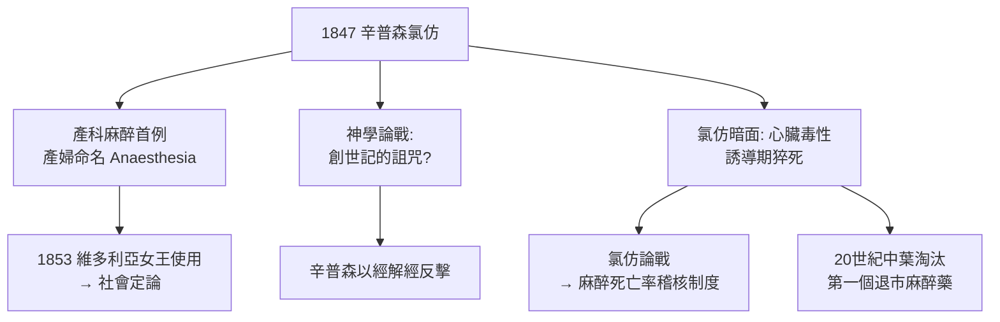

## 1847 - 辛普森氯仿與產科麻醉（「讓我吸入這個東西吧，Doctor」）

## 案件摘要

**本案偵破了麻醉在誕生僅八個月後的第一場大擴張與第一場大戰爭：蘇格蘭婦科醫生詹姆斯·辛普森把氯仿帶入產房，就此引爆「分娩該不該無痛」的百年論戰。**

1847 年 11 月，愛丁堡大學婦產科教授**詹姆斯·楊格·辛普森（James Young Simpson）**與兩位同事在自己家中以身試藥，逐一吸入多種化合物，尋找比乙醚更好用的麻醉藥——當他們吸入**氯仿（chloroform）**後，全數昏倒，醒來後的結論只有一個：就是它了。氯仿氣味宜人（甜香）、起效比乙醚快得多、不爆燃，辛普森立即將其用於產科。據傳一位產婦 Anna Elizabeth 在產下女嬰時經歷氯仿麻醉，醒來後引用《創世記》為女兒命名：**阿納西婭（Anaesthesia，麻醉）**。而反對陣營搬出的武器是《創世記》第三章的詛咒：「你生產兒女必多受苦楚」——產科麻醉從第一天起就是醫學與神學的戰場。

## 前因 -- 為什麼會有這個案子

- **乙醚的技術缺陷**。誘導慢（15 分鐘嗆咳掙扎）、有洋蔥般刺激味、**極易爆燃**（在手術燈與火源密佈的產房與手術室是噩夢）——臨床需要更好的溶劑。
- **辛普森的職業痛點**。產科手術（產鉗、轉位、碎胎術）在清醒產婦身上近乎酷刑；他所見的產婦痛苦遠超一般外科。
- **神學與醫學的地盤戰**。止痛在分娩中的合法性，觸及「女性受苦的意義」這一文化核心——蘇格蘭教會為此爆發激烈抨擊。

## 線索與推理 -- 數學式、程式、理論

**線索一：氯仿的物理與藥理偵查。** 氯仿（CHCl₃）的參數解釋了它的速勝：

| 參數 | 氯仿 | 乙醚 | 結論 |
|---|---|---|---|
| MAC | 約 0.5% | 約 1.9% | 效價高 4 倍，幾口就睡 |
| 血/氣分配係數 | 約 7 | 約 12 | 誘導更快 |
| 可燃性 | 不燃 | 高度易燃 | 手術室安全 |
| 臨床甜香 | 良好 | 刺激嗆鼻 | 病人接受度高 |

**線索二：但氯仿是雙面間諜。** 它的心臟毒性在 1850 年代陸續現形：氯仿可使心肌對兒茶酚胺敏感，誘發**心室纖維顫動**，導致「誘導期猝死」——病人常在興奮掙扎階段突然死亡。統計顯示其死亡風險約為乙醚的 10 倍以上。1900 年代英美醫界展開著名的「氯仿論戰」（chloroform controversy）：愛丁堡學派繼續使用，倫敦學派（Joseph Clover、John Snow 的傳人）主張精確定量給藥。最終氯仿在 20 世紀中葉被逐步淘汰——本案是麻醉史第一個「藥物大規模退市」案例，催生了**麻醉死亡率稽核**制度。

**線索三：辛普森的辯護策略——書面論戰。** 面對宗教抨擊，辛普森的反擊堪稱「以經解經」的偵探式操作：神創造夏娃之前先讓亞當「沉睡」（肋骨手術），所以**聖經第一場手術就是麻醉手術**；「苦楚」應譯為「勞動之辛勞」而非必然的疼痛。1853 年，當維多利亞女王以氯仿迎接第七子利奧波德（見 `1853-維多利亞女王與雪的氯仿.md`），論戰的天平徹底傾斜。

**線索四：產科麻醉的生理偵查。** 現代痛覺科學解釋了為何分娩鎮痛特別值得做：分娩痛屬於**內臟＋軀體混合痛**，經由 T10–L1 與 S2–S4 進入脊髓，且反覆的傷害性輸入可誘發**中樞敏化**（見 `1965-痛覺閘門學說.md`）：

$$ \text{反覆 C 纖維輸入} \Rightarrow \text{脊髓背角 NMDA 上調} \Rightarrow \text{中樞敏化} \Rightarrow \text{疼痛自我放大} $$

因此產科麻醉不只是仁慈，更是防止痛覺通路「越燒越敏感」的神經保護——這一層道理要到 1965 年閘門學說後才被講清楚。

## 結案 -- 後果與影響

- **麻醉的應用面爆炸**。從外科擴展到產科、牙科、婦科——麻醉在誕生一年內就成為跨科技術；麻醉專科化的壓力開始累積（手術台旁的給藥者究竟該聽誰的？）。
- **第一個藥物安全制度**。氯仿猝死事件催生了麻醉前評估、心臟監聽與給藥記錄的萌芽——「麻醉醫生盯著病人而非盯著藥」的職業本能由此養成。
- **女性醫療權的先聲**。產科麻醉的勝利（以 1853 年女王背書定案）是「病人有權拒絕承受不必要之痛」這一現代醫學倫理的第一次立法級實踐。
- **一句話結案**：氯仿不是好藥，辛普森卻是好偵探——他看穿真正的障礙不是化學，而是文化；他贏下產房的方式不是發明藥物，而是打贏了關於「痛的意義」的論戰。

## 關鍵人物與文獻

- **James Young Simpson（1811–1870）**——愛丁堡婦科教授、氯仿推廣者、婦科手術器械（辛普森產鉗）發明人；首位受封爵士的麻醉推廣者。
- **Anna Elizabeth Duncan（產婦）**——1847 年 11 月下女兒命名 Anaesthesia 的臨床現場證人（此故事見於辛普森友人記述，細節有史學爭議，但已成麻醉史標誌性傳說）。
- **John Snow（1813–1858）**——倫敦麻醉定量派大師（見 `1853-維多利亞女王與雪的氯仿.md`），撰有《氯仿及其他麻醉藥》一書。
- **Joseph Clover（1825–1882）**——英國麻醉先驅，發明氯仿定量吸入器與頜托法（維持氣道通暢），是「麻醉技師」走向專業化的橋樑人物。
