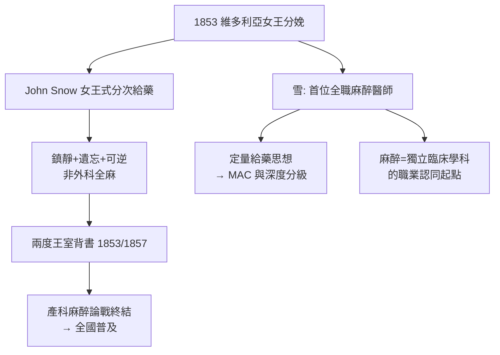

## 1853 - 維多利亞女王與雪的氯仿（一場分娩麻醉如何終結全國論戰）

## 案件摘要

**本案偵破了麻醉史上最關鍵的一場「名人背書」案：1853 年 4 月 7 日，約翰·雪（John Snow）為 33 歲的維多利亞女王在利奧波德王子出生時施予氯仿麻醉，以一己之身終結了席捲英國的「產科麻醉神學論戰」。**

1853 年 4 月 7 日，白金漢宮。倫敦最著名的麻醉專家**約翰·雪（John Snow）**受王室醫療團隊之邀，為維多利亞女王在分娩第七子利奧波德（Leopold）時施用氯仿。雪採用的是他自創的**分次定量吸入器**，以「間歇滴在疊層手帕上」的方式溫和給藥——他後來在《醫學時報》匿名發表此案，稱之為**「睡眠分次給藥」（chloroform à la reine，即女王式給藥）**：以「第一下吸入」為訊號、在宮縮間歇給藥、隨時可被叫停。女王本人事後寫道：「那效果是鎮靜與無比的舒適……疼痛消失但意識仍在。」1857 年她生下第九子 Beatrice 時再次使用。王室兩度背書，全國宗教與輿論的反對聲浪瞬間瓦解——產科麻醉自此成為英國貴婦與中產階級的時尚，隨後成為普遍權利。

## 前因 -- 為什麼會有這個案子

- **論戰白熱化**。自 1847 年辛普森把氯仿引入產科（見 `1847-辛普森氯仿與產科麻醉.md`），蘇格蘭教會與《刺胳針》主編 Wakley 陣營持續攻擊「分娩麻醉違反上帝的詛咒」與「氯仿殺人」兩條戰線。
- **雪的專業地位**。雪自 1847 年起專職麻醉——他是**史上第一位全職麻醉醫師**，為倫敦各醫院提供麻醉服務，並以定量實驗精神研究麻醉藥（著《論氯仿》《論乙醚的吸入》）。
- **雪的另一重身份**。他同時是 1854 年倫敦 Broad Street 霍亂疫情的地圖偵探——同一個人，在兩場「病因推理」中都留下了名字。
- **王室陣痛的實際需求**。女王先前七次分娩均未麻醉；她對分娩之痛的畏懼與她對萊恩醫生（John Snow）技術的信任，促成了這一決定——醫療決策由病人本人（哪怕是女王）作出，這本身就是一個新時代的訊號。

## 線索與推理 -- 數學式、程式、理論

**線索一：「女王式給藥」的技術偵查。** 雪的方法本質上是現代**間歇鎮靜／分娩鎮痛**的原始版：

```python
def queen_style_contraction(iteration):
    # 宮縮前的第一下吸入 = 病人訊號; 間歇給藥 = 可控深度
    return "宮縮來臨前吸入 → 深度僅至鎮靜/遺忘層 → 隨時可逆"

for contraction in range(1, 4):
    print(f"宮縮 {contraction}:", queen_style_contraction(contraction))
```

其目標**不是外科麻醉，而是「痛而不記、醒而不僵」**——深度控制在遺忘與鎮痛之間，母子安全優先。這是麻醉深度「分級調控」思想的先驅，日後發展為 BIS 監測時代的精準麻醉（見 `1996-BIS麻醉深度監測.md`）。

**線索二：雪的定量科學。** 雪以動物實驗量化氯仿的**血中濃度—作用曲線**，提出麻醉深度取決於血中藥物濃度的思想——這是百年後**肺泡最低有效濃度（MAC）**與血藥濃度監測的概念前身。他的分次定量吸入器限制了單次吸入量，本質上是在管理**時間加權濃度**：

$$ C_{\text{腦}}(t) \approx \int_0^t \dot{V}_{\text{吸入}} \cdot C_{\text{吸入}} \cdot e^{-k(t-\tau)}\, d\tau $$

給藥間歇讓濃度不至於爬入危險區——這一數學直覺，使他避開了氯仿誘導期猝死（見 `1847-辛普森氯仿與產科麻醉.md`）的最大陷阱。

**線索三：名人效應的社會偵查。** 王室分娩的公共性（官方公告、媒體追逐）使本案成為全國性廣告。反對陣營無法把「女王用氯仿」定罪為墮落——論戰在一夜之間從神學問題降維成時尚問題。這是醫學史上「關鍵意見領袖（KOL）效應」的教科書案例。

**線索四：麻醉職業化的里程碑。** 雪以「麻醉專家」身份受邀進入最高規格的醫療團隊，證明：給藥不是外科醫生的副業，而需要**專職的臨床學科**。麻醉科的職業身份認同，在此劃下第一道刻痕。



## 結案 -- 後果與影響

- **產科麻醉的普及路徑**。女王背書→上層階級採用→中產階級跟進→ 1900 年代「夕暮睡眠」（twilight sleep，嗎啡＋東莨菪鹼）運動→ 20 世紀中葉硬膜外鎮痛普及（見 `1898-比爾自體實驗脊椎麻醉.md`）——分娩止痛的每一步都伴隨「什麼才算好母親」的文化辯論。
- **雪的雙重遺產**。1854 年他以同一套偵探式推理（繪圖、統計、排除法）斷定霍亂經水傳播、拆除 Broad Street 泵把手——麻醉科與流行病學共享同一個精神祖先。
- **病人主權的先聲**。「疼痛消失但意識仍在」的女王證詞，把「治療體驗」納入醫療品質的評價——現代麻醉「以病人為中心的舒適化醫療」由此發端。
- **一句話結案**：改變論戰結局的不是新證據，而是一位位高權重的病人公開「按讚」——醫學進步有時需要實驗室，有時需要白金漢宮。

## 關鍵人物與文獻

- **John Snow（1813–1858）**——首位全職麻醉醫師、定量麻醉學之父、霍亂偵探；1858 年卒於中風（年僅 45 歲，死於書房）。
- **維多利亞女王（1819–1901）**——兩度使用氯仿分娩；其日記與致長女信件是本案一手證詞。
- **James Clark 爵士**——女王內科醫師，促成雪進入王室醫療團隊。
- **Snow, J. (1858). *On Chloroform and Other Anaesthetics***——麻醉定量研究的開山著作。
