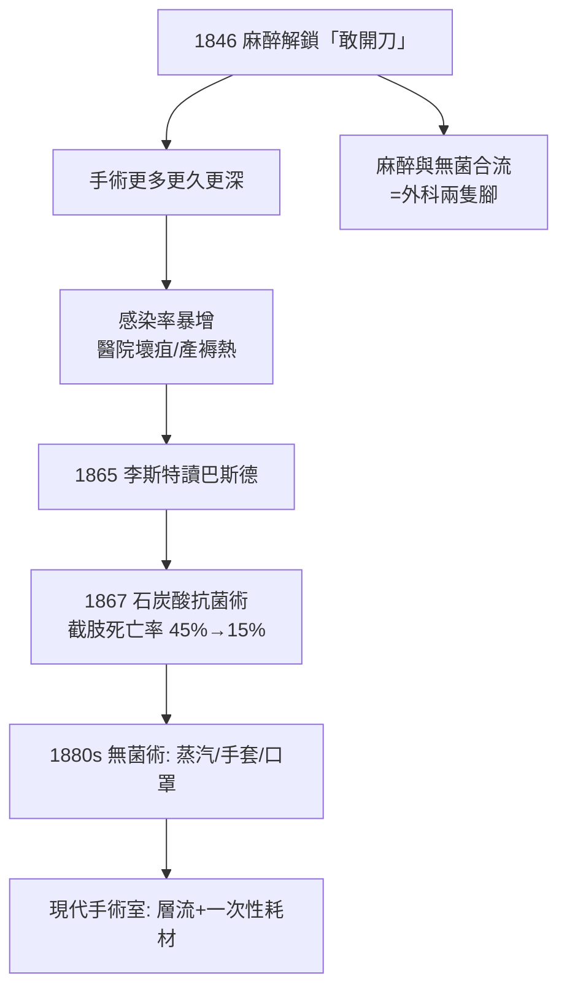

## 1867 - 李斯特無菌術與麻醉安全（當「不痛」遇上「不爛」）

## 案件摘要

**本案偵破了外科的第二樁命案：手術不再痛了，病人卻死於感染——1867 年約瑟夫·李斯特以石炭酸無菌術，與麻醉合流，才真正解鎖了現代外科。**

1846 年麻醉問世後（見 `1846-乙醚日莫頓公開示範.md`），外科醫生可以從容切開人體——但 **醫院壞疽（hospital gangrene）、產褥熱、敗血症**的死亡率驚人：1840 年代的倫敦與巴黎大醫院，截肢死亡率一度高達 40–50%。病人開始「寧可在客廳開刀也不要進醫院」。1865 年，格拉斯哥外科教授**約瑟夫·李斯特（Joseph Lister）**閱讀巴斯德的發酵研究後，認定傷口化膿的元兇是空氣中的微生物；1867 年他發表《外科實務中的抗菌原理》（*On the Antiseptic Principle in the Practice of Surgery*），以**石炭酸（苯酚）**噴灑傷口與手術現場——截肢死亡率從約 45% 降到約 15%。麻醉與無菌的合流，使「大手術」第一次成為值得做的手術。

## 前因 -- 為什麼會有這個案子

- **麻醉的悖論**。麻醉使手術時間變長、切口變深——但也使傷口暴露更久、感染機會更大。外科的下一個瓶頸瞬間變成感染。
- **「瘴氣論」統治下的錯誤偵查**。當時主流認為化膿源於空氣中的「瘴氣」（miasma）；李斯特卻注意到不同之處：單純骨折（不破皮）不化膿，複雜骨折（破皮）化膿——元兇必須從「空氣本身」改為「經由空氣進入傷口的東西」找起。
- **巴斯德的發酵線索**。1864 年巴斯德證明腐敗與發酵由微生物引起，並提出「加熱、過濾、化學藥物」三種滅菌法——李斯特從中選了第三條路。
- **Semmelweis 的前案**。1847 年匈牙利醫生 Semmelweis 已在維也納證明醫生洗手可使產褥熱死亡率從 18% 降至 1%——卻被醫界嘲笑排擠，1865 年死於精神病院。無菌戰役的第一位偵探死在同一年李斯特發表論文之前。

## 線索與推理 -- 數學式、程式、理論

**線索一：李斯特的推理鏈。**

| 步驟 | 觀察/推理 | 對應偵探動作 |
|---|---|---|
| 1 | 複雜骨折化膿、單純骨折不化膿 | 對照組的田野觀察 |
| 2 | 巴斯德：腐敗=微生物 | 引入外部科學證據 |
| 3 | 空氣中的灰塵攜帶微生物 | 兇手載體假說 |
| 4 | 石炭酸可殺菌（污水處理經驗） | 選擇武器 |
| 5 | 石炭酸噴灑+敷料+器械消毒 | 全面封鎖現場 |
| 6 | 截肢死亡率 45%→15% | 結案數據 |

**線索二：抗菌（antiseptic）→無菌（aseptic）的技術演化。** 李斯特的方案是「殺已入侵者」，其德國傳人（Bergmann、Schimmelbusch）與同事推進到「根本不讓它進來」：

$$ \text{抗菌 1867（殺菌於傷口）} \rightarrow \text{無菌 1880s（蒸汽滅菌+手套+隔離）} $$

1886 年 Halsted 推行橡膠手套（為其護士兼妻子而設計）、1890 年代口罩與手術隔離衣出現——手術室逐漸變成「半導體級的潔淨現場」。現代手術室潔淨度分級（層流手術室）正是這條線的終點站。

**線索三：麻醉與無菌的合流效應。** 兩項技術對外科的乘法貢獻：

```python
def surgery_viability(pain_control, infection_control):
    # 任一為零, 手術都不可行 — 乘法而非加法
    return pain_control * infection_control

pre_1846 = surgery_viability(0.05, 0.9)   # 痛死/休克死
post_1846 = surgery_viability(0.9, 0.1)   # 感染死
post_1867 = surgery_viability(0.9, 0.9)   # 現代外科誕生
print(pre_1846, post_1846, post_1867)     # 0.045, 0.09, 0.81 → 10 倍躍升
```

**線索四：麻醉安全同步升級。** 無菌革命的技術（洗手、清潔、器械滅菌）同樣改造了麻醉：氣管導管、喉鏡、面罩的消毒；之後的一次性耗材與鈉石灰罐更換流程——感染控制成為麻醉品質的隱性支柱（尤其氣道操作是免疫缺陷病人的高風險環節）。



## 結案 -- 後果與影響

- **外科的真正誕生**。麻醉解決「能不能開」，無菌解決「開了值不值」——腹部、胸腔、顱腔手術自此從禁忌變成常規；體腔外科學派（Billroth、Halsted）接連登場。
- **Semmelweis 的遲來正名**。李斯特的成功使醫界回頭承認洗手先驅——1906 年布達佩斯為他立像；「醫生洗手」成為全球公衛最便宜也最有效的救命措施。
- **麻醉科的「隱形崗位」成形**。無菌與監測的需求，使手術台旁必須有一位「不拿刀、專管病人的生理與安全」的醫生——麻醉科作為獨立學科的組織理由日益充分（見 `1920-格德爾麻醉分期.md`）。
- **一句話結案**：1846 年手術變得可以忍受，1867 年手術變得可以存活——外科的兩隻腳，缺一隻都只能原地跳。

## 關鍵人物與文獻

- **Joseph Lister（1827–1912）**——格拉斯哥→倫敦國王學院外科教授、李斯特菌屬以他命名；受封李斯特男爵。
- **Louis Pasteur（1822–1895）**——發酵與微生物學研究，本案的理論供應商。
- **Ignaz Semmelweis（1818–1865）**——洗手先驅，無菌戰役的第一位殉難偵探。
- **William Halsted（1852–1922）**——橡膠手套推行者、外科住院醫師制度之父；同時是第一個以可卡因做**傳導阻滯**示範的醫生（見 `1884-柯勒可卡因局部麻醉.md`）。
- 現代註腳——手術部位感染（SSI）至今仍是全球醫院感染大宗；WHO 手術安全核查表（2008）把無菌與麻醉監測並列為手術安全的雙主軸。
