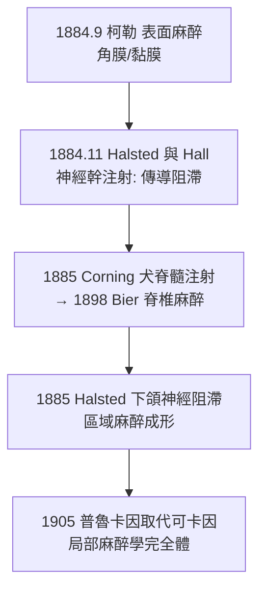

## 1884 - 柯勒可卡因局部麻醉（十分鐘的發現，三十六小時的論文競賽）

## 案件摘要

**本案偵破了麻醉史上最快的一次破案：1884 年 9 月 15 日，維也納眼科住院醫生卡爾·柯勒（Carl Koller）在十分鐘的自體實驗中證明可卡因能麻醉角膜——局部麻醉學在一個下午誕生。**

1884 年夏，維也納總醫院。年輕醫生們（弗洛伊德也在場）圍繞著一個問題：可卡因能否作為「全身強壯劑」之外的醫療用途？眼科醫生**卡爾·柯勒**注意到同事 Freud 在論文中提到可卡因使舌頭麻木——「麻木」二字觸發了他的推理：如果把可卡因滴到**角膜**上，角膜沒有血管、不吸收進入全身，若麻木持續，那就是純粹的**局部作用**。9 月 15 日，柯勒把可卡因溶液滴入自己眼中，以別針刺角膜——**無感**。他隨即在眼科學會上演示犬眼實驗，並以 36 小時的極速完成論文，趕在 9 月 17 日海德堡眼科會議截稿前投出——維也納因此錯失在國際會議上宣布的機會，柯勒終生遺憾。但局部麻醉的科學地位自此確立。

## 前因 -- 為什麼會有這個案子

- **可卡因的南美線索**。1859 年德國化學家 Niemann（在 Wöhler 實驗室）從古柯葉提純可卡因；南美原住民咀嚼古柯以抗疲勞與飢餓的紀錄早已傳入歐洲。
- **維也納的可卡因熱**。1880 年代初，維也納醫學界把可卡因視為治抑鬱、嗎啡成癮的靈藥——弗洛伊德 1884 年發表《論古柯》，推薦其作為精神與體力補劑（他後來因此備受批評）。
- **眼科的特殊困境**。全身麻醉（乙醚/氯仿）用於眼科小手術風險大、嘔吐會撕裂眼球縫線——眼科是**最需要局部麻醉**的科別。
- **弗洛伊德想治的是神經**，柯勒看到的卻是「麻木」這個副作用——同一份材料，不同的問題意識，決定了誰破案。

## 線索與推理 -- 數學式、程式、理論

**線索一：實驗設計的乾淨度。** 柯勒 9 月 15 日的十分鐘實驗，是麻醉史上設計最簡潔的實驗之一：

| 步驟 | 操作 | 排除的干擾 |
|---|---|---|
| 1 | 可卡因溶液滴入自己右眼 | — |
| 2 | 數分鐘後以別針刺角膜 | 觸覺仍在（可感到壓力）但**痛覺消失** |
| 3 | 對照左眼無藥 | 排除心理作用 |
| 4 | 犬眼實驗同樣無痛 | 排除個體特異性 |
| 5 | 角膜無血管 | 推斷為**局部作用**而非全身吸收 |

**線索二：可卡因的分子機轉——鈉通道阻滯。** 柯勒不知道（1884 年離子通道概念尚未誕生）他觸碰的是神經電生理的核心：可卡因阻斷**電壓門控鈉通道**（Nav），使動作電位無法上傳：

$$ \text{局部麻醉藥} \rightleftharpoons \text{帶電態/不帶電態} \Rightarrow \text{不帶電態穿膜} \Rightarrow \text{帶電態堵住通道內口} $$

其「用頻率依賴性阻滯」（opened-state block）的特性，正好優先封鎖高頻放電的痛覺纖維——細無髓纖維（C 纖維、Aδ）最先被阻斷，粗運動纖維最後——這解釋了「麻醉藥為何可以先止痛、後麻動作」的分級現象（與 `1965-痛覺閘門學說.md` 的纖維生理學相扣）。

**線索三：從表面麻醉到傳導阻滯的三十個月。** 可卡因的應用在 1884–1885 年以「月」為單位推進：

紐約的**William Halsted** 則走向更危險的一步：把可卡因直接注射到神經幹（傳導阻滯）——並在此過程中與同事 Hall 互相實驗而成癮，Halsted 晚年長期住進醫院戒斷（見 `1898-比爾自體實驗脊椎麻醉.md` 的自體實驗倫理線）。

**線索四：可卡因的暗面——成癮與心血管毒性。** 可卡因同時是血管收縮劑、欣快劑與成癮物質；醫療用可卡因的社會災難（毒癮擴散）直接催生 1905 年普魯卡因（novocaine，見 `1905-奴佛卡因的合成.md`）與 1900 年代初的麻醉品管制法。

## 結案 -- 後果與影響

- **局部麻醉成為獨立學科**。表面麻醉→浸潤麻醉→傳導阻滯→椎管內麻醉，四代技術在 1884–1898 十四年內全部亮相——這是麻醉學史上技術迭代最快的一段時期。
- **眼科手術的現代化**。白內障、青光眼手術自此可以在局麻下門診完成——「不用睡著的手術」成為麻醉科的另一支柱業務（今日日間手術與區域麻醉復興的源頭）。
- **柯勒的正名**。維也納 1914 年在實驗室為他立碑；「Koller」在麻醉史教科書中與「乙醚日」並列——破案只用了十分鐘，正名卻用了三十年。
- **一句話結案**：破案的鑰匙是「麻木」這個被所有人忽略的副作用——別人看見的是藥效，柯勒看見的是機轉的洩密信號。

## 關鍵人物與文獻

- **Carl Koller（1857–1944）**——維也納眼科醫生，後移民美國；被稱為「局部麻醉之父」。
- **Sigmund Freud（1856–1939）**——可卡因研究與《論古柯》作者，其舌頭麻木觀察是本案的關鍵線索來源。
- **William Halsted（1852–1922）**——傳導阻滯先驅，可卡因自體實驗成癮的悲劇主角。
- **Koller, C. (1884). *Vorläufige Mittheilung über locale Anästhesierung am Auge***——局部麻醉的第一篇論文。
