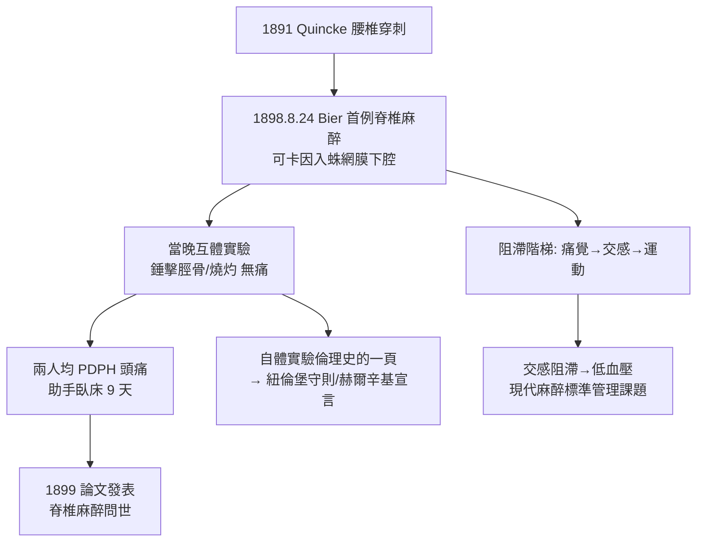

## 1898 - 比爾自體實驗脊椎麻醉（把自己打進蛛網膜下腔的男人）

## 案件摘要

**本案偵破了區域麻醉最勇敢也最痛苦的一案：1898 年 8 月，德國外科醫生奧古斯特·比爾（August Bier）與助手希爾德布蘭特（Augustus Hildebrandt）互為對方施行脊椎麻醉——並以自己的身體記錄了完整的副作用目錄。**

1898 年 8 月 24 日，基爾大學外科診所。比爾先在六位病人身上試驗以腰椎穿刺注入可卡因入**蛛網膜下腔**，完成下肢手術（截肢、矯形）——麻醉成功，但部分病人出現劇烈頭痛與嘔吐。為弄清藥物在人體的完整行為，當晚比爾與助手希爾德布蘭特**互相在對方身上做腰椎穿刺**：希爾德布蘭特先給比爾注射，但因注射器接合不良可卡因漏失，比爾未得麻醉；隨後比爾親自為希爾德布蘭特穿刺成功——希爾德布蘭特雙腿麻木、以錘敲打、以火柴燒灼腿部、掐捏皮膚、甚至**用錘子猛擊脛骨**，皆無痛感。實驗後兩人均遭嚴重脊椎麻醉後頭痛（PDPH）：希爾德布蘭特臥床九天，比爾頭痛嘔吐、持續數日。次年比爾發表論文，脊椎麻醉（spinal anesthesia）正式問世。

## 前因 -- 為什麼會有這個案子

- **腰椎穿刺技術已備**。1891 年 Quincke 描述腰椎穿刺方法；脊髓與神經根的解剖學已清晰——「從背後給脊髓區域送藥」在技術上可行。
- **可卡因局部麻醉的成熟**。1884 年柯勒（見 `1884-柯勒可卡因局部麻醉.md`）證明局部麻醉可行；比爾的同僚 Corning 早在 1885 年就曾以犬與人嘗試「椎管內注射」（但其定位偏硬膜外且當時概念混亂，比爾才是第一個明確將藥物注入**腦脊髓液**者）。
- **外科的需求**。下肢手術若能局部完成，可避免全身麻醉的嘔吐、吸入性風險——尤其適合腹部以下手術與高危病人。

## 線索與推理 -- 數學式、程式、理論

**線索一：解剖學的偵查現場。** 脊椎麻醉的藥物送達路徑：

$$ \text{L}_{3/4}\text{–L}_{4/5}\text{ 間隙穿刺} \Rightarrow \text{穿過硬脊膜+蛛網膜} \Rightarrow \text{藥物進入腦脊髓液} \Rightarrow \text{浸泡脊髓腰段神經根} $$

比重看藥液的**重力行為**：高比重液（加葡萄糖）下沉，用於會陰部；低比重液上浮——手術部位的選擇可由藥液「體位學」設計，這是麻醉科獨有的物理化學思維。

**線索二：PDPH 頭痛的機轉偵查。** 比爾自述的頭痛——坐起劇痛、平躺緩解、伴噁心耳鳴——正是**低顱壓性頭痛**的教科書表現：穿刺孔讓腦脊髓液持續漏出，腦組織失去「水床」支托而向下牽拉痛覺敏感結構：

```python
def pdph_diagnosis(headache):
    signs = {
        "體位性": True,       # 坐立劇痛, 平躺緩解
        "CSF漏":  True,       # 硬膜穿孔
        "MRI表現": "硬膜下積液/腦下垂"
    }
    return all([headache["posture_dependent"], signs["CSF漏"]])

print(pdpH := {"posture_dependent": True, "CSF_leak": True}, "→ 診斷: 脊椎麻醉後頭痛")
```

比爾的副作用自錄，成了日後 PDPH 防治（細針筆尖式穿刺針、硬膜外血補片）的原始臨床資料——偵探以自己的身體充當案發現場。

**線索三：神經根浸泡的生理學。** 蛛網膜下腔給藥直接作用於**脊神經根與脊髓背角**——因為神經根無髓鞘保護層（root sleeve 薄），對局麻藥極敏感：

$$ \text{C 纖維/A}\delta \text{（細，無髓）} \xrightarrow{\text{最先被阻滯}} \text{交感纖維} \rightarrow \text{A}\alpha\text{（粗，有髓，最後被阻滯）} $$

阻滯順序解釋了脊椎麻醉的階梯效應：先麻醉痛溫覺→再交感（血壓下降！）→最後運動。**交感阻滯導致的低血壓**至今仍是脊椎麻醉最常見的生理併發症，管理手段（預負荷、血管加壓藥、左傾子宮體位）都是本案效應的後續工程。

**線索四：自體實驗倫理的重量。** 本案與 Halsted 可卡因成癮（見 `1884-柯勒可卡因局部麻醉.md`）、華岡青洲家人試藥（見 `0200-華佗麻沸散之謎.md`）、比爾助手九天臥床一起，構成麻醉史的「以身試藥」悲壯系列——20 世紀中期起被紐倫堡守則與赫爾辛基宣言制度化約束（知情同意、風險最小化）。



## 結案 -- 後果與影響

- **區域麻醉王國誕生**。脊椎麻醉→硬膜外麻醉（1921 Sicard/Fidel）、腰硬聯合→神經叢阻滯——區域麻醉成為麻醉科的半壁江山；產科「無痛分娩」的硬膜外技術（20 世紀中葉普及）正是本案血脈。
- **可卡因終被替換**。脊椎麻醉的可卡因劑量貼近中毒量，1900 年代起被普魯卡因（見 `1905-奴佛卡因的合成.md`）取代——本案催生了更安全的局麻藥需求。
- **比爾的另一發明**。他同時發明了**靜脈區域麻醉（Bier block，1908）**——止血帶下靜脈注射局麻藥，至今仍是上肢短手術的標準技術。
- **一句話結案**：比爾用錘子敲出了兩個結論——藥物能封鎖整條神經根，以及偵探必須為自己的實驗付身體賬單；前者開創了區域麻醉，後者催生了現代研究倫理。

## 關鍵人物與文獻

- **August Bier（1861–1949）**——脊椎麻醉與靜脈區域麻醉發明人；後成為著名外科教授，晚年對脊椎麻醉態度轉趨保守。
- **Augustus Hildebrandt（1868–1922）**——助手與第一位受試者，承受了本案最大的身體代價。
- **James Leonard Corning（1855–1923）**——1885 年椎管內注射的先驅，其工作與比爾形成優先權爭議。
- **Heinrich Quincke（1842–1922）**——腰椎穿刺技術的描述者。
- 現代註腳——脊椎麻醉後頭痛發生率已從比爾時代的近 100%（粗針）降至 1% 以下（25G 筆尖針）——本案以身體換來的副作用數據，是最早期的麻醉品質改進資料庫。
