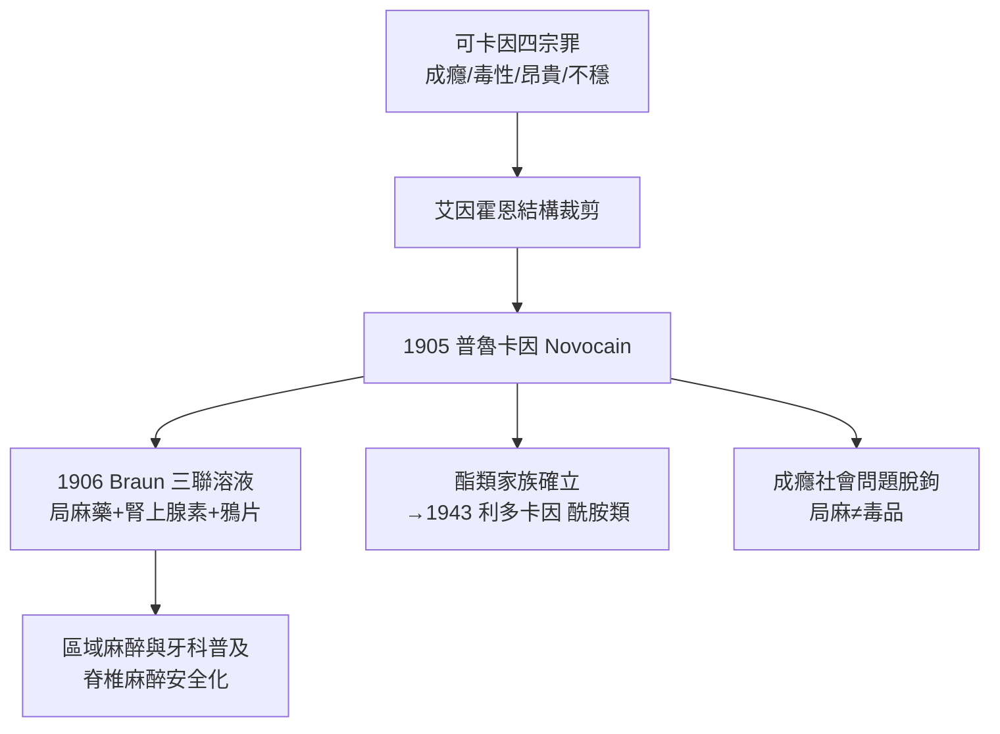

## 1905 - 奴佛卡因的合成（把「神藥」變成「日用品」的化學偵查）

## 案件摘要

**本案偵破了局部麻醉的「去可卡因化」工程：1905 年，德國化學家阿爾弗雷德·艾因霍恩（Alfred Einhorn）合成普魯卡因（procaine，商品名 Novocain／奴佛卡因）——第一個人工合成的安全局部麻醉藥，終結了可卡因時代。**

1905 年，慕尼黑大學化學家**艾因霍恩**發表其歷經多年篩選的第「47 號」化合物——**普魯卡因**：以苯甲酸酯結構為核心的合成局麻藥。它不產生欣快與成癮、化學性質穩定（可蒸氣滅菌）、毒性僅為可卡因的約 1/4–1/6。外科醫生 Heinrich Braun 立即將其推上臨床，並提出改變局部麻醉史的**「三聯溶液」概念**：局麻藥＋腎上腺素（收縮血管、延長作用）＋小劑量鴉片類——「化學止血鉗」。1906 年起 Novocain 行銷全球，牙科與區域麻醉自此有了安全且可大量生產的彈藥。

## 前因 -- 為什麼會有這個案子

- **可卡因的四宗罪**。成癮性（社會災難，1900 年代初各國立法管制）、心血管毒性、價格昂貴（天然提純、供應受南美收成制約）、化學不穩定（煮沸即失效、無法常規滅菌）。
- **比爾脊椎麻醉的教訓**（見 `1898-比爾自體實驗脊椎麻醉.md`）——椎管內給藥把局麻藥的毒性問題逼到極限，「更安全的局麻藥」成為麻醉科最急迫的需求清單第一項。
- **合成化學的黃金期**。染料工業（德國 BASF、拜耳、赫斯特）帶動了苯胺化學與結構修飾技術——「以分子結構為偵查對象」的新式偵探工作登場。

## 線索與推理 -- 數學式、程式、理論

**線索一：結構—活性關係的首次演繹。** 艾因霍恩的偵查對象是可卡因分子的「有效骨架」：他推理可卡因的麻醉力未必需要苯甲酰甲基托烷的複雜母核，而只需要**芳香環—酯鍵—氨基醇**這一最小結構單元：

$$ \text{對氨基苯甲酸酯（PABA 酯）+ 二乙氨基乙醇} \Rightarrow \text{普魯卡因} $$

這是藥物化學史上「骨架裁剪」（molecular pruning）的經典案例——把天然產物的複雜性剝掉，只留藥理核心。日後每一個新局麻藥（丁卡因、利多卡因、布比卡因）都是這條推理線的延長。

**線索二：局麻藥的分類學建立。** 普魯卡因確立了**酯類**家族，與後來的酰胺類（利多卡因，1943）形成局部麻醉藥的兩大血統：

| 性狀 | 酯類（普魯卡因） | 酰胺類（利多卡因） |
|---|---|---|
| 代謝 | 血漿假性膽鹼酯酶水解 | 肝臟 CYP 氧化 |
| 過敏 | PABA 類過敏較常見 | 極罕見 |
| 穩定性 | 遇熱易失效 | 可高壓滅菌 |
| 現狀 | 已多被取代 | 臨床主力 |

**線索三： Braun 的「化學止血鉗」與藥代動力學。** 腎上腺素的加入本質上是在做**血流動力學封鎖**：血管收縮→局麻藥從注射部位吸收減慢→作用延長、血藥峰濃度下降：

```python
def peak_concentration(vessel_constriction):
    # 吸收速率常數 k_a 隨血管收縮下降 → Cmax 下降、作用時間延長
    k_a = 0.10 * vessel_constriction   # 1.0 = 無收縮
    return f"k_a={k_a:.2f} → 峰濃度↓, 中毒風險↓, 作用時長↑"

print(peak := peak_concentration(0.3))
```

「加腎上腺素延長作用」至今仍是局麻配方的標準操作——1905 年的臨床直覺，百年後成為藥代動力學教材公式。

**線索四：量—效—毒三角的安全學。** 普魯卡因的治療指數優勢：

$$ \text{治療指數}_{\text{普魯卡因}} \gg \text{治療指數}_{\text{可卡因}} \Rightarrow \text{脊椎麻醉/硬膜外可安全給到有效劑量} $$

正是這個餘量，使脊椎麻醉（1898 年還得小心翼翼貼近中毒量）在 1900–1920 年代成為腹部以下手術的常規麻醉。



## 結案 -- 後果與影響

- **局部麻醉的「大眾化」**。Novocain 成為牙科診所的日常——「打一針就好」重塑了全民對醫療疼痛的預期；「Novocain」甚至成為英語中「麻醉針」的代名詞。
- **局麻藥設計的範式**。結構裁剪＋代謝途徑設計（酯/酰胺）＋血管收縮劑協同——此範式運行至今；布比卡因（1963）、羅哌卡因（1996）的長效化、低毒化都是本案的續集。
- **毒品與藥物的分道**。可卡因退出常規局麻（僅餘耳鼻喉表面麻醉的收縮血管用途），局麻藥從此與成癮問題脫鉤——醫療與毒品的邊界第一次由合成化學劃清。
- **一句話結案**：艾因霍恩證明破案不必靠天然資源，靠的是把兇手的「作案手法」提煉成藍圖——現代藥物化學的基本作案方式自此定型。

## 關鍵人物與文獻

- **Alfred Einhorn（1856–1917）**——慕尼黑化學家，普魯卡因合成者。
- **Heinrich Braun（1862–1934）**——外科醫生，三聯溶液與《局部麻醉》教科書作者，區域麻醉臨床化的總工程師。
- **Niels Ryberg Finsen/染料工業**——背景角色：德國化學工業為本案提供技術平台。
- 現代註腳——普魯卡因因效價低、穿透力弱，今日臨床已少用，但其名字（Novocain）成為大眾文化的麻醉代名詞；而「局麻藥＋腎上腺素」與「酯/酰胺分類」仍是每一本麻醉教科書的第一章內容。
