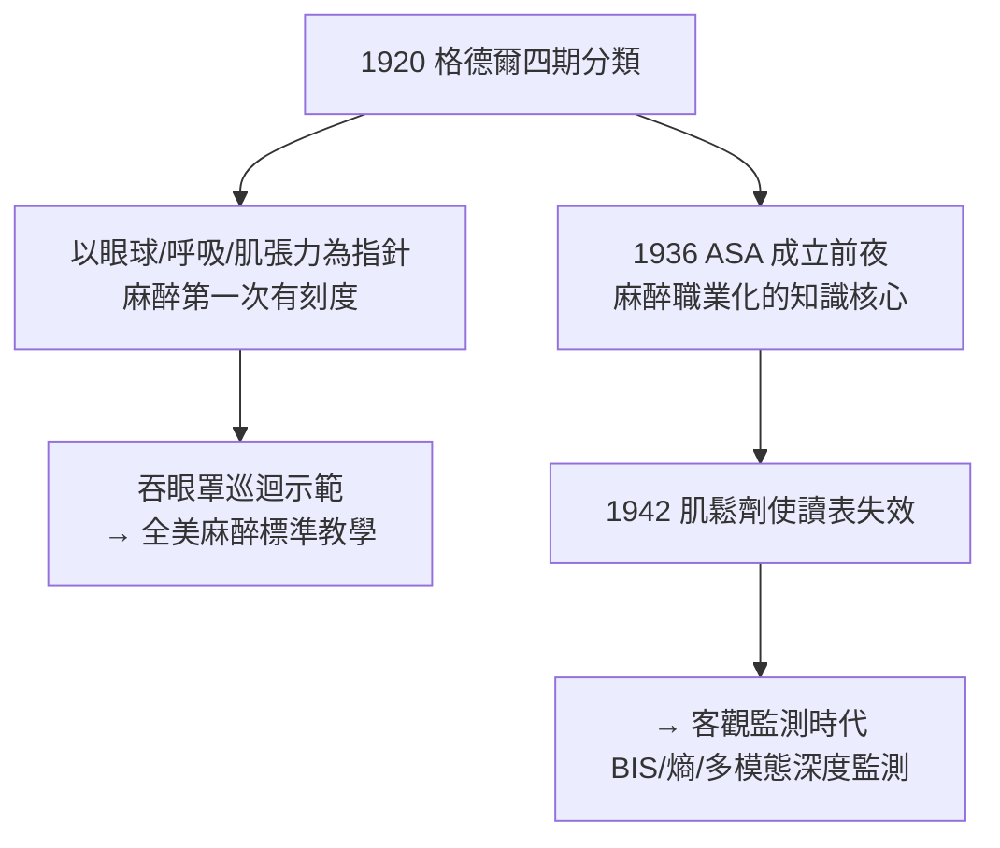

## 1920 - 格德爾麻醉分期（把「睡著了」變成一幅儀表盤）

## 案件摘要

**本案偵破了麻醉臨床的「深度之謎」：1920 年代，美國麻醉醫生亞瑟·格德爾（Arthur Guedel）以可重複的臨床觀察，把全身麻醉過程劃分為四期，讓「病人睡到哪一層」第一次可以被讀表判斷——麻醉從手藝變成有刻度的科學。**

1920 年，印第安納波利斯的麻醉醫生**亞瑟·格德爾（Arthur Guedel）**發表《乙醚麻醉的分期》論文，並以著名的**「吞下眼罩」示範**（把護目鏡沉入水面下的眼鏡蛇表演）走遍美國講授其分期系統。他將乙醚麻醉劃分為：

- **第一期：鎮痛期**——從給藥到意識消失，痛覺遲鈍；
- **第二期：譫妄（興奮）期**——意識消失但反射亢進，掙扎、嘔吐、心律不整的危險區；
- **第三期：手術麻醉期**——又分四級（眼球活動→眼球固定→呼吸模式變化→肋間肌麻痺），手術在此進行；
- **第四期：延髓麻痺期**——呼吸循環衰竭，**過量**，死亡的入口。

格德爾的分期以**眼球、瞳孔、呼吸模式、肌肉張力**為觀測指針，是麻醉史上第一套在床邊可操作的「深度儀表」。

## 前因 -- 為什麼會有這個案子

- **麻醉已用 74 年，卻無標準語言**。1846–1920 年間，麻醉給藥全憑經驗：「看他呼吸」「睡夠了」——不同醫生之間無法精確交流，過量與過淺全靠手感。
- **氯仿猝死陰影**（見 `1847-辛普森氯仿與產科麻醉.md`）——給藥深度控制的失誤會直接致死，臨床急需「深度標尺」。
- **麻醉專業化的時代**。第一次世界大戰（1914–1918）大量戰傷手術催生專職麻醉人員；1920 年代美國開始出現麻醉醫師的職業組織（1936 年 ASA 前身）——專業需要知識體系。
- **觀察對象的獨特性**：格德爾選擇**未用肌鬆劑、未用阿片**的純乙醚麻醉——各項生理指標未被藥物干擾，分期才能乾淨可讀。

## 線索與推理 -- 數學式、程式、理論

**線索一：觀測指針的選擇邏輯。** 格德爾分期本質上是**以中樞抑制的「由上而下」順序**為刻度——麻醉藥對中樞的抑制有層次性（演化上越新的結構越先被抑制）：

| 期 | 抑制的結構/反射 | 床邊指針 |
|---|---|---|
| 1 | 皮質痛覺處理 | 鎮痛、意識仍在 |
| 2 | 皮質（意識消失） | 眼瞼反射消失、興奮掙扎 |
| 3-1 | 皮質下 | 規律呼吸、眼球活動 |
| 3-2 | 中腦 | 眼球固定、瞳孔縮小 |
| 3-3 | 橋腦 | 呼吸型態改變 |
| 3-4 | 肋間肌 | 腹式呼吸、肋間麻痺 |
| 4 | 延髓 | 瞳孔散大、呼吸循環衰竭 |

**線索二：呼吸模式的法醫學價值。** 第三期的分級以**呼吸**為主指針——因為呼吸肌由不同平面支配（肋間肌 T1–T11，膈肌 C3–5），抑制由高到低推進時，呼吸型態從「胸腹同步」→「胸式消失」→「腹式擺動」→「呼吸停止」，是一台天然的麻醉深度梯度儀：

$$ \text{深度} \propto f(\text{眼球},\ \text{呼吸型態},\ \text{肌張力},\ \text{瞳孔}) $$

**線索三：分期為何在現代「失準」？** 推理的下一層：格德爾分期以單一乙醚為前提；現代複合麻醉（阿片＋肌鬆劑＋丙泊酚，見 `1942-箭毒與肌肉鬆弛劑.md`、`1986-異丙酚與日間麻醉.md`）把「意識、鎮痛、肌鬆」三個維度拆開給藥——**眼瞼與呼吸指針被肌鬆劑廢掉、痛覺被阿片覆蓋**，分期讀表法失效。於是深度判斷轉向客觀生理與腦電監測：

```python
def depth_monitoring(era):
    return {
        1920: "格德爾分期: 眼球/呼吸/肌張力 臨床讀表",
        1942: "肌鬆劑時代: 讀表失效 → 血壓/心率/汗液/流淚",
        1996: "BIS 腦電監測: 0-100 數字化深度",
        2000s+: "熵/Narcotrend、fMRI、機器學習多模態"
    }[era]

for year in (1920, 1942, 1996):
    print(year, depth_monitoring(year))
```

**線索四：記憶與「知曉」的問題浮出。** 分期的第二期與淺第三期交界處，是**術中知曉（awareness）**的溫床——病人未睡足但被肌鬆劑固定。這個 1920 年代無法量化的恐怖狀態，成為百年後 BIS 監測與麻醉深度科學的核心動機（見 `1996-BIS麻醉深度監測.md`）。



## 結案 -- 後果與影響

- **麻醉教學的語言標準化**。「第三期二級」成為全球麻醉科的通用語——標準化是專業化的前提，麻醉科的學科身份（考試、執照、住院醫師訓練）由此奠基。
- **「過淺比過深更常見」的反轉**。分期理論使臨床第一次能系統性區分「睡不足」與「睡過頭」，為之後的安全統計（麻醉死亡率從 1900 年代的 1/1000 降至今天的 1/20 萬）鋪路。
- **臨床觀察 vs 儀器監測的張力**。格德爾讀表法被儀器取代，但其精神——**深度必須被刻度化、可交流**——延續到 BIS（見 `1996-BIS麻醉深度監測.md`）與現代多模態監測。
- **一句話結案**：格德爾的偉大不在發現了什麼，而在把「手感」翻譯成「讀表」——任何一門技藝科學化的第一步，都是發明自己的刻度尺。

## 關鍵人物與文獻

- **Arthur Guedel（1883–1956）**——印第安納/加州麻醉先驅，分期理論與「吞眼罩」巡迴教學的傳奇人物；其子參與建立美國水下醫學。
- **Guedel, A. E. (1920). Third stage ether anesthesia: a subclassification regarding the significance of the position and migration of the eyeball**——分期理論的原始論文。
- **Ralph Waters（1883–1979）**——同期美國麻醉專業化領袖，1936 年協助創立 ASA；1927 年設立美國第一個大學麻醉講座。
