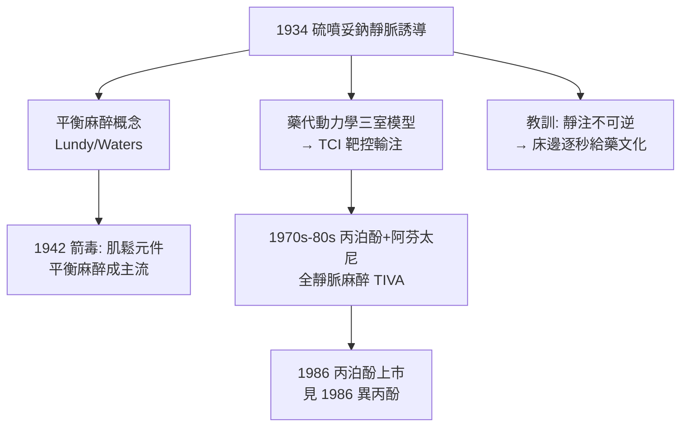

## 1934 - 硫噴妥鈉與靜脈麻醉（「你會開始數數，然後什麼都不記得」）

## 案件摘要

**本案偵破了麻醉的第三條給藥通道：1934 年，梅約診所的 John Lundy 與拉爾夫·沃特斯團隊將超短效巴比妥「硫噴妥鈉」帶入手術室——「數到三就睡著」的靜脈誘導自此成為全球麻醉的標準開場。**

1934 年，梅約診所的**約翰·倫迪（John Lundy）**在臨床試用 Abbott 公司新合成的超短效巴比妥**硫噴妥鈉（thiopental，商品名 Pentothal）**；同年在威斯康辛的**拉爾夫·沃特斯（Ralph Waters）**團隊亦系統評估其用途。此藥以鈉鹽粉劑封裝、靜脈注射後**一次臂腦循環時間（約 10–20 秒）即生效**、甦醒快——病人「開始數數就失去意識」。靜脈麻醉從此與吸入麻醉並列為兩大支柱，而「靜脈誘導＋吸入維持」的組合成為 20 世紀麻醉的標準配方。

## 前因 -- 為什麼會有這個案子

- **乙醚誘導的痛苦**。吸入乙醚誘導需 10–15 分鐘嗆咳掙扎（見 `1540-乙醚的誕生與甜油之謎.md`），病人在意識消失前經歷最恐怖的一段——「先苦後麻」是麻醉的公認缺陷。
- **巴比妥家族的化學積累**。1903 年 barbital 上市後，德國化學工業持續修飾巴比妥酸母核；1930 年代中期出現多款短效與超短效品種——硫噴妥鈉以「硫」取代氧原子，脂溶性大增、起效極快。
- **Lundy 的「平衡麻醉」概念**。他主張以多種藥物分工（鎮靜＋鎮痛＋肌鬆）取代單一深麻醉——這一哲學在 1942 年箭毒問世後成為主流（見 `1942-箭毒與肌肉鬆弛劑.md`）。

## 線索與推理 -- 數學式、程式、理論

**線索一：脂溶性與「一次臂腦循環」的偵查。** 硫噴妥鈉誘導快的原因是一場**藥代動力學的接力賽**：

$$ \text{靜注} \xrightarrow{10\text{–}20\,\text{s}} \text{高脂溶性→穿血腦屏障入腦} \Rightarrow \text{GABA}_A\text{ 受體變構增強} \Rightarrow \text{意識消失} $$

隨後藥物隨血流重新分布到肌肉與脂肪（**再分布**）——血藥濃度下降、藥效消退。甦醒靠的不是代謝，而是**再分布**：

```python
def thiopental_phases(t):
    # 簡化示意: 腦(快)→肌肉(中)→脂肪(慢) 的三室再分布
    compartments = [("腦", 0.5, 20), ("肌肉", 20, 180), ("脂肪", 180, 1440)]
    for name, t_start, t_end in compartments:
        if t_start <= t <= t_end:
            return f"t={t} min: 藥物主導部位={name}"
    return "已基本清除"

for t in (1, 60, 600):
    print(thiopental_phases(t))
```

**線索二：快速甦醒的代價——「二次睡眠」。** 再分布是把雙面刃：若劑量過大，脂肪緩慢釋放藥物導致**甦醒後再度嗜睡**；且硫噴妥鈉在脂肪中幾乎不代謝，連續大量注射會蓄積。這解釋了它「適合誘導、不適合維持」的定位——單次靜脈注射的「超短效」是**分布學假象**，不是真正的短效。

**線索三：歷史的黑色一頁——珍珠港謠言與二戰**。1941 年珍珠港事件後流傳「燒傷傷兵被硫噴妥鈉大量靜注致死」的說法（劑量過大於燒傷休克血容量不足的病人）。史學考證顯示誇大成分居多，但它成為麻醉教學的經典案例：**靜脈給藥「見效即無法撤回」**——藥物一旦推入靜脈，與吸入麻醉「隨時可稀釋倒帶」的本質差異，正是麻醉醫生必須在床邊逐秒掌控給藥的原因。

**線索四：靜脈麻醉的科學化接力。**



## 結案 -- 後果與影響

- **麻醉流程的標準化**。靜脈誘導→氣管插管→吸入維持的「三段式」流程成為 20 世紀手術室的全球標配；硫噴妥鈉使用逾七十年，直到被丙泊酚（見 `1986-異丙酚與日間麻醉.md`）取代。
- **藥代動力學成為麻醉科的核心數學**。三室模型、再分布、清除率——從硫噴妥鈉開始，麻醉醫生必須是「給藥的數學家」，這為靶控輸注（TCI）與現代藥代軟體鋪路。
- **靜脈與吸入的分工哲學**。誘導靠靜脈（快、無味）、維持靠吸入（可滴定、可逆）——「各用所長」的組合思維是平衡麻醉的第一課。
- **一句話結案**：硫噴妥鈉的意義不在「更快」，而在證明麻醉可以被拆成**誘導與維持兩個獨立控制的階段**——把一個連續過程切塊，是所有工程學的起點。

## 關鍵人物與文獻

- **John Lundy（1894–1973）**——梅約診所麻醉主任，硫噴妥鈉臨床化與「平衡麻醉」概念的提出者。
- **Ralph Waters（1883–1979）**——威斯康辛大學首位麻醉講座教授，美國麻醉住院醫師訓練制度之父，本案的另一驗證陣地。
- **Ernest Volwiler 與 Donalee Tabern**——Abbott 藥廠化學家，1934 年合成硫噴妥鈉。
- 現代註腳——硫噴妥鈉 2010 年代因供應鏈與成本問題在多國退市；死刑注射用途引發的藥廠抵制，是麻醉藥史上罕見的「臨床外的道德戰場」。
